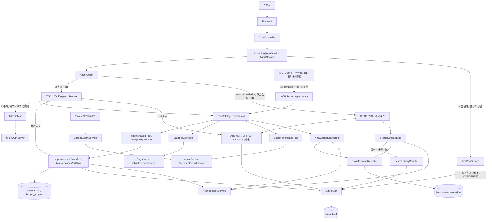
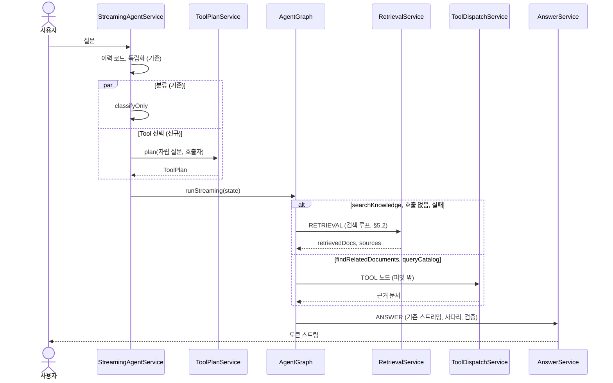
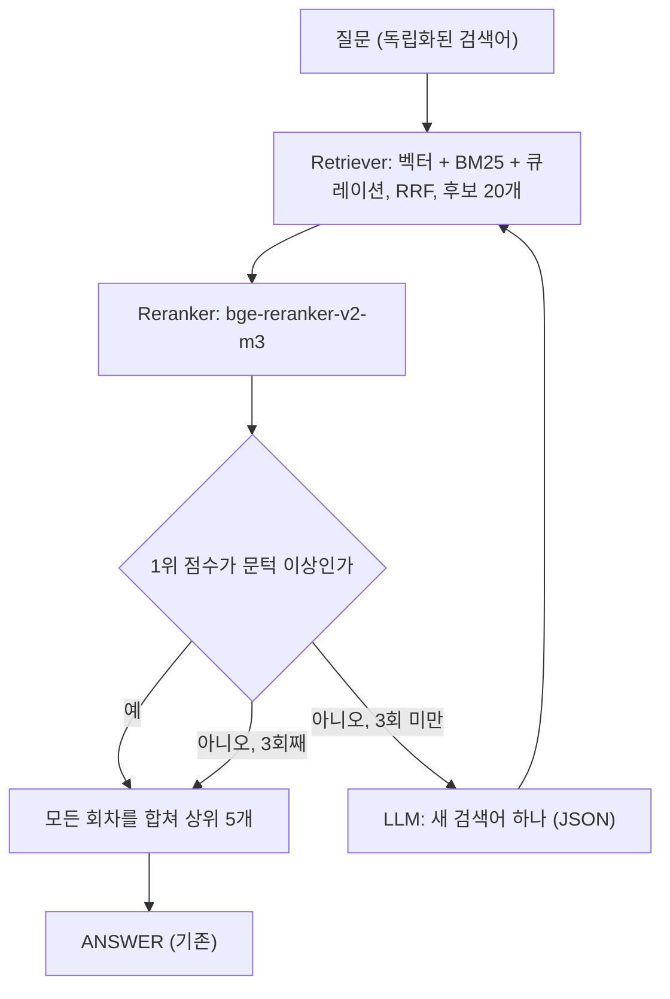
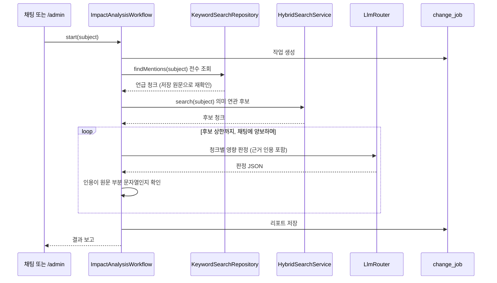
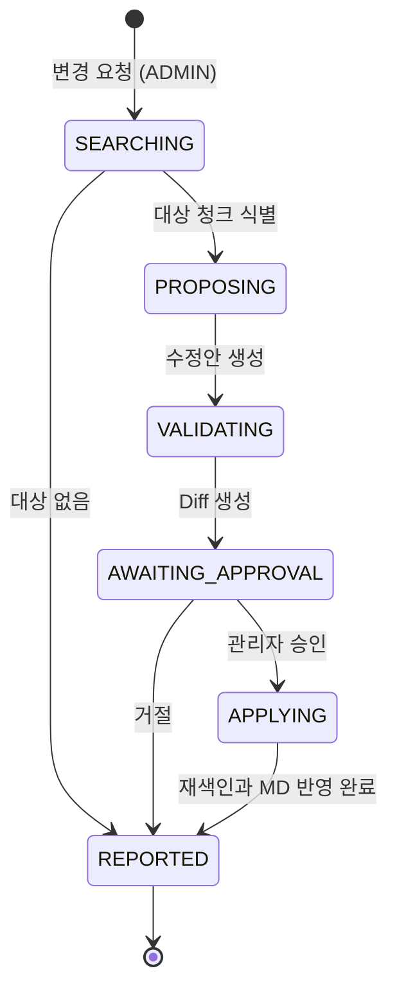
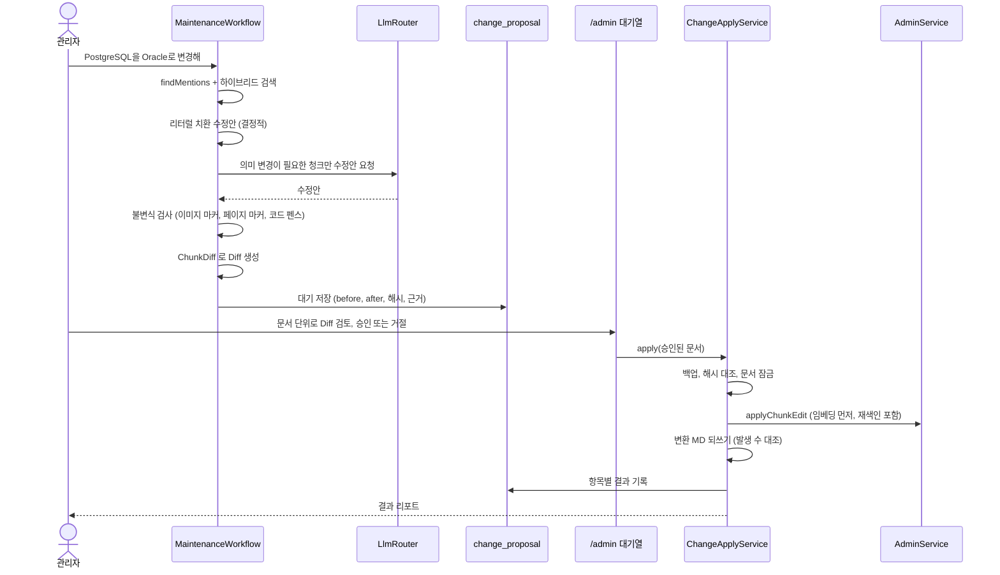
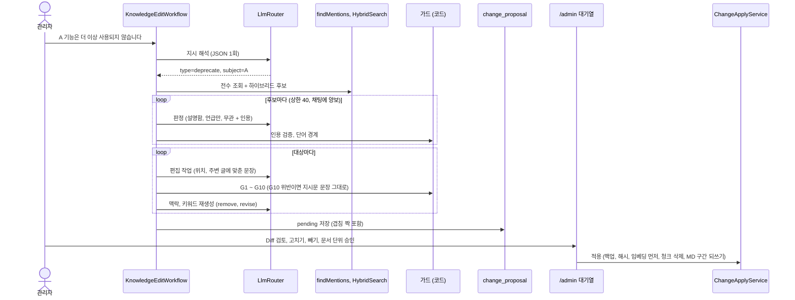
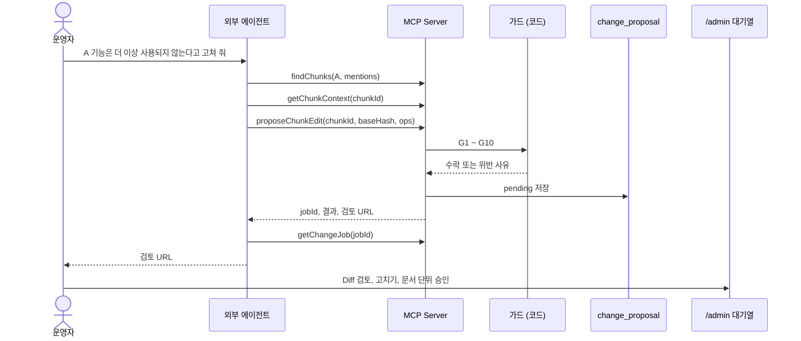
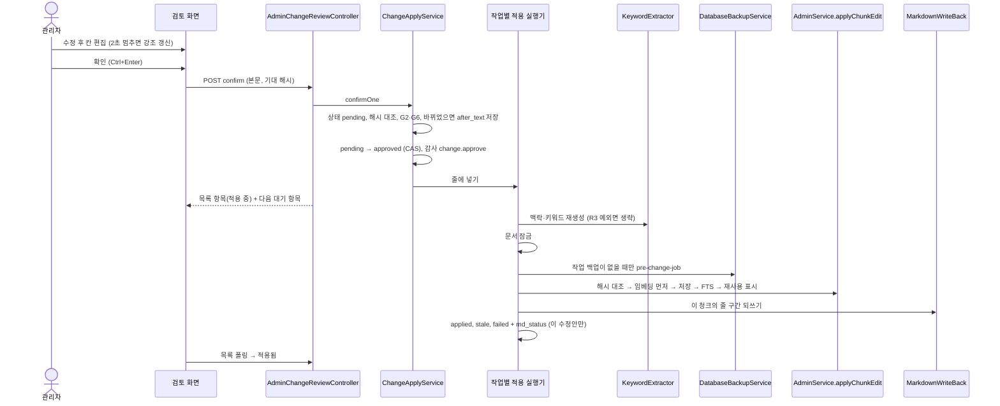

# MCP 기반 Agent 아키텍처 설계서 및 개발 로드맵

> **이 문서는 설계 시점의 기록이다.** §1~§9 는 2026-11-05 설계(Phase 0~5), §10 은 2026-11-17 이후 설계(Phase 6 — 자연어 지식 수정)다. 전부 구현됐고(2026-11-06~23), 구현이 설계와 다른 자리는 **「구현:」** 으로 표시했다. 살아 있는 동작 명세는 코드와 CLAUDE.md, 깨지기 쉬운 곳은 PITFALLS, 진행 상태는 [PLAN.md §6.33](PLAN.md).
>
> 설계와 구현의 큰 차이 셋: ① Tool 선택은 네이티브 `tools` 가 아니라 **프롬프트 JSON** 이고([AGENT_EVALUATION.md](AGENT_EVALUATION.md) — 정확도 0.939 vs 0.20) 새 사이트 없이 `ThinkingSite.CONDENSE` 를 쓴다 ② `onToolCall`/SSE `tool` 은 만들지 않았다(추적은 `/admin` 패널) ③ 유지보수·지식 수정은 채팅에서 **되묻고 확정한 뒤에만** 시작하고, 적용은 사람이 검토 화면에서 하나씩 확인한다(§10.15).
>
> 수치 중 부록 A 는 2026-11-05 의 일회성 스크립트 실측이다. 앱으로 다시 잰 값은 [SEARCH_EVALUATION.md](SEARCH_EVALUATION.md) §7 · AGENT_EVALUATION · [KNOWLEDGE_EDIT_EVALUATION.md](KNOWLEDGE_EDIT_EVALUATION.md).

## Context

**왜 하는가.** 지금 앱은 `AgentGraph` 라는 이름을 쓰지만 LLM이 도구를 고르지는 않는다. 질문은 항상 같은 순서(분류, 검색, 답변, 검증)로 처리된다. 목표는 LLM이 문서 검색, DB 조회, 관련 문서 찾기가 필요한지 판단해 Tool을 호출하고, 그 위에서 영향도 분석과 문서 유지보수까지 지원하는 것이다.

**결론 여섯 가지.**

1. **검색을 Retriever + Reranker로 바꾼다.** 후보 20개를 찾아 교차 인코더로 재순위화하고 상위 5개만 LLM에 넣는다. 실측에서 LLM에 넣는 청크는 절반이 됐는데 recall은 올랐다(골든셋 0.96에서 1.00, 후속 질문 0.67에서 0.76).
2. **답을 못 찾으면 다른 검색어로 최대 3회까지 다시 찾는다.** 재검색 여부는 리랭커 점수로 코드가 정하고, 새 검색어는 LLM이 만든다. 후속 질문 recall이 0.90까지 오른다. 로컬 모델이 재검색을 스스로 결정하지 못해서(무관한 결과를 줘도 12건 중 0건) 역할을 이렇게 나눴다.
3. **LLM은 턴마다 Tool을 한 번 고르고, 답변은 기존 `ANSWER → CRITIC` 이 쓴다.** `searchKnowledge` 를 고르면 `RETRIEVAL` 의 검색 루프로 이어진다. 스트리밍, 프롬프트 축소 사다리, 검증은 바뀌지 않는다. 선택은 프롬프트 JSON 으로 한다(「구현:」 — 네이티브 Tool Calling 은 사전 평가에서 0.20).
4. **앱 내부 Tool은 같은 JVM에서 직접 호출하고, 같은 Tool을 MCP Server로 외부에 공개한다.** Retriever와 Reranker는 `searchKnowledge` Tool 안에 있어 양쪽이 같은 검색을 쓴다. MCP Client는 외부 MCP 서버가 생길 때만 붙인다.
5. **영향도 분석과 유지보수는 자유 루프가 아니라 고정 워크플로다.** LLM은 단계 안의 판단만 한다. 쓰기는 관리자 승인 뒤 워크플로 코드만 수행한다.
6. **Q&A 품질을 올리는 것은 Tool Calling이 아니라 리랭크와 재검색이다.** Tool 선택의 가치는 지금 못 하는 일(카탈로그 조회, 영향도 분석, 유지보수)로 가는 길을 여는 것이다. 그래서 순서도 검색 개선이 먼저다.

**이번에 정한 결정.**

| 항목 | 결정 |
|---|---|
| MCP 경로 | 내부 직접 호출 + MCP Server로 외부 공개 |
| DB 조회 | 앱 내부 DB만, 미리 정한 조회만. LLM이 쓴 SQL은 실행하지 않는다 |
| 코퍼스 반영 | 관리자 승인 후 반영 |
| 수정 범위 | 청크 + 변환 MD. 원본 DOCX/PDF는 고치지 않고 리포트에 명시 |
| 재검색 주도 | 코드가 리랭커 점수로 판단, LLM은 새 검색어만 생성. 최대 3회 |
| 적용 범위 | 새 응답 모드 없이 S/N/C 공통 검색 경로에 적용. `/settings` 로 끌 수 있고 C 모드는 그대로 둔다 |
| 리랭커 | 교차 인코더(`bge-reranker-v2-m3`)를 `llama-server --reranking` 으로 운영 |
| 리랭크 후보 수·최종 컷 | `search-top-k` 하나만 편집한다. 후보 수 = `search-top-k × 2`, 최종 컷 = `max(5, ⌈search-top-k × 2/3⌉)` 로 파생하고 `/settings` 에서 조회 전용으로 보인다(§4.3, 2026-11-06) |

**선결 결함 (Phase 0, 해결).** 블로킹 LLM 호출의 `model` 이 설정값이 아니라 `gpt-5-mini` 로 나갔다 — `ModelPinningChatModel` 로 고쳤다(§2.4).

**권장 모델 (운영 기준, 2026-11-17).** Agent(`app.agent.enabled`)를 켜는 배포는 LOCAL 모델을 **Gemma 4 12B 이상, 또는 Tool 사용(함수 호출·구조화 출력)에 맞춘 최신 모델**로 둔다. E2B 는 Agent 없는 채팅·검색의 최소 구성이다. 측정이 아니라 운영 기준이다 — 앱 하네스로 잰 모델은 E2B 뿐이고, E2B 는 짧은 수정 명령 인식 4/6, 의미 변경 수정안 통과 1/10, 네이티브 Tool Calling 0.20 으로 판단·형식이 약했다. 모델을 바꾸면 `ToolCallingEvaluationTest` 로 다시 재고 [AGENT_EVALUATION.md](AGENT_EVALUATION.md) 에 남긴다. 운영 절차는 ADMIN_MANUAL §10.1 "Agent 를 켤 때의 모델".

**알려진 제약.** llama-server와 달리 LM Studio에서는 앱의 "생각 끔"이 듣지 않는다. 고치지 않기로 했다(운영 결정). 이 문서의 LLM 호출 지연은 생각을 끈 값이므로 LM Studio에서는 더 걸린다(§2.4).

---

## 1. 현재 구조 분석

설계 당시(HEAD `0f19115`)의 구조 스냅샷 — 아키텍처 그림, 요청·RAG·검색·프롬프트 흐름, Spring AI 사용 방식 — 은 줄 번호와 파일 수가 낡아 걷었다(git 이력에 있다). 지금 구조는 CLAUDE.md 의 Architecture 와 Key Files 가 단일 출처다. 설계에 영향을 준 사실만 남긴다: 질문은 늘 같은 순서(분류 → 검색 → 답변 → 검증)로 처리됐고 LLM 이 도구를 고르지 않았다 · 앱 코드에 `ChatClient`·Advisor·Tool Calling·MCP 가 없었다(모델은 `LlmRouter` 의 게이트 클로저 안에서 `model.call()` 로 부른다) · 채팅 스트리밍은 데코레이터 체인을 우회한다(`AnswerStreamer`).

---

## 2. MCP 적용 포인트

### 2.1 Tool 후보 식별

| 컴포넌트 | 승격 | 이유 | 처리 |
|---|---|---|---|
| `RetrievalService` | 직접 불가 | 공개 API가 `AgentState` 뿐. 합성 state는 `threadId=null` 이면 Vision 미스 때 NPE, `version=null` 이면 BM25 0건 | 검색 본체를 `HybridSearchService` 로 분리 |
| `RagService` | 일부 가능 | `listDocuments`, `findDocument`, `listTags`, `listVersions` 는 바로 쓸 수 있다 | 조회만 승격. `indexDocument`, `deleteDocument` 제외 |
| `KeywordSearchRepository` | 간접 | `search()` 결과 본문이 저장 원문이 아니라 파생 텍스트이고 score도 없다 | 전수 조회 `findMentions` 신설 후 원문 치환 |
| `VectorStoreFacade` | 간접 | `findByIds` 는 유용하지만 version 정규화가 키워드 축과 다르다 | Tool이 직접 부르지 않고 서비스 경유 |
| `AdminService` | 일부 가능 | `getChunks`, `getChunk`, `countChunks` 는 조회. `updateChunk`, `reindexChunk` 는 쓰기 | 쓰기는 워크플로 내부에서만 |
| `DocumentExportService`, `ChunkReassembler` | 일부 수정 | 재조립 텍스트가 지역 변수라 밖으로 안 나온다 | `reassembledText()` 공개 메서드 추가 |
| `ChunkDiff` | 그대로 | Spring 의존이 없는 순수 클래스 | 그대로 호출. 축약 포매터만 신규 |
| `ChunkReportService` | 일부 가능 | 조회는 쓸 수 있으나 전 사용자 데이터 | ADMIN 전용 |
| `RetrievalMetricsService`, `QuestionReuseService` | ADMIN만 | 범위가 전 사용자라 다른 사용자의 질문·답변이 보인다 | 일반 Tool로 공개 금지 |
| `CuratedQaService`, `CuratedSubmissionService` | 금지 | 코퍼스로 들어가는 유일한 문이고, 진입 메서드가 호출 출처를 검사하지 않는다 | Tool로 노출하지 않는다 |

### 2.2 승격 전에 해결할 구조 문제

Tool은 컨트롤러를 거치지 않고 서비스를 직접 부르므로, 컨트롤러가 지키던 것이 사라진다.

| 문제 | 근거 | 대응 |
|---|---|---|
| 권한 검사가 URL 필터뿐이다 | `@PreAuthorize` 0건. `SecurityConfig:87, :138, :205-215` | Tool 계층에 `ToolGuard` 를 둔다 |
| SSE 워커에는 `SecurityContext` 가 없다 | `ChatController:209` 의 가상 스레드 | 호출자(`ToolCaller`)를 요청 스레드에서 만들어 명시로 넘긴다 |
| 사전 확인과 감사가 컨트롤러에만 있다 | 재인덱싱 409는 `AdminController:696-709`, 내보내기 감사는 `DocumentController:284` | 쓰기는 워크플로 서비스로 옮기고 Tool 호출을 `AuditLogger` 로 남긴다 |
| `version` 인자가 `curated` 예약 네임스페이스에 닿는다 | 업로드·`index()`·`VectorStoreFacade.add` 에 거부 코드가 없다 | LLM 입력에서 `version` 을 뺀다. 서버가 정한다 |
| DB 연결이 1개다 | `DataSourceConfig:20-22, :242` | 오래 걸리는 조회를 Tool로 내지 않는다. `tagsByDocIds` 는 호출 금지 |
| 청크 쓰기가 실패를 돌려주지 않는다 | `updateChunk` 반환이 `void`. Chroma는 실패를 삼키고, sqlite-vec는 0행 갱신도 성공이다. 재임베딩이 실패하면 본문만 새것으로 남는다(`AdminService:616-620, :637-664, :724-727, :895-905`) | 임베딩을 먼저 하고 결과를 돌려주는 `applyChunkEdit()` 신설(§5.5) |

### 2.3 재사용 가능한 컴포넌트

기존 검색·답변·예산·승인 패턴(임베딩·벡터 저장소·청킹·`AnswerService`·`PromptLadder`·`ChunkDiff`·compare-and-set 상태 전이·`DatabaseBackupService`)은 그대로 썼고, 새로 만든 것은 Tool 계층·Tool 선택·검색 루프·MCP 서버·워크플로·저장소다. 클래스 목록은 §6.1 과 CLAUDE.md Key Files.

### 2.4 Spring AI 2.0.2에서 실제로 확인한 제약

> 「구현:」 Tool 선택을 프롬프트 JSON 으로 해서 요청에 `tools` 를 싣지 않으므로, 아래 중 `tools`·`tool_calls`·`RoutedChatModel` 에 관한 줄(계획 호출용 비차단 경로·계측 수정 등)은 대응할 필요가 없어졌다. Spring AI 의 사실로는 여전히 맞아 LLM 자율 Tool 루프를 다시 열 때(§7) 필요하다.

| 사실 | 근거 | 설계 영향 |
|---|---|---|
| `internalToolExecutionEnabled` 는 제거됐고 `OpenAiChatModel` 은 Tool을 실행하지 않는다. 실행 루프는 `ToolCallingAdvisor` 또는 수동 루프다 | 2.0.2 upgrade-notes, `javap` | 앱의 `model.call()` 은 `tool_calls` 를 돌려주기만 한다. Tool 계획 호출에 이 성질을 그대로 쓴다 |
| `LlmResult` 는 텍스트만 남긴다 | `LlmRouter:354, :1129` | `RoutedChatModel` 처럼 클로저로 `ChatResponse` 를 붙잡는다 |
| 퍼밋은 `call.apply()` 동안 유지되고, 장애 전환은 클로저를 다시 돌린다 | `LlmRouter:1099-1102, :758, :819` | 게이트 안에서 Tool을 실행하면 중첩 획득과 Tool 재실행이 생긴다. Tool은 퍼밋 밖에서만 돈다 |
| 체인의 옵션 복사는 `mutate()` 라 tool 필드를 보존한다 | `ThinkingControl:104`, `MaxTokensCappingChatModel:92` | 체인은 고칠 필요가 없다. `ThinkingControl.fromGeneric` 만 유실하므로 `OpenAiChatOptions` 를 직접 쓴다 |
| `RoutedChatModel` 은 `fixedRoutingMode()` 만 쓴다 | `RoutedChatModel:46`, `ThinkingSite:193-198` | 대화 라우팅 사이트면 예외가 나고, 고정 모드면 LOCAL_ONLY 대화가 원격으로 나갈 수 있다. 턴의 모드를 받게 고친다 |
| `RoutedChatModel.getOptions()` 는 일반 옵션이다 | `RoutedChatModel:60-63` | `ChatClient` 와 조합하면 tool 콜백이 조용히 빠진다. `ChatModel` 로 직접 쓴다 |
| `AnswerStreamer` 는 `tool_calls` 를 읽지 않는다 | `AnswerStreamer:190-212` | 이 경로에 tools를 실으면 빈 답변이 된다. 싣지 않는다 |
| 서버가 `tools` 를 거부하면 라우터가 프로바이더를 차단한다 | `LlmRouter:752-755, :801-814` | 강등한 답변까지 소진으로 실패한다. 비차단 경로가 필요하다 |
| 계측 3곳이 Tool 메시지를 모른다 | `CalibratingChatModel:160-166`, `LlmCurlLogger:56-60`, `ThinkingObservations:224-233` | 토큰 보정 왜곡, 재현 로그 불일치, 텍스트 없는 응답을 "생각함"으로 오판 |
| MCP 서버는 서블릿 환경에서 `immediateExecution(true)` 로 돈다 | `McpServerStatelessAutoConfiguration` 바이트코드 | Tool이 요청 스레드에서 돌아 `SecurityContext` 를 읽을 수 있다 |
| `ToolCallbackProvider` 빈은 전부 MCP로 나간다 | `ToolCallbackUtils`, `StatelessToolCallbackConverterAutoConfiguration` | 공개 범위는 빈 하나(`mcpExposedTools`)로 통제한다 |
| `spring.ai.mcp.server.enabled` 기본값은 켜짐이다 | 설정 메타데이터 | 스타터를 넣으면 명시적으로 꺼 둔다 |
| `mcpServerJsonMapper` 는 `defaultCandidate=false` 라 앱의 `JsonMapper` 를 밀어내지 않는다 | `McpServerJsonMapperAutoConfiguration`, `OnBeanCondition.isDefaultCandidate` | 코드상 안전. `spring.jackson.*` 가 살아 있는지 Phase 2 테스트로 고정한다 |
| Stateless 서버는 `McpSyncRequestContext` 메서드를 건너뛴다 | 2.0.2 문서 | 진행률 알림을 쓰지 않고 작업 조회 Tool로 대신한다 |
| LM Studio는 형식이 틀린 tool 호출을 `content` 로 돌려준다. `tool_choice=required` 는 llama.cpp 엔진에서만 된다 | LM Studio 문서 | `[TOOL_REQUEST]`, `<tool_call>` 이 본문에 보이면 실패로 처리한다. `required` 에 의존하지 않는다. 실측에서는 지연도 16.8초로 컸다 |
| LM Studio는 `chat_template_kwargs.enable_thinking` 을 무시하고 `reasoning_effort: none` 은 받는다 | 실측(부록 A.2) | 고치지 않고 알려진 제약으로 둔다. `application.properties` 주석에 남겼다 |
| LM Studio에는 `/v1/rerank` 가 없다 | 실측 | 리랭커는 별도 `llama-server --reranking` 으로 돌린다 |
| llama.cpp는 `--jinja` 가 있어야 Tool Calling이 되고, 병렬 호출은 기본 꺼짐이다 | llama.cpp 문서 | 운영 매뉴얼과 Phase 3 사전 평가의 사전 조건에 넣는다 |

**선결 결함: 블로킹 호출의 `model` 누락 (2026-11-06 해결).** 호출자가 옵션을 주면 `OpenAiChatModel` 은 기본 옵션을 병합하지 않고, 모델을 싣지 않은 옵션의 `model` 은 라이브러리 기본값 `gpt-5-mini` 다 — 분류·검증·독립화 같은 블로킹 호출이 그 이름으로 나갔다(모델 이름을 무시하는 llama-server 에서는 안 보인다). 체인 가장 안쪽의 `ModelPinningChatModel` 이 고치고, `ThinkingControlWireTest` 가 요청 본문의 `model` 을 단언한다.

**알려진 제약: LM Studio의 생각 끄기.** LM Studio 는 `chat_template_kwargs.enable_thinking=false` 를 오류 없이 무시하고 `reasoning_effort: none` 만 듣는다(부록 A.2). 그래서 LM Studio 에 붙인 배포에서는 생각 수준을 전부 끔으로 출하했어도 분류·독립화·검증이 생각을 한다. 고치지 않기로 했다(2026-11-05 운영 결정) — 필요하면 그 프로바이더에 `thinking-dialect=openai-effort` 를 준다(기본값을 바꾸면 llama-server 가 깨질 수 있다).

---

## 3. Tool 설계

### 3.1 원칙

- **Q&A에서 LLM에게 보이는 Tool은 4개(관리자 5개)다.** 소형 모델은 선택지가 많을수록 틀릴 가능성이 커진다(사전 평가는 AGENT_EVALUATION).
- **인자는 짧은 평문만 받는다.** `version`, `userId` 는 인자에 없다. 서버가 정한다.
- **결과는 짧게 돌려준다.** 행 수와 발췌 길이에 상한을 둔다(발췌 300자, 50행).
- **호출자에 따라 목록을 거른다.** `ToolCatalog.forCaller(caller)` 가 권한 없는 Tool은 스키마조차 주지 않는다. 모든 Tool 메서드는 첫 줄에서 `ToolGuard` 를 지난다.
- **쓰기는 Tool이 아니다.** 적용과 재색인은 승인 뒤 워크플로만 호출한다.

정의는 `@Tool` 메서드로 한 번만 쓴다. 내부 호출은 `ToolCallbacks.from()`, 외부 공개는 `ToolCallbackProvider` 빈 하나를 거친다. `@Tool` 에는 `readOnlyHint` 같은 MCP 힌트가 없지만, 공개 Tool이 읽기와 제안뿐이라 처음에는 넘어간다.

### 3.2 Tool 목록

| Tool | 요청서 대응 | Agent 노출 | MCP 노출 | 접근 |
|---|---|---|---|---|
| `searchKnowledge` | `searchKnowledge()` | O (`RETRIEVAL` 로 연결) | O | 읽기 |
| `findRelatedDocuments` | `findRelatedDocuments()` | O | O | 읽기 |
| `queryCatalog` | `searchDatabase()` | O | O | 조회마다 다름 |
| `analyzeImpact` | 영향도 분석 | O | O | 읽기 |
| `requestDocumentChange` | `updateDocument()` 대체 | ADMIN만 — **채팅은 되묻고 "네"를 받은 뒤에만**(`PendingChangeConfirmations`), 옵션(`semantic`·`caseVariants`)은 채팅에서 못 켠다. 지시문만 받으면 자연어 수정 워크플로(§10) | ADMIN만 | 제안 |
| `findChunks` | `find_chunk` (§10.9) | X | ADMIN만 | ADMIN 읽기 |
| `proposeChunkEdit` | `update_chunk`, `delete_chunk_section` (§10.9) | X | ADMIN만 | 제안 — 대기열에만 쌓인다 |
| `getChunkContext` | 추가 | X | O | 읽기 |
| `getDocument` | `getDocument()` | X | ADMIN만 | ADMIN 읽기 |
| `getChangeJob` | 추가 | X | ADMIN만 | 읽기 — 「구현:」 4단계에서는 만들지 않았고 6b(§10.9)에서 ADMIN 으로 만들었다(외부 에이전트가 가드 위반을 읽고 고쳐 다시 내야 한다) |
| `generateDiff` | `generateDiff()` | X | O | 읽기 |

Tool이 아닌 내부 기능: `ChangeApplyService.apply()`(`updateDocument` 의 실제 쓰기)와 재색인(`reindexKnowledge` 에 해당). 둘 다 관리자 승인 뒤 워크플로만 호출한다.

### 3.3 Tool 상세

**searchKnowledge**

| 항목 | 내용 |
|---|---|
| 목적 | 문서와 큐레이션 Q&A를 찾는다. Retriever(하이브리드 검색)와 Reranker(교차 인코더)가 이 Tool 안에 있다 |
| 입력 | `query`(필수), `keywords`(선택), `tags`(선택), `topK`(선택, 리랭크 컷 이하) |
| 출력 | `hits[{chunkId, file, page, snippet, score}]`, `totalHits`, `lowConfidence` |
| 구현 | 신규 `KnowledgeSearchTool` 이 `HybridSearchService.search()` 와 `CrossEncoderReranker.rerank()` 를 잇는다. 채팅은 `RETRIEVAL` 노드의 검색 루프(§5.2)로 같은 두 서비스를 쓰고, MCP 호출은 재검색 없이 1회 검색한다. 외부 LLM은 `score`, `lowConfidence` 를 보고 스스로 다시 부를 수 있다 |
| 재사용 | 높음. 리랭커가 켜지면 질의 확장은 끈다. 측정상 골든셋 26건 중 0~1건만 바뀌고 검색마다 LLM 1회와 약 1.1초를 쓴다 |

**findRelatedDocuments**

| 항목 | 내용 |
|---|---|
| 목적 | 주제나 식별자와 관련된 문서를 문서 단위로 찾는다 |
| 입력 | `subject`(필수), `limit`(기본 10) |
| 출력 | `documents[{docId, file, tags, hitCount, topSnippet}]` |
| 구현 | `HybridSearchService` 결과를 docId로 묶고 `RagService.findDisplayNames()` 로 표시 이름을 붙인다 |
| 재사용 | 중간 |

**queryCatalog** (`searchDatabase` 대체)

| 항목 | 내용 |
|---|---|
| 목적 | 앱 내부 메타데이터를 미리 정한 이름으로 조회한다 |
| 입력 | `name`(enum), `params`(선택) |
| 출력 | `rows[]`(50행 이하), `truncated` |
| 구현 | 신규 `CatalogQueryService`. `documents.list`, `documents.recent`, `tags.list` 는 `RagService`, `reports.open` 은 `ChunkReportService`(ADMIN), `usage.summary` 는 `LlmUsageRepository`(ADMIN) |
| 재사용 | 높음. 자유 SQL 없음. `users`, `app_secret`, `persistent_logins`, `settings_override`, `llm_provider_override` 는 대상이 아니다 |

**analyzeImpact**

| 항목 | 내용 |
|---|---|
| 목적 | 변경이나 삭제 대상의 영향 범위를 분석한다 |
| 입력 | `subject`(필수), `changeNote`(선택) |
| 출력 | `{jobId, status}` |
| 구현 | `ImpactAnalysisWorkflow.start()` (§5.4) |
| 재사용 | 중간. `findMentions` 와 판정 단계는 신규 |

**requestDocumentChange** (`updateDocument` 대체)

| 항목 | 내용 |
|---|---|
| 목적 | 문서 변경 요청을 받아 수정안을 만들기 시작한다. **코퍼스에는 아무것도 쓰지 않는다** |
| 입력 | `instruction`(필수), `from`, `to`(리터럴 치환일 때) |
| 출력 | `{jobId, status}` |
| 구현 | `MaintenanceWorkflow.start()` (§5.5) |
| 재사용 | `curated_submission` 의 대기열 패턴 |

**getChunkContext**

| 항목 | 내용 |
|---|---|
| 목적 | 검색된 청크의 앞뒤 문맥을 읽는다 |
| 입력 | `chunkId`(필수), `before`(2 이하), `after`(2 이하) |
| 출력 | `chunks[{chunkId, index, text}]` |
| 구현 | `AdminService.getChunk()` 로 위치를 읽고 `getChunks(collection, docId, offset, limit)` 로 이웃을 읽는다 |
| 재사용 | 높음 |

**getDocument**

| 항목 | 내용 |
|---|---|
| 목적 | 문서 전문을 구간 단위로 읽는다 |
| 입력 | `docId`(필수), `offset`, `maxChars`(기본 4,000) |
| 출력 | `{docId, file, totalChars, text, nextOffset}` |
| 구현 | `DocumentExportService.reassembledText()` 추가. `getAllChunks`, `ChunkReassembler.reassemble`, `postProcess` 를 잇고 overlap은 `DocRegistry.findByDocId(docId).chunkOverlap()` 에서 읽는다 |
| 재사용 | 높음. ADMIN 전용인 이유는 `/ui/documents/*/export` 가 ROLE_ADMIN이기 때문이다(`SecurityConfig:212`) |

**getChangeJob, generateDiff**

| Tool | 입력 | 출력 | 구현 |
|---|---|---|---|
| `getChangeJob` | `jobId` | 상태, 수정안 목록, 축약 Diff, 검토 URL | `ChangeProposalService.jobSummary`. ADMIN만(§10.9) |
| `generateDiff` | `before`, `after` | 변경 구간 요약 | `ChunkDiff.compare()` + 신규 `UnifiedDiffFormatter`. `lines` 에 같은 줄이 전부 들어 있고 `tooLarge` 일 수 있어 축약이 필요하다 |

---

## 4. Target Architecture



요청서의 목표 구조와 다른 점은 셋이다. **내부 Tool은 MCP Client를 거치지 않고, 재검색 여부는 LLM이 아니라 코드가 정하며, 답변은 Tool 루프가 아니라 기존 노드가 쓴다.**

### 4.1 설계 결정

| # | 결정 | 이유 | 버린 대안 |
|---|---|---|---|
| D1 | Tool 선택은 턴당 1회, `searchKnowledge` 는 `RETRIEVAL` 로 연결 | `sources`, `imageRefs`, LazyVision, 재시도 입력이 그대로다. 답변 프롬프트의 조립 경로가 하나로 남는다 | 근거 수집 루프를 첫 노드로. 결과 병합, 재시도, 검증 상한을 전부 다시 맞춰야 한다 |
| D1a | 재검색 여부는 리랭커 점수로 코드가 정하고, 새 검색어만 LLM이 만든다 | 로컬 모델은 재검색을 스스로 결정하지 않았고(0/12), 충분 여부 판단도 치우쳤다(답이 있어도 10/12 부족). 새 검색어 생성은 1.5초에 안정적이었다 | LLM 자율 루프. 재개 신호는 §7 |
| D1b | 새 응답 모드 없이 공통 검색 경로에 적용 | 추가 비용이 작고 재검색은 필요한 턴에서만 돈다. C는 근거 엄격도 축의 모드라 바꾸면 응용 기능이 사라진다 | 심층 모드 추가, C 모드 변경 |
| D1c | 교차 인코더를 별도 서버로 | 점수를 주므로 재검색 판단이 가능하다. 후보 20개에 약 3초로 LLM 리랭커(15.7초)보다 빠르다. llama-server와 GGUF가 이미 있어 과거 제외 사유(ONNX 도입, `PLAN §10.5`)가 사라졌다 | 기존 LLM 리랭커. 순서만 돌려줘 점수가 없다 |
| D2 | Tool 선택을 분류와 병렬로 사전 단계에서 호출 | `condensedF.thenApplyAsync` 에 하나를 더하면 된다(`AgentService:133`). 임계 경로 지연이 거의 늘지 않는다 | 그래프 노드에서 순차 호출 |
| D3 | 호출이 없거나 실패하면 `RETRIEVAL` | Agent가 검색을 없앨 수 없게 한다. "Tool 없음"을 잡담으로 읽으면 소형 모델의 실수가 근거 없는 답변이 된다 | 호출 없음을 `DIRECT_ANSWER` 로 |
| D4 | 분류기와 독립화 유지 | meta 판단과 자립 질문을 그대로 쓴다. Tool 계획 입력에 이력이 필요 없어 예산 문제가 사라진다 | 첫 LLM 호출로 분류 대체. 측정 뒤 재검토 |
| D5 | `ChatClient` + `ToolCallingAdvisor` 를 쓰지 않는다 | 게이트 클로저에 넣으면 퍼밋을 쥔 채 Tool이 돌고, 장애 전환이 Tool을 재실행한다 | 라이브러리 기본 루프 |
| D6 | 내부 직접 호출 + 같은 프로세스의 MCP Server | HTTP 왕복과 신원 재전달이 없다. SQLite pool=1, 메모리 브레이커와 게이트를 공유한다 | 별도 프로세스는 같은 DB 파일을 쓸 수 없다 |
| D7 | MCP Server는 `STATELESS` | 세션 관리가 없다. 양방향 기능은 쓰지 않는다 | `STREAMABLE`. 진행률이 꼭 필요해지면 재검토 |
| D8 | 영향도·유지보수는 고정 워크플로 | 소형 모델에게 긴 계획을 맡기지 않는다. 재개, 감사, 재현이 쉽다 | LLM 주도 다단계 계획 |
| D9 | 기본 꺼짐(`app.agent.enabled=false`, MCP Server도 꺼짐) | 기존 경로가 언제나 폴백이다 | 일괄 전환 |

### 4.2 MCP Server 구성

```properties
spring.ai.mcp.server.enabled=${MCP_SERVER_ENABLED:false}
spring.ai.mcp.server.protocol=STATELESS
spring.ai.mcp.server.type=SYNC
spring.ai.mcp.server.name=rag-agent
spring.ai.mcp.server.streamable-http.mcp-endpoint=/api/v1/mcp
```

- 의존성은 `spring-ai-starter-mcp-server-webmvc` 하나다. BOM이 2.0.2로 고정하고 Jackson 3용 `mcp-json-jackson3` 을 쓴다.
- 앱에 토큰 인증이 없으므로 `McpApiKeyFilter` 를 새로 만든다. 읽기 키와 ADMIN 키를 분리한다. 폐쇄망에서 인가 서버를 전제할 수 없어 OAuth2는 쓰지 않는다.
- 이 경로에는 **기존 세 체인보다 앞선 전용 `SecurityFilterChain`** 을 둔다(`@Order`, STATELESS, CSRF 끔, API 키 필수). 전용 체인이 없으면 세션 체인의 CSRF나 평문 no-auth의 `permitAll` 을 그대로 받는다.
- `NoAuthAutoLoginFilter` 는 `@Component` 라 서블릿 필터로도 돌아 principal을 덮어쓸 수 있고, 관리자가 없으면 `/setup` 으로 리다이렉트한다. `isPassThrough` 에 이 경로를 더한다.
- `RateLimitFilter` 에 전용 `mcp` 버킷을 둔다. 그대로 두면 `default` 버킷이라 `chat` 한도를 우회한다.

### 4.3 Reranker 구성

임베딩 서버와 같은 방식으로 llama-server를 하나 더 띄운다. 측정에 쓴 명령은 다음과 같다.

```bash
llama-server -m bge-reranker-v2-m3-Q8_0.gguf -c 8192 -ngl 0 --host 127.0.0.1 --port 8092 --reranking -b 2048 -ub 2048 --no-webui
```

```properties
app.reranker.base-url=${RERANK_BASE_URLS:${RERANK_BASE_URL:}}
app.reranker.model=${RERANK_MODEL:bge-reranker-v2-m3}
app.reranker.timeout-seconds=${RERANK_TIMEOUT_SECONDS:15}
app.search-rerank-min-score=${SEARCH_RERANK_MIN_SCORE:0.0}
app.search-max-attempts=${SEARCH_MAX_ATTEMPTS:3}
```

- `base-url` 이 비면 리랭커가 꺼지고 앱은 지금과 똑같이 동작한다.
- `search-top-k`(기본 10)의 뜻은 바꾸지 않는다. 리랭커가 없거나 죽었을 때의 최종 컷으로 남겨, 장애 시 동작이 정확히 현재와 같아진다. 리랭커가 동작할 때의 후보 수와 최종 컷은 이 값에서 파생한다(아래).
- `search-rerank-min-score`, `search-max-attempts` 는 핫 편집 대상이다(`SettingsKeys`, `SEARCH_HOT_SPECS`, `searchXxxSafe()` 셋 다).
- `relevance_score` 는 모델의 원점수라 문턱 0.0은 이 모델 값이다. 모델을 바꾸면 다시 잰다.
- 폐쇄망 배포에는 GGUF 파일(`Q8_0`)을 함께 옮긴다.

#### 후보 수와 최종 컷은 `search-top-k` 에서 파생한다 (결정 2026-11-06)

설정으로 고치는 값은 `search-top-k` 하나다. 리랭커가 동작할 때의 후보 수와 최종 컷은 별도 프로퍼티가 아니라 이 값에서 계산한다.

| 값 | 식 | 기본(`search-top-k`=10) |
|---|---|---|
| 리랭크 후보 수 (`effectiveRerankCandidates()`) | `search-top-k × 2` | 20 |
| 리랭크 최종 컷 (`effectiveRerankTopK()`) | `max(5, ⌈search-top-k × 2/3⌉)`, 후보 수를 넘지 않는다 | 7 |
| 리랭커 없음·장애 | `search-top-k` 그대로 | 10 |

| `search-top-k` | 1 | 2 | 4 | 10 | 11 | 20 | 50 (설정 상한) |
|---|---|---|---|---|---|---|---|
| 후보 수 | 2 | 4 | 8 | 20 | 22 | 40 | 100 |
| 최종 컷 | 2 | 4 | 5 | 5 | 6 | 10 | 25 |

- 두 값은 `AppProperties` 의 파생 메서드라 프로퍼티·환경변수가 없고, `search-top-k` 를 핫 편집하면 다음 검색부터 함께 바뀐다. 하나만 열어 두므로 후보 수가 최종 컷보다 작은 설정이 만들어질 수 없다. `/settings` 의 `search-top-k` 아래에 조회 전용으로 보인다(리랭커가 꺼졌으면 "적용되지 않음" 배지).
- 기본값 10에서 20 / 5는 부록 A의 실측 구성과 같다. 다른 `search-top-k` 에서의 recall은 측정하지 않았다.
- **위험.** 후보 수가 `search-top-k` 를 따라 커진다. 20개에 약 3초(CPU)를 선형으로 가정하면 상한(50)에서는 후보 100개에 약 15초다(미측정). 상한을 두지 않았다. 필요하면 측정한 뒤 후보 수 상한을 더한다.

---

## 5. Agent Workflow

### 5.1 Q&A Agent



「구현:」 계획 호출은 네이티브 `tools` 가 아니라 **프롬프트 JSON 한 번**이다(`ToolPlanService` — 도구 목록을 프롬프트 `prompt.agent.plan` 에 적고 `{"tool": "...", "arguments": {...}}` 를 받는다). 요청에 `tools` 를 싣지 않으므로 설계가 걱정한 서버의 `tools` 거부·형식이 틀린 tool 호출·계측 3곳의 Tool 메시지 문제가 생기지 않는다. 호출 지점은 `ThinkingSite.CONDENSE`(생각 끔 · 출력 예약 256 · 고정 라우팅).

**규칙.**

| 항목 | 내용 |
|---|---|
| 입력 | 시스템 프롬프트 `prompt.agent.plan` + `effectiveSearchQuestion()`. 이력을 넣지 않아 §6.31 이력 제외와 충돌하지 않는다 |
| 실행 | 고른 Tool 하나만 쓴다. Tool은 그래프 노드에서 퍼밋 밖으로 실행한다 |
| 우선순위 | 분류가 `meta` 면 Tool 계획을 무시하고 `afterClassify()` 를 그대로 지난다(되묻기에 "네" 로 확정된 계획만 meta 보다 앞선다) |
| 대상 턴 | `ResponseMode.allowsAgent()`, 시작은 N 모드만. `directMode` 는 제외 |
| 근거 문서 | `retrievedDocs` 에 넣고 `sources` 는 비운다. 재사용 출처가 만들어지지 않아 시간이 지나면 낡는 카탈로그 답변이 재사용되지 않는다 |
| 재시도 | `sufficient=false` 는 기존 `RETRIEVAL` 로 간다. 카탈로그로 못 답한 질문이 문서 검색으로 내려가는 효과가 있다 |

**실패 처리.** 어떤 실패도 턴을 실패시키지 않는다 — 호출 실패·형식 오류·`NONE`·모르는/보이지 않는/권한 없는 Tool·스키마와 안 맞는 인자·Tool 예외는 전부 계획 없음이고 그래프는 `RETRIEVAL` 이다(D3). 사용자 중단(인터럽트)만 그대로 전파한다.

### 5.2 검색 루프 (Retriever + Reranker)

요청하신 흐름을 그대로 담되, 재검색을 결정하는 주체만 코드로 옮겼다.



**실측 결과.** 재현 스크립트이고 큐레이션 축은 빠졌다(부록 A).

| 방식 | LLM에 넣는 청크 | 골든셋 26건 recall | 후속 질문 21건 recall |
|---|---|---|---|
| 현재(RRF 상위 10개) | 10 | 0.96 | 0.67 |
| RRF 상위 5개, 리랭크 없음 | 5 | 0.96~1.00 | 0.62 |
| 후보 20개 리랭크, 상위 5개 | 5 | 1.00 | 0.76 |
| **리랭크 + 재검색 최대 3회** | **5** | **1.00** | **0.90** |

앱의 후속 질문 경로는 독립화까지 포함해 0.714~0.762다. 위 표의 후속 질문은 독립화 없이 원문으로 돌렸고, 재검색 때만 앞 질문을 LLM에게 줬다.

**규칙.**

| 항목 | 내용 |
|---|---|
| 후보 수 | `search-top-k × 2`(기본 20, §4.3). 15개는 후속 질문이 0.67에 머물렀다. 요청 범위(12~20)의 위쪽이다 |
| 최종 컷 | `max(5, ⌈search-top-k × 2/3⌉)`(기본 7, §4.3), 후보 수를 넘지 않는다. 기본값에서는 후보의 35%다. 처음 설계(÷ 2 → 기본 5, 후보의 1/4)는 문서 수가 너무 작아 2/3 로 올렸다(2026-11-12) |
| 최대 횟수 | `app.search-max-attempts=3`. 첫 검색을 포함한다 |
| 재검색 조건 | 리랭커 1위 점수가 `app.search-rerank-min-score`(0.0) 미만. 실측에서 답을 못 찾은 5건을 모두 잡았고 불필요한 재검색은 6건이었다 |
| 새 검색어 | 입력은 질문, 앞 질문, 지금까지 쓴 검색어, 상위 3개 발췌(160자). 출력은 `{"nextQuery": "..."}`. 「구현:」 새 사이트 없이 `ThinkingSite.CONDENSE`(`QuestionCondenser.distill()` 과 같은 자리) |
| 종료 | 문턱 이상, 횟수 소진, 새 검색어가 비거나 이미 쓴 것일 때 |
| 합치기 | 회차별 점수의 최댓값으로 같은 청크를 합치고 점수순으로 자른다 |
| 원문 치환 | 리랭크 전에 `withStoredText` 를 지난다(키워드 축 히트는 파생 텍스트다) |
| 질의 확장 | 리랭커가 동작하면 `MultiQueryExpander` 를 건너뛴다. 턴의 전처리 LLM 호출을 늘리지 않는다 |
| 사후 재시도 | 루프는 턴의 첫 `RETRIEVAL` 에서만 돈다. `sufficient=false` 재시도는 지금처럼 1회 검색이라 최악의 호출 수가 곱해지지 않는다 |
| 낮은 관련도 | 3회 뒤에도 문턱 미만이면 `retrievalWarnings` 로 `[경고]` 에 남긴다 |
| 진행 표시 | `stage` 이벤트로 "다른 표현으로 다시 찾는 중 (2/3)" 을 보낸다 |
| 기록 | 검색 횟수, 쓴 검색어, 1위 점수. 점수는 `SourceRef` 로 `/admin` 검색 진단에 보인다 |
| 대상 | S/N/C 공통. Direct는 검색이 없어 해당 없다 |

**실패 처리.**

| 상황 | 동작 |
|---|---|
| 리랭커 연결 실패, 시간 초과 | RRF 순서로 `search-top-k` 만큼 자른다. 재검색은 하지 않는다. 현재 동작과 같다 |
| 새 검색어 생성 실패 | 그때까지 찾은 결과로 진행 |
| 재검색 결과가 나쁨 | 점수 최댓값으로 합치므로 첫 결과를 잃지 않는다 |

**청크 수를 줄일 때의 파급.** 리랭크 최종 컷(`effectiveRerankTopK()`)이 곧 답변·검증의 문서 수다. `PromptLadder.floor()` 는 `search-top-k` 기준 그대로 둔다(2026-11-06 결정) — 문서가 5개면 바닥이 문서 수와 같아 '문서를 바닥까지' 칸이 빠지고 이력을 먼저 줄인다. 재시도 증가분(+1)과 이력 제외·모드 부스트는 최종 컷 위에 그대로 더하고, 리랭커가 실패하면 컷을 `search-top-k` 기준으로 되돌린다. 「구현:」 `ChunkReranker` 인터페이스는 만들지 않았다(소비자가 둘이 되지 않았다) — `CrossEncoderReranker` 를 직접 쓴다. 측정은 `SEARCH_EVALUATION.md` §7.5.

### 5.3 Tool을 고르는 대표 사례

| 질문 | Tool | 이후 |
|---|---|---|
| "고객 가입 정책 알려줘" | `searchKnowledge` | RETRIEVAL, ANSWER |
| "결제 관련 문서 뭐 있어?" | `findRelatedDocuments` | TOOL, ANSWER |
| "문서 몇 개 등록돼 있어?" | `queryCatalog` | TOOL, ANSWER |
| "ABC API가 삭제되었어" | `analyzeImpact` | TOOL, 영향도 워크플로 |
| "PostgreSQL을 Oracle로 변경해" | `requestDocumentChange` | TOOL, 유지보수 워크플로 |
| "안녕" | 분류기가 meta | DIRECT_ANSWER |

워크플로 Tool을 고른 턴은 정형 문구와 작업 링크를 답변으로 남기고 `FINALIZE` 로 간다(검색 0건 경로와 같은 모양). 권한이 없으면 애초에 스키마가 없어서 고를 수 없다.

### 5.4 영향도 분석 워크플로

Top-k 검색은 "관련 있는 몇 개"를 찾는 도구이고, 영향도는 "언급된 곳 전부"가 필요하다. 그래서 전수 조회를 먼저 쓴다.



- 판정은 `BeanOutputConverter` + `LenientJson`, 기존 패턴이다.
- 인용 검증은 코드가 한다. 인용이 원문에 없으면 그 판정을 "근거 미확인"으로 표시한다.
- 후보가 상한(제안 40개)을 넘으면 나머지는 언급 목록으로만 보여 주고 숫자를 함께 밝힌다.
- LLM 호출은 `ClarifiedQuestionBackfill` 처럼 대화형 게이트가 비어 있을 때 보낸다.
- `chunk_fts` 는 trigram이라 2글자 식별자는 찾지 못한다. 이 경우 리포트에 명시한다.
- 진행은 `IndexingProgressService` 와 같은 방식의 SSE로 보여 주고, 리포트는 요청자와 ADMIN만 본다.
- 재기동 시 진행 중이던 작업은 `interrupted` 로 표시한다.

### 5.5 Maintenance Agent 워크플로





**단계별 규칙.**

| 단계 | 규칙 |
|---|---|
| 대상 식별 | 큐레이션 청크(`doc_type=curated_qa`)는 수정안을 만들지 않고 "수동 처리"로 분류한다. 단일 출처가 `curated_qa` 라 청크를 고쳐도 재임베딩 때 되돌아간다 |
| 수정안 | 치환만으로 되는 곳은 코드가 만든다. 의미 변경(드라이버 클래스, 포트, SQL 문법)만 LLM이 만들고 "검토 필요"로 표시한다. 단위가 청크이므로 소형 모델의 창에 들어간다 |
| 맥락과 키워드 | `chunk_context`, `excerpt_keywords` 에도 같은 치환을 건다. 검색 텍스트는 `chunk_context + 본문` 이라(`SearchTextBuilder:45-49`) 본문만 고치면 옛 용어로 계속 검색된다 |
| 불변식 검사 | `ChunkImageEditor.markers()` 로 이미지 마커 보존, 페이지 마커 보존, `MarkdownCorrectionService.findFenceProblems()` 로 펜스 짝. 위반하면 수정안을 버린다 |
| 승인 단위 | **문서.** 일부 청크만 고치면 이웃 청크와 겹침 구간이 달라져 `ChunkReassembler` 의 재조립에 중복이 생긴다. 상태 전이는 compare-and-set이고 코퍼스 전체 일괄 승인은 만들지 않는다 |
| 적용 전 | `DatabaseBackupService` 로 백업한다. sqlite-vec에서는 벡터까지 한 파일이라 복구 지점이 된다. docId 단위로 잠가 재인덱싱과 겹치지 않게 한다 |
| 적용 | 현재 본문 해시가 `before_hash` 와 다르거나 청크가 없으면 `stale`. 신규 `AdminService.applyChunkEdit(collection, chunkId, newText, metaChanges, expectedHash)` 를 쓴다. 임베딩을 먼저 하고 `vectorStore.add` 로 저장하므로 임베딩 실패 시 아무것도 바뀌지 않고, 결과를 돌려준다. 청크 id가 유지되고 재사용 표시는 `modified` 가 된다 |
| MD 되쓰기 | `converted/{docId}_corrected.md`, 없으면 `{docId}.md`. 청크에는 부모 제목, `(2)` 제목, 이어짐 마커, 표 머리글이 더해져 MD와 본문이 다르므로 구간 일치에 기대지 않는다. 리터럴은 발생 수를 대조해 맞을 때만 치환하고, 어긋나면 `MD_CONFLICT` 로 남긴다. 임시 파일에 쓰고 원자적으로 옮긴다. 스캔 PDF처럼 MD가 없으면 `MD_MISSING` 이다 |
| 리포트 | 적용, stale, `MD_CONFLICT`, `MD_MISSING`, 수동 처리 수와 함께 "원본 파일을 다시 올리면 이 수정은 사라진다"를 명시한다 |

알려진 한계가 둘 있다. MD 반영에 성공해도 `edited_at` 이 찍혀 재인덱싱 경고가 뜬다(`AdminService:407-419`). 문서 재인덱싱은 청크 id를 바꾸므로 대기 중인 수정안은 `stale` 이 된다.

> 글자 치환이 아닌 자연어 지시(사용 중단 표시·내용 삭제·주의 사항 추가·설명 수정)로 넓힌 설계는 **§10**. 「구현:」 승인은 6e 부터 문서 단위가 아니라 검토 화면에서 하나씩이다(§10.15 R10).

### 5.6 저장 구조 (Flyway `V12` 이후)

`change_job`(작업 — 영향도·유지보수, 요약 JSON) · `change_proposal`(수정안 — before/after·해시·상태·`md_status`) · `agent_tool_call`(V14 — 「구현:」 질문 본문·인자는 저장하지 않는다). 컬럼과 상태 값의 단일 출처는 [DATABASE.md](DATABASE.md). `change_proposal.status` 의 상태 전이는 `ChangeProposalRepository.transition()` 의 compare-and-set 뿐이다.

---

## 6. 패키지 설계

### 6.1 패키지 구조

기존 패키지를 옮기지 않고 새 패키지만 더한다. 235개 파일과 `CLAUDE.md`, `PITFALLS.md` 의 참조를 흔들 이유가 없다. 요청서 예시의 `rag`, `document`, `vector` 는 이미 `service`, `ingestion` 에 있으므로 만들지 않는다.

```text
com.example.ragagent
├─ agent/                기존: AgentGraph(TOOL 노드 추가), AgentState
├─ tool/                 ToolCatalog, ToolCaller, ToolAccess, ToolGuard, ToolResultFormatter,
│                        ToolPlanService, ToolDispatchService, ToolPlan, PendingChangeConfirmations
│  ├─ knowledge/         KnowledgeSearchTool, DocumentLookupTool
│  ├─ catalog/           CatalogQueryTool
│  └─ change/            ImpactAnalysisTool, ChangeRequestTool, ChunkEditTool, DiffTool
├─ mcp/
│  └─ server/            McpSecurityConfig, McpApiKeyFilter, McpToolsConfig, McpProperties
├─ workflow/             ImpactAnalysisWorkflow, MaintenanceWorkflow, KnowledgeEditWorkflow,
│                        ChangeProposalService, ChangeApplyService, MarkdownWriteBack,
│                        AnchoredEdit, EditGuards, EditIntent, ReviewRules, ReviewDiff, UnifiedDiffFormatter
├─ service/              기존 + HybridSearchService, SearchLoopService, CrossEncoderReranker,
│                        SearchQueryRewriter, CatalogQueryService
├─ repository/           기존 + ChangeJobRepository, ChangeProposalRepository, AgentToolCallRepository
└─ controller/           기존 + AdminChangeController, AdminChangeReviewController, ImpactJobController
```

「구현:」 설계의 `agent.tool` 패키지·`WorkflowJobService`·`McpServerConfig`·`ChunkReranker` 는 만들지 않았다(Tool 선택은 `tool/` 에 두었다).

| 패키지 | 역할 | 의존 방향 |
|---|---|---|
| `tool` | 전송 중립 Tool 정의, 권한, 결과 축약, Tool 선택과 실행 연결 | `service`, `workflow`, `llm` |
| `mcp.server` | MCP 노출과 인증. 비즈니스 로직 없음 | `tool` |
| `workflow` | 고정 단계 작업, 승인, 적용 | `service`, `repository`, `llm` |

`mcp.client` 는 외부 MCP 서버가 실제로 생길 때 만든다. 그때 `SyncMcpToolCallbackProvider` 를 `ToolCatalog` 에 더하면 된다.

### 6.2 클래스 구조

설계 때의 클래스 다이어그램은 구현과 어긋나(인터페이스 `ChunkReranker`, `RoutedChatModel` 경유 계획 호출) 걷었다. 지금의 클래스와 역할은 CLAUDE.md Key Files(`tool/*`·`workflow/*`·`mcp/server/*` 행)가 단일 출처다. 경계 규칙은 그대로다 — Tool 은 `ToolCatalog` 를 거쳐서만 공개되고(채팅·MCP 가 같은 콜백) 각 Tool 메서드의 첫 줄이 `ToolGuard.require()` 이며, Tool 계층은 쓰기·임베딩·승인 경로를 부르지 않는다(`ToolBoundaryConventionTest`).

---

## 7. 개발 로드맵

Phase 0 은 1a 가 검색 코드를 옮기기 전의 기준선과 선결 결함 수정이고, 1a 는 MCP 와 무관하게 채팅 품질을 올리는 단계라 먼저 했다. 각 단계의 작업 목록과 완료 기준 전문은 git 이력에 있다(이 절은 2026-11-27 에 결과만 남겼다).

| Phase | 내용 | 상태 |
|---|---|---|
| 0 | 선결 결함(`model` 누락) · 검색 기준선 | ✅ 11-06 |
| 1a | `HybridSearchService` 추출 · 교차 인코더 · 재검색 루프 · 하네스 확장 · 여러 청크 골든셋 | ✅ 11-06~11 — 골든셋 recall@5 1.000 · 후속 질문 0.857(기준 0.85). **남은 것**: `SourceRef` 리랭크 점수와 `/admin` 진단 표시(지금은 로그에만) |
| 1b | Tool 계층(`ToolCatalog`·`ToolGuard`·읽기 Tool 여섯) | ✅ 11-06 — 경계는 `ToolBoundaryConventionTest` |
| 2 | MCP Server(전용 체인·API 키·`mcp` 버킷·감사) | ✅ 11-06 — 세 보안 모드 테스트. **남은 것**: MCP Inspector·Claude Code 연결 확인 |
| 3 | Tool 선택(`ToolPlanService`·`TOOL` 노드, 기본 꺼짐) | ✅ 11-10 — 사전 평가로 프롬프트 JSON(아래 판단표 둘째 줄) |
| 4 | 영향도(4a) · 유지보수 수정안·적용(4b) | ✅ 11-10 — 실코퍼스 종단 확인(`scripts/maintenance_e2e/`), 영향도 회수 24/24. **남은 것**: 가짜 인용 걸러냄의 실모델 확인 |
| 5 | Tool 호출 추적(`agent_tool_call` V14, `/admin` 패널) · 매뉴얼 · 백업 되돌리기 리허설 | 🟡 구현 11-11, 리허설 11-23. **남은 것**: `AGENT_ENABLED=true` 2주 관측(폴백 비율·턴 지연) → 기본값 판단 |
| 6 | 자연어 지식 수정(§10) — 6a~6e | ✅ 11-17~23. **남은 것**: 6e 한글 IME · MCP 클라이언트로 끝까지 |

**사전 평가 판단표** (구현 전에 Tool 선택 방식을 정한다)

| 측정 결과 (제안 기준) | Phase 3 방식 |
|---|---|
| 선택 정확도 90% 이상, 잘못된 우회 5% 이하, 형식 실패 5% 이하 | 네이티브 Tool Calling |
| 그 미만이지만 JSON 판정은 안정적 | `ClassifierService` 와 같은 프롬프트 JSON으로 Tool 선택. 나머지 설계는 같다 |
| 둘 다 불안정 | 로컬은 규칙 라우팅, Tool 선택만 상위 모델에 맡기는 안 검토 |

### 범위에서 뺀 것: LLM 자율 Tool 루프

LLM이 `ToolCallingManager` 수동 루프로 재검색을 스스로 결정하는 방식은 만들지 않는다. E2B와 e4b가 재검색을 결정하지 못했고(부록 A.3), 코드 주도 방식이 같은 효과를 냈기 때문이다.

**재개 신호.** Tool을 스스로 이어 부르는 모델이 배포에 들어오고, 그 모델의 자율 루프가 코드 주도보다 후속 질문 recall이나 다단계 질문에서 앞서는 것이 측정될 때. 그때 필요한 일은 다음과 같다.

- 위치는 첫 노드가 아니라 `sufficient=false` 분기(`AgentGraph:142-147`)로, `evalReason` 을 계획 입력으로 쓴다.
- 옵션을 다음 `Prompt` 에 함께 넘긴다. `new Prompt(history)` 만 쓰면 tool 정의가 사라진다.
- `RetrievalService:283-390` 을 `assemble(...)` 로 뽑아 `sources`, `imageRefs`, LazyVision을 공유한다.
- 결과는 이어 붙이지 말고 재순위화해 자른다. 그대로 이으면 발췌 상한 32,000자를 넘어 부정 판정이 버려진다(`AnswerService:1103-1110`).
- Tool 본문 예외는 문자열로 LLM에 돌아가므로 강등 조건을 형식 오류와 컨텍스트 초과로 좁힌다.

---

## 8. 리스크 분석

### 8.1 MCP 도입 시 영향

| 리스크 | 심각도 | 대응 |
|---|---|---|
| no-auth 모드에서 MCP 경로가 무인증 노출 | 높음 | 기본 꺼짐, 전용 체인, API 키 필수 |
| 세션 체인의 CSRF, `/setup` 리다이렉트에 막힘 | 중간 | 전용 체인, `isPassThrough` |
| Tool이 URL 권한을 우회 | 높음 | `ToolGuard`, 호출자별 목록, 권한 거부 테스트 |
| 공개하지 않으려던 Tool이 MCP로 나감 | 중간 | `ToolCallbackProvider` 빈을 하나만 둔다 |
| 외부 클라이언트가 문서 전문을 대량 수집 | 중간 | `getDocument` ADMIN 전용, 전용 레이트리밋, 감사 |

### 8.2 Local LLM 한계

| 리스크 | 심각도 | 대응 |
|---|---|---|
| 로컬 모델이 재검색을 스스로 결정하지 못함 | 확인됨 | 코드 주도 재검색(D1a). LLM은 새 검색어만 만든다 |
| 로컬 모델의 충분 여부 판단이 치우침 | 확인됨 | 판단을 맡기지 않고 리랭커 점수를 쓴다 |
| Tool 선택 품질 | 중간 | 사전 평가로 프롬프트 JSON(0.939). 실사용 질문으로 재측정이 남았다 |
| LM Studio에서 생각이 꺼지지 않아 호출마다 약 13초 | 중간 | 고치지 않기로 한 알려진 제약(§2.4). llama-server에서는 꺼진다 |
| 수정안 품질 | 높음 | 청크 단위, 리터럴 우선, 불변식 검사, 사람 승인 |

### 8.3 Tool Calling 품질

| 리스크 | 심각도 | 대응 |
|---|---|---|
| 검색이 필요한데 Tool을 안 부름 | 낮음 | D3: 호출 없음은 `RETRIEVAL` 이라 손해가 없다 |
| 문서 질문을 다른 Tool로 잘못 보냄 | 중간 | Phase 3 사전 평가의 잘못된 우회율 기준. `sufficient=false` 면 문서 검색으로 내려간다 |
| 영향도·유지보수를 잘못 시작 | 중간 | 유지보수는 ADMIN만, 시작해도 코퍼스는 안 바뀐다. 영향도는 사용자별 동시 1건 |
| 인자 환각 | 낮음 | `searchKnowledge` 인자는 쓰지 않고, 나머지는 서버가 검증한다 |
| 문서 본문의 프롬프트 인젝션 | 중간 | Tool 계획 입력에 문서 본문이 없다. 워크플로 판정은 결과가 구조화되고 쓰기는 사람 승인 뒤다 |

### 8.4 Agent Loop 문제

재검색 루프의 판단과 상한을 코드가 쥐고 있어 LLM 자율 루프의 위험 대부분이 사라진다.

| 리스크 | 시점 | 대응 |
|---|---|---|
| 재검색 반복 | 1a | 횟수 상한, 같은 검색어면 종료 |
| 재시도와 재검색의 곱셈 | 1a | 재검색은 턴의 첫 `RETRIEVAL` 에서만 돈다 |
| 재검색이 첫 결과를 망침 | 1a | 회차별 점수 최댓값으로 합친다 |
| 유휴 워치독이 작업 중 끊음 | 1a, 3 | 재검색과 Tool 이벤트를 활동으로 센다. 기본 300초 |
| Tool 재실행 | 3 | Tool을 게이트 클로저 밖에서 실행해 장애 전환과 분리 |

### 8.5 성능과 검색 품질

측정은 부록 A의 일회성 실측이다. 코퍼스는 23종 2,388청크, LLM은 gemma-4-E2B, 리랭커는 CPU다.

| 항목 | 현재 | 적용 후 |
|---|---|---|
| 검색 단계 | 0.2초(확장 끔), 1.3초(확장 켬) | 중앙값 2.4~3.1초. 재검색이 돈 턴은 6~10초 |
| 턴당 평균 검색 횟수 | 1 | 1.15(골든셋), 1.48(후속 질문) |
| 새 검색어 생성 | 없음 | 약 1.5초 |
| 답변 입력 토큰 | 4,300~4,750 | 2,020~2,660 |
| 답변 첫 토큰 | 약 5초 | 0.3~2.1초(3건 표본, 프롬프트 캐시 영향 가능) |
| 답변 생성 | 12~50초 | 답변 길이에 좌우된다 |
| Tool 계획 호출 | 없음 | 2.6초(생각 끔). 분류와 병렬 |

청크가 줄어 얻는 시간이 리랭크 비용 대부분을 메운다. 재검색 턴만 눈에 띄게 늦어진다. 새 검색어, Tool 계획, 답변의 지연은 생각을 끈 값이다. LM Studio에서는 앱이 생각을 끄지 못해 이 호출들이 더 걸리고, 재검색 턴의 추가 시간도 그만큼 늘어난다.

| 리스크 | 심각도 | 대응 |
|---|---|---|
| 청크 5개가 비교형, 종합형 질문에 모자람 | 높음 | 골든셋은 첫 정답 청크만 본다. 여러 청크 질문을 측정에 더하고, 모자라면 컷을 6~7로 올린다. 값은 핫 편집이다 |
| 리랭커가 큐레이션 가중치를 무시함 | 중간 | 지금은 RRF 가중치로 큐레이션을 올린다. 리랭크 뒤에는 그 가중이 사라진다. 측정 DB에 큐레이션이 1건뿐이라 재지 못했다. 큐레이션 전용 질문 세트(`curated-related.json`)로 확인한다 |
| 문턱 0.0이 표본에 맞춰진 값 | 중간 | 같은 47건으로 정했다. 새 질문으로 다시 잰다 |
| 리랭크 서버 CPU 부하 | 중간 | 자체 세마포어. 동시 부하에서 p50 5.8초까지 늘었다. 필요하면 GPU로 옮긴다 |
| 로컬 서버 처리량 | 중간 | Tool 계획과 재검색이 LLM 호출을 늘린다. 게이트 기본 동시성은 3이다 |
| SQLite 연결 1개 | 중간 | 영향도 전수 조회와 일괄 적용은 후보 상한과 건별 처리로 연결을 오래 쥐지 않는다 |

### 8.6 운영 이슈

| 리스크 | 심각도 | 대응 |
|---|---|---|
| 폴백이 늘어도 드러나지 않음 | 중간 | 폴백 비율을 `/admin` 에 표시 |
| 적용 중 실패로 데이터 어긋남 | 높음 | 임베딩 먼저, 항목별 상태, 사전 백업 |
| Chroma 백엔드 동작 차이 | 중간 | 유지보수는 sqlite-vec 먼저. `AdminService.collectionFor()` 의 `manual_` 과 `VectorStoreRegistry` 의 컬렉션 이름이 달라 보이는 점은 미확인이므로 Chroma 지원 전 확인 |
| 원본 재업로드로 수정 소실 | 중간 | 리포트 경고 |
| 감사 로그의 민감 정보 | 중간 | 인자 마스킹, 본문 미기록 |

---

## 9. 최종 권고안

「구현:」 설계 때의 "지금 당장"·"나중에" 목록은 대부분 끝났다(§7 표). 남은 것:

1. Agent 기본값 켜기 — 2주 관측(Phase 5) 뒤.
2. MCP 외부 클라이언트(MCP Inspector·Claude Code) 연결 확인.
3. 분류기를 Tool 선택으로 합치는 최적화 — 측정 뒤.
4. MCP Client — 외부 MCP 서버가 실제로 생기면.
5. 원본 DOCX 쓰기 — 수요가 확인되면 별도 과제로.
6. LLM 자율 Tool 루프 — 재개 신호(§7)가 관측되면.

### 하지 말아야 할 일

1. `AgentGraph` 를 자유 ReAct 루프로 교체하지 않는다.
2. LLM에게 쓰기 Tool을 주지 않는다. `updateChunk`, `reindexChunk`, `createFromSubmission` 이 대상이다. 수정안을 대기열에 넣기만 하는 제안 Tool(`requestDocumentChange`, `proposeChunkEdit` — §10.9)은 쓰기가 아니다. 임베딩·재색인·**승인**도 Tool 로 만들지 않는다.
3. 자유 SQL을 실행하는 Tool을 만들지 않는다.
4. 같은 JVM 안에서 MCP Client로 자기 서버를 호출하지 않는다.
5. MCP Server를 별도 프로세스로 빼서 같은 SQLite 파일을 공유하지 않는다.
6. `ChatClient` + `ToolCallingAdvisor` 를 게이트 안에서 돌리지 않는다.
7. 채팅 스트리밍 경로(`AnswerStreamer`, `rawModel()`)에 tools를 싣지 않는다.
8. 측정 없이 Agent를 기본값으로 켜지 않는다.
9. 소형 로컬 모델에게 재검색 여부나 근거 충분 여부의 판단을 맡기지 않는다.
10. C 모드를 심층 검색으로 바꾸지 않는다. 문서를 재료로 새 코드를 만드는 지금 기능이 사라진다.

---

## 10. 자연어 지식 수정 (추가 설계, 2026-11-17 — 6a 구현)

> 기준: `fix/opus` HEAD `089515a`. Phase 4(§5.4·§5.5)가 구현된 상태 위의 설계다. 6a·6b·6c 2026-11-17, 6d 11-18, 6e 11-23 구현. 설계와 다른 곳(구현 순):
>
> - **6a** — 청크 삭제의 MD 되쓰기는 줄 비교가 아니라 본문 덩어리 찾기(PITFALLS "자연어 지식 수정 6a") · 겹침 짝의 해시 사전 대조는 짝이 있는 수정안만.
> - **6b** — 편집 하나라도 가드에 걸리면 제안 전체를 받지 않는다 · 외부 제안에는 겹침 짝(⑨)과 지시문이 있어야 하는 가드(G3·G4·G10)를 걸지 않는다 · `newText` 상한 2만 자.
> - **6c** — 사전 평가 없이 네 유형을 먼저 열었다가 사전 평가(11-20, 판단표 둘째 줄)대로 **`remove`·`revise` 를 지시문 경로에서 닫았다**(11-23 — 유형을 고른 폼과 6b 로만, `EditIntent.FORM_ONLY`) · 청크 삭제는 남은 본문이 전혀 없을 때만 · 겹침 짝(⑨)은 만들지 않았다(기본 `chunk_overlap=0`) · `revise` 의 G5 는 걸지 않았다 · 일부 작업이 버려져도 남은 작업으로 수정안을 만든다 · 해석의 `unclear` 는 작업 실패.
> - **6e** — §10.15 머리말.

**왜 하는가.** 지식 오류를 고치려면 지금 운영자가 일곱 단계를 손으로 한다 — 관련 청크 검색 → 내용 확인 → 대상 선정 → 수정 → 저장 → 임베딩 재생성 → 인덱스 갱신. 유지보수 워크플로(§5.5)가 이 중 대부분을 자동으로 하지만 **글자 치환(A → B)만** 받는다. "A 기능은 더 이상 사용되지 않음", "B 기능에 대한 내용을 삭제", "B 에 C 와 같은 주의 사항 추가", "이 문단의 설명을 고쳐" 같은 지시는 치환으로 표현되지 않는다. 의미 변경 옵션(`semantic`)은 치환 결과를 LLM 이 통째 다시 쓰는 방식이라 실측에서 9청크 중 1개만 가드를 통과했다(PITFALLS "의미 변경 수정안").

**목표.** 자연어 지시 하나로 Agent 가 관련 청크를 찾고, 고칠 곳을 고르고, before/after 수정안을 만들고, 관리자가 (필요하면 고친 뒤) 승인하면 저장·재임베딩·인덱스·변환 MD 반영까지 끝낸다. 외부 에이전트(MCP)도 같은 대기열로 수정안을 낼 수 있다.

### 10.1 설계 결정

| # | 결정 | 이유 | 버린 대안 |
|---|---|---|---|
| E1 | **쓰기·임베딩·재색인·승인은 Tool 이 아니다.** 요청서의 `update_chunk`·`delete_chunk_section` 은 수정안을 대기열에 넣는 **제안 Tool** 로, `create_embedding`·`reindex_chunk` 는 승인 뒤 적용 단계로 대응한다(§10.9) | 코퍼스로 들어가는 문은 관리자 승인 하나다(§3.1, §9). 저장과 임베딩을 따로 부르면 본문과 벡터가 어긋난 상태가 생긴다(§2.2 — `applyChunkEdit` 이 둘을 한 번에 하는 이유). 승인을 Tool 로 열면 외부 에이전트가 관리자 키로 자기 수정안을 승인할 수 있다 | 쓰기 Tool + 확인 문구 |
| E2 | **LLM 은 본문을 다시 쓰지 않고, 원문 인용에 고정된 편집 작업(앵커 편집)을 낸다.** 코드가 인용을 원문에서 찾아 적용한다(§10.4) | 통째 다시 쓰기는 무관한 구절을 지우고 마커를 바꿨다(실측). 인용은 코드가 확인할 수 있고, 출력이 짧아 출력 예약이 4,096 에서 1,024 로 준다 | 지금의 `semantic`(통째 다시 쓰기 + 가드) |
| E3 | **새로 넣는 문장(주의 사항·사용 중단 안내)은 지시문이 사실의 출처이고, LLM 이 주변 글에 맞춰 다듬는다.** 모델은 위치를 고르고 지시문의 문장을 그 자리의 문체·용어·주어에 맞게 고쳐 쓴다. 코드가 다듬은 문장을 지시문과 대조하고(G10), 어기면 지시문 문장을 템플릿에 그대로 넣는다(2026-11-17 개정) | 지시문을 그대로 붙이면 "~해야 합니다"·"이거"처럼 문서와 어울리지 않는다. 사실(숫자·식별자·부정 여부)은 코드가 지시문과 대조하므로 지어낼 수 없다 | 모델이 자유롭게 문장 작성 · 지시문 문장을 고치지 않고 그대로(처음 설계) |
| E4 | **대상 식별은 영향도 판정(§5.4)을 넓혀 재사용하고 "설명함 / 언급만 / 무관"을 가른다** | 4a 판정은 실측 회수 24/24, 인용 검증과 단어 경계 가드가 이미 있다. "B 삭제"가 B 를 언급만 하는 비교표·목록까지 지우면 안 된다 | 언급된 청크 전부를 대상으로 |
| E5 | **관리자가 수정안 본문을 고친 뒤 승인할 수 있다.** 고친 결과도 마커·펜스 불변식은 다시 지난다 | 요청서 요구. 모델이 "거의 맞는" 수정안을 내도 쓸모가 생긴다 | 거절하고 청크 화면에서 손으로 — 지금 절차로 돌아간다 |
| E6 | **변환 MD 되쓰기를 줄 단위 구간 대조로 넓힌다.** 리터럴은 지금의 발생 수 대조를 그대로 쓴다 | 자유 편집·사람 편집도 MD 에 들어가야 다음 재인덱싱이 되돌리지 않는다. 지금 의미 변경은 `MD_PARTIAL` 이다 | 청크에서 MD 를 다시 만들기 — 청크에 더해진 부모 제목·표 머리글 때문에 MD 와 다르다 |
| E7 | **겹침 구간의 편집은 이웃 청크에 같은 편집을 짝으로 붙인다.** 문서의 `chunk_overlap` 이 0 이면(기본값) 아무것도 하지 않는다 | 한쪽만 고치면 `ChunkReassembler` 가 겹침을 못 찾아 내보내기·`getDocument` 에 중복이 생긴다. 리터럴은 양쪽이 같이 바뀌어 드러나지 않았다 | 무시 |
| E8 | **두 경로, 한 대기열.** 앱 안 워크플로(로컬 모델)와 외부 에이전트(MCP 관리자 키)가 같은 `change_proposal` 에 쌓고 같은 가드·승인·적용을 지난다 | 대상 식별과 편집 작성은 큰 모델이 훨씬 낫다. 검증·승인·적용은 앱 코드가 쥔다 | 앱 안 워크플로만 — 소형 모델 품질이 상한이 된다 |
| E9 | **채팅의 Tool 선택지는 늘리지 않는다.** `requestDocumentChange` 가 자연어 지시도 받는다 | 선택지가 늘면 소형 모델의 선택 정확도가 떨어진다(§3.1) | 새 Tool `requestKnowledgeEdit` |
| E10 | **고정 워크플로다**(D8 유지). 단계 순서와 상한은 코드가 정하고 LLM 은 단계 안의 판단만 한다 | 재현·감사·재개가 쉽다 | 자유 Tool 루프 |

### 10.2 지금 절차와 바뀌는 것

| 단계 | 지금 (수동) | 바뀐 뒤 | 하는 쪽 |
|---|---|---|---|
| 1. 관련 청크 검색 | `/admin` 청크 화면, 채팅 출처를 보고 찾는다 | 전수 조회(`findMentions`) + 하이브리드 검색·리랭크 후보 | 코드 |
| 2. 청크 내용 확인 | 하나씩 읽는다 | 청크별 판정(설명함·언급만·무관) + 근거 인용, 인용은 코드가 원문에서 확인 | LLM + 코드 |
| 3. 수정 대상 선정 | 운영자가 고른다 | 유형별 규칙으로 고르고(§10.6) 화면에서 빼거나 더한다 | 코드 → 관리자 |
| 4. 청크 내용 수정 | 텍스트 칸에서 고친다 | 앵커 편집 수정안 + Diff, 가드(§10.5) | LLM + 코드 |
| 5. 저장 | `updateChunk` — 임베딩은 그대로 | 문서 단위 승인(필요하면 고친 뒤) | 관리자 |
| 6. 임베딩 재생성 | 청크마다 `reindexChunk` 를 따로 누른다 | `applyChunkEdit` 한 번(해시 대조 → 임베딩 먼저 → 저장 → FTS) | 코드 |
| 7. 벡터 인덱스 갱신 | 위와 같음. 변환 MD 는 고치지 않는다 | 같음 + 변환 MD 구간 되쓰기(§10.8) | 코드 |

지금 절차는 5와 6 사이에 본문과 벡터가 어긋난 시간이 있고, 6을 잊으면 계속 어긋난다. MD 에 반영하지 않으므로 그 문서를 재인덱싱하면 수정이 사라진다(`edited_at` 경고만 뜬다). 자동 경로의 5~7은 4b-2 가 이미 만든 적용 순서(§5.5)를 그대로 쓴다.

### 10.3 수정 유형

| 유형 | 지시 예 | 대상 청크 | 편집 | 새 문장의 출처 |
|---|---|---|---|---|
| `replace` (지금) | "PostgreSQL 을 Oracle 로 바꿔" | 언급된 곳 전부 | `TermReplacement` | 지시문의 from/to |
| `deprecate` | "A 기능은 더 이상 사용되지 않습니다" | A 를 **설명하는** 청크. 섹션마다 첫 청크 하나 | 안내 블록 삽입. **원문은 지우지 않는다.** 선택: "A 를 쓰라"는 문장 고치기 | 지시문(대안 "대신 X" 포함), LLM 이 주변 글에 맞춰 다듬음(G10) |
| `remove` | "B 기능에 대한 내용을 삭제해" | B 를 설명하는 청크 | 구간 지우기 · 섹션 지우기. 남는 본문이 없으면 청크 삭제(승인 뒤 적용) | 없음 |
| `add_note` | "B 기능과 관련해 C 와 같은 주의 사항을 추가해" | B 를 설명하는 청크 중 리랭커 점수 1위를 **추천**(수정안), 다음 후보 최대 5개는 화면에서 골라 더한다(§10.7) | 문단 뒤 삽입 | 지시문의 C, LLM 이 주변 글에 맞춰 다듬음(G10) |
| `revise` | "A 의 기본 타임아웃은 30초가 아니라 60초다" | 그 사실을 담은 청크 | 구간 바꾸기 | 지시문(새 낱말은 지시문에서만, G4) |

`deprecate` 는 **원문을 지우지 않고 안내만 넣는다**(확정 2026-11-17). 옛 버전을 쓰는 독자가 남아 있을 수 있고, 되돌리기 쉽다. 설명을 지우는 것은 별도의 `remove` 요청이다.

**LLM 이 하는 글쓰기의 범위.** `revise` 의 바꾼 문장, `deprecate` 의 선택 문장 고치기, 그리고 `deprecate`·`add_note` 의 넣는 문장은 모두 LLM 이 주변 글에 맞춰 쓴다. 공통 규칙은 하나다 — **사실은 지시문에서만, 표현은 주변 글에 맞춰.** 코드는 표현을 막지 않고 사실만 대조한다(G4·G10).

### 10.4 앵커 편집

**편집 작업 넷.**

| 작업 | 인용 | 적용 |
|---|---|---|
| 바꾸기 | `원문`(바꿀 구간 전체), `새글` | 그 구간을 새글로 |
| 지우기 | `처음`, `끝` | 처음 인용의 시작부터 끝 인용의 끝까지. 긴 문단을 통째 베껴 쓰게 하면 출력이 길고 한 글자만 틀려도 인용이 깨지므로 두 끝만 받는다 |
| 섹션 지우기 | `제목`(제목 줄) | 그 제목 줄부터 같거나 높은 수준의 다음 제목 전까지(청크 끝을 넘으면 이어지는 청크는 통째 삭제, §10.8) |
| 넣기 | `뒤`(이 문장 뒤) | 블록을 넣는다. 위치는 인용 끝이 속한 **문단·표·코드 펜스·목록 블록의 끝**으로 민다. 표나 펜스 한가운데에는 넣지 않는다 |

**출력 형식.** 본문에 따옴표·줄바꿈·코드 펜스가 많아 JSON 이 아니라 지금 의미 변경과 같은 줄 형식을 쓴다. 값은 다음 키 줄이나 `@@` 줄 전까지다.

```text
판정: 변경 필요 | 변경 없음
이유: <한 줄>
@@ 바꾸기
원문: <원문에서 그대로 복사한 문장>
새글: <바꾼 문장>
@@ 지우기
처음: <지울 구간의 앞부분, 원문 그대로>
끝: <지울 구간의 뒷부분, 원문 그대로>
@@ 섹션 지우기
제목: <제목 줄, 원문 그대로>
@@ 넣기
뒤: <이 문장 뒤, 원문 그대로>
```

**인용 찾기.** 정확히 일치를 먼저 보고, 없으면 공백 정규화(연속 공백·줄바꿈을 한 칸으로) 일치를 원래 위치로 되짚는다. **정확히 한 곳**이어야 한다. 여러 곳이면 그 작업을 버린다(재시도하지 않는다). 작업끼리 구간이 겹치면 모두 버린다. 적용은 뒤쪽 위치부터 한다.

**청크가 덧붙인 줄은 인용이 될 수 없다.** 부모 제목 줄, 다시 넣은 제목, 다시 넣은 표 머리글, 코드 이어짐 표시는 변환 MD 에 없어 되쓸 수 없다. 판정은 `ChunkReassembler` 의 같은 strip 함수로 한다(출처 하나). 섹션 지우기의 `제목` 만 실제 제목 줄을 가리킨다.

**넣는 블록: LLM 이 다듬고 코드가 틀을 씌운다.** 넣기 작업에는 위치(`뒤`)와 함께 다듬은 문장(`글`)이 온다. 모델에게는 넣을 자리 앞뒤 문단과 지시문에서 뽑은 문장(`content`·`replacement`)을 주고, 그 자리의 문체(합니다체·해라체), 문서가 쓰는 용어와 표기(예: 문서가 `initConfig()` 로 쓰면 그 표기), 주어를 맞춰 한두 문장으로 고쳐 쓰게 한다. 블록의 머리(`**사용 중단**`·`**주의**`)와 인용 블록 모양은 코드가 번들 키(`edit.block.deprecated`, `edit.block.note`)로 씌운다.

```text
@@ 넣기
뒤: <이 문장 뒤, 원문 그대로>
글: <주변 글에 맞춘 문장>
```

```text
> **사용 중단** — {다듬은 문장}
> **주의** — {다듬은 문장}
```

다듬은 문장이 G10 을 어기거나 비어 있으면 **지시문 문장을 그대로** 넣은 기본 문장으로 물러난다(`{subject}은(는) 더 이상 사용되지 않습니다. 대신 {replacement}을(를) 사용하세요.` · `{content}` — 대안이 없으면 둘째 문장을 뺀다). 리포트와 Diff 에 "다듬은 문장 / 기본 문장" 중 어느 것인지 표시한다. `MessageFormat` 으로 채우므로 템플릿에 작은따옴표를 쓰지 않는다(PITFALLS "채팅에서 관리자 호출"의 함정).

**반영 날짜는 문장에 넣지 않는다**(확정 2026-11-17). 언제 바뀌었는지는 청크의 수정일(`edited_at`, 적용 때 찍힌다)로 보고, 누가·어떤 작업으로 바꿨는지는 감사 로그(§10.8)에 남긴다.

`deprecate` 의 위치는 코드가 정한다: 대상 이름이 (단어 경계에서) 든 첫 제목 줄 바로 아래, 그런 제목이 없으면 대상이 처음 나오는 블록 앞(코드 펜스 안이면 펜스 앞), 청크에 대상이 없으면 첫 제목 아래다. 「구현:」 처음에는 청크의 첫 제목 아래였다 — 그 제목은 흔히 위치 표시용 상위 제목이라 메서드 하나의 중단이 섹션 전체의 중단처럼 읽혔고 사전 평가에서 거절된 사용 중단 수정안이 전부 그 모양이었다(2026-11-20 고침, [KNOWLEDGE_EDIT_EVALUATION.md](KNOWLEDGE_EDIT_EVALUATION.md) §3.3). 그래서 `deprecate` 의 LLM 호출은 위치가 아니라 문장 다듬기 하나다.

### 10.5 가드

모델의 출력을 믿지 않는다. 가드 하나라도 어기면 **그 작업을 버리고** 사유를 리포트에 남긴다. 작업이 하나도 남지 않으면 그 청크의 수정안을 만들지 않는다.

| # | 검사 | 대상 | 근거 |
|---|---|---|---|
| G1 | 인용 고정 — 모든 인용이 원문에 정확히 한 곳(공백 정규화 허용), 청크가 덧붙인 줄이 아님 | 전부 | 인용이 없으면 무엇을 바꾸는지 코드가 알 수 없다 |
| G2 | 보호 구간 — 이미지 마커와 바로 뒤 설명, `[페이지: N]`, 코드 펜스 줄, 표 구분선을 **일부만** 건드리지 않는다. 통째로 지우는 것은 `remove` 만 허용 | 전부 | 마커가 반쯤 깨지면 그림·페이지가 깨진다 |
| G3 | 대상 관련성 — 지우기·바꾸기 구간 또는 그 구간이 속한 섹션 제목에 대상(또는 별칭)이 단독으로 나온다(`hasStandaloneOccurrence`) | `remove`, `revise` | E2B 가 무관한 구절(`SQLException인 경우`)을 지운 실측에 대한 직접 대응 |
| G4 | 새 사실은 지시문에서만 — 바꾸기의 새글에 새로 생긴 낱말 중 원문·지시문·템플릿 어디에도 없는 것이 1개 이하, 숫자는 0개 | `revise`, `deprecate` 의 문장 고치기 | 소형 모델이 값을 지어내는 것을 막는다 |
| G10 | 넣는 문장의 사실 대조 — ① 지시문 문장의 숫자·식별자(영숫자·`_`·`.`·`()` 를 품은 낱말)·따옴표 안 문자열이 **모두 그대로** 들어 있다 ② 그 밖의 숫자·식별자는 주변 문단에 있는 것만 ③ 부정 표현(않·없·금지·말·불가·never·not)의 수가 지시문 문장과 같다 ④ 새로 생긴 내용어(지시문·주변 문단·템플릿 어디에도 없는 낱말)가 2개 이하 ⑤ 길이가 지시문 문장의 0.5~2배, 400자 이하 · 마커·펜스·표 줄 없음 | `deprecate`·`add_note` 의 넣는 문장 | 표현은 바꾸되 사실은 바꾸지 못하게. 어기면 지시문 문장 그대로로 물러난다(작업을 버리지 않는다) |
| G5 | 크기 — 작업 5개 이하. `deprecate`·`add_note` 는 지우기 0, 넣는 블록 500자 이하. `revise` 는 바뀐 글자가 원문의 30% 이하. `remove` 는 상한 없음, 남은 본문(덧붙인 줄·마커·공백 제외)이 **전혀 없을 때만** 청크 삭제로 바꾸고 한 글자라도 남으면 문장 수정이다(2026-11-17 결정 — 처음 설계는 40자 미만) | 유형별 | 요약·과잉 수정을 거른다 |
| G6 | 불변식 — 지금의 `invariantViolation`(마커 목록, 페이지 마커, 펜스 결함 증가). `remove` 가 마커를 통째로 지웠으면 지운 목록과 정확히 맞아야 한다 | 전부 | 리터럴·의미 변경과 같은 검사 |
| G7 | 무변화·중복 — 결과가 원문과 같거나, 같은 안내 블록이 이미 있다(정규화 비교) | 전부 | 같은 지시를 두 번 돌려도 안내가 두 번 들어가지 않는다 |
| G8 | 겹침 짝 — 이웃 청크의 같은 구간을 정확히 맞추지 못하면 짝 둘 다 버린다 | 겹침이 있는 문서 | E7 |
| G9 | 사람 편집 — G2·G6만 강제하고 나머지는 화면에 경고로만 보인다 | 관리자가 고친 수정안 | 사람의 판단을 모델용 가드로 막지 않는다 |

### 10.6 전체 흐름 (앱 안 워크플로)



| 단계 | 하는 일 | 규칙 |
|---|---|---|
| ① 지시 해석 | LLM 1회, `ThinkingSite.CONDENSE`(출력 256), JSON `{type, subject, from, to, content, replacement}` | `type` 이 집합 밖이거나 `unclear` 면 작업 실패("유형과 대상을 직접 고르라"). **`subject`·`content`·`replacement` 는 지시문의 부분 문자열이어야 한다**(공백 정규화) — 모델이 대상이나 넣을 문장을 지어내지 못한다. 별칭도 모델이 지어낼 수 있어 받지 않는다(폼의 별칭 칸으로만). `replace` 면 지금 경로(§5.5)로 넘긴다. 폼이나 MCP 가 유형·대상을 직접 주면 이 단계를 건너뛴다(지금 from/to 와 같다) |
| ② 확인 | 채팅만. 해석된 유형·대상·넣을 문장을 되묻는다(§10.10) | "네" 뒤에는 **확인한 해석 그대로** 돈다. 다시 해석하지 않는다 |
| ③ 후보 | 전수 조회(대상, 상한 200) ∪ 하이브리드 검색 + 교차 인코더(지시문, 후보 `effectiveRerankCandidates()`) | 큐레이션 청크는 수정안 대상이 아니고 수만 센다("수동 처리"). 3글자 미만은 전수 조회를 못 해 하이브리드 후보만 쓰고 리포트가 "빠진 곳이 있을 수 있다"고 밝힌다. 영향도의 열린 항목인 "의미 연관 후보"도 이 코드로 해결된다 |
| ④ 판정 | 후보마다 LLM 1회, `ThinkingSite.RERANK`(출력 512), JSON `{role, quote}` | `prompt.impact.judge` 를 넓힌 `prompt.edit.judge`. 인용이 저장 원문에 없으면 대상에서 뺀다(`unverified`). 단어 경계 밖 언급은 모델에 묻지 않는다. 상한 40(`MAX_JUDGED`)을 넘는 후보는 언급 목록으로만 |
| ⑤ 대상 선정 | 코드 | `deprecate`: 설명함 청크를 (문서, 섹션 제목)으로 묶어 묶음마다 `chunk_index` 가 가장 작은 하나. `remove`·`revise`: 설명함 전부. `add_note`: 설명함 중 리랭커 점수 1위 하나만 수정안으로 만들고, 다음 후보 최대 5개는 "추가 적용 후보"로 리포트에 싣는다(점수·근거 인용과 함께, 수정안은 만들지 않는다). 언급만은 리포트 목록이고 화면에서 하나씩 더할 수 있다 |
| ⑥ 편집 작업 | 대상마다 LLM 1회, `ThinkingSite.RERANK`, 출력 `min(설정, 1024)` | 유형별 번들 `prompt.edit.ops.remove`·`.revise`·`.insert`(위치 + 다듬은 문장, `deprecate` 는 위치를 코드가 주고 문장만). 본문은 `PromptInjectionGuard.wrap()` |
| ⑦ 가드 | 코드 | §10.5 |
| ⑧ 맥락·키워드 | `remove`·`revise` 만, 대상마다 `KeywordExtractor` 1회 | 의미가 바뀌면 `chunk_context` 요약이 지운 내용을 계속 말한다. 수정안을 만들 때 다시 만들어 Diff 에 보이고, 적용은 LLM 을 부르지 않는다. 실패하면 옛 값을 그대로 둔다 |
| ⑨ 겹침 짝 | 코드 | 문서의 `chunk_overlap > 0` 일 때만. 편집 구간이 이웃 청크의 겹침 창 안에도 있으면 같은 작업을 이웃에 붙이고 `group_key` 로 묶는다 |
| ⑩ 저장 | `change_proposal`(§10.11), 리포트 | 리포트는 유형·대상·후보 수·판정 분포·대상 수·버린 작업과 사유·언급만 목록·수동 처리 수 |

**비용.** 한 작업의 LLM 호출은 해석 1 + 판정 최대 40 + 편집 최대 대상 수 + 맥락 재생성 최대 대상 수다. 판정이 지배하므로 영향도 분석 한 건과 비슷하다. 영향도처럼 사용자당 동시 1건, 가상 스레드, 호출마다 대화형 게이트가 비기를 기다린다(상한 30초). 새 `ThinkingSite` 는 만들지 않는다(3단계·4a 와 같은 이유).

### 10.7 관리자 검토와 고치기

`/admin/change-jobs/{id}` 의 문서별 Diff 화면을 넓힌다. 전부 `/admin/**`(ADMIN), `POST` 는 CSRF.

| 동작 | 엔드포인트 | 규칙 |
|---|---|---|
| 판정 근거 보기 | (화면) | 수정안마다 역할(설명함)·근거 인용·편집 작업 목록·가드가 버린 작업과 사유 |
| 고치기 | `POST /admin/change-jobs/{id}/proposals/{pid}/edit` | `pending` 일 때만(CAS). 새 본문에 G2·G6 → 통과하면 `after_text` 를 바꾸고 처음 기계 수정안은 `machine_after_text` 에 한 번만 남긴다. 실패하면 400 이 아니라 사유와 입력값을 담은 폼 조각을 `HX-Retarget` 으로 돌려준다(`ProviderCatalog` 선례 — 400 은 토스트만 남긴다). 배지 "관리자가 고침" |
| 이 청크 빼기 | `POST …/proposals/{pid}/withdraw` | `pending` → `withdrawn`. 겹침 짝은 함께 빠진다 |
| 추가 적용 후보 고르기 (`add_note`) | `POST …/chunks/propose` (`chunkIds` 여러 개) | 리포트의 "추가 적용 후보"(최대 5개)를 체크박스로 골라 한 번에 수정안을 만든다. 같은 지시문 문장을 청크마다 그 자리에 맞춰 다듬는다(청크당 LLM 1회) |
| 언급만인 청크 더하기 | `POST …/chunks/propose` (`chunkIds` 하나) | 그 청크로 §10.6 의 ⑥~⑨만 다시 돌려 수정안을 붙인다(LLM 1회) |
| 승인·거절 | 지금과 같다(문서 단위) | 승인하면 그 문서의 `pending` 전부가 `approved` 가 되고 곧바로 적용한다. **6e(§10.15 R10) 뒤로는 문서 단위 승인을 `deprecate`·`add_note` 자연어 작업의 "넣기만" 수정안에만 연다** — 그 밖의 작업은 검토 화면에서 하나씩 확인한다(거절은 지금처럼 문서 단위로 된다) |

고친 뒤에도 맥락·키워드는 수정안을 만들 때의 값 그대로다. 본문을 크게 고쳤으면 수정안을 빼고 그 청크를 다시 제안하게 하는 편이 낫다고 화면이 알린다. 「구현:」 그 뒤 `POST …/proposals/{pid}/regenerate-context`(관리자가 고를 때만 `KeywordExtractor` 1회)가 생겼다. **6e 검토 화면(§10.15)** 은 청크 하나씩 고치고 확인하는 경로를 더하고, 그 경로에서는 사람이 고친 본문의 맥락·키워드를 확인 때 언제나 다시 만든다.

### 10.8 적용과 변환 MD 되쓰기

**적용 순서는 §5.5 그대로이고 셋이 더해진다.**

1. **해시 사전 대조.** 백업 뒤 쓰기 전에 그 문서의 승인된 수정안 전부의 해시를 먼저 대조한다. 겹침 짝 중 하나라도 `stale` 이면 짝 전체를 `stale` 로 둔다(한쪽만 적용되면 겹침이 어긋난다).
2. **청크 삭제.** `kind=delete_chunk` 는 새 `AdminService.applyChunkDelete(collection, chunkId, expectedHash)` 로 간다 — 해시 대조 뒤 기존 `deleteChunk`(벡터·FTS·`doc_registry` 청크 수·재사용 표시 `markChunkDeleted`). 문서 잠금 안에서 돈다.
3. **`image_paths` 동기화.** `applyChunkEdit` 은 지금 메타데이터를 그대로 이어받아, `remove` 가 그림 마커를 지우면 지운 그림이 답변 썸네일에 계속 붙는다. `updateChunk` 가 쓰는 `mergeEditableMeta(…, oldText, newText)` 의 마커 차분 규칙을 `applyChunkEdit` 에도 건다.
4. **감사 로그.** 청크마다 적용 결과를 `AuditLogger` 에 `change.apply` 로 남긴다 — 작업 번호, 수정안 번호, 청크 id, 문서 id, 종류(`literal`·`semantic`·`edit`·`delete_chunk`), 유형(`deprecate` 등), 결과(`applied`·`stale`·`failed`), 승인자, 관리자가 고쳤는지, 넣는 문장이 다듬은 것인지 기본 문장인지. 본문은 남기지 않는다(before/after 는 `change_proposal` 에 있다). 문서 단위 승인·거절도 `change.approve`·`change.reject` 로 남긴다. 화면의 "언제"는 청크 `edited_at`, "누가·무엇을"은 이 기록이다.

**MD 되쓰기.** 리터럴 작업은 지금의 발생 수 대조(`MarkdownWriteBack.apply`)를 그대로 쓴다. 그 밖의 작업(앵커 편집, 의미 변경, 관리자가 고친 것, 청크 삭제)은 새 `MarkdownWriteBack.applyHunks` 로 간다.

- 적용된 수정안마다 `before_text → after_text` 를 줄 단위로 비교해(`ChunkDiff`) 바뀐 구간(hunk)을 얻는다. 기계 수정안과 사람이 고친 수정안이 같은 방식이라 앵커 정보에 기대지 않는다.
- 청크가 덧붙인 줄은 구간에서 뺀다(§10.4와 같은 판정). 그 줄만 바뀐 구간은 되쓸 수 없어 충돌이다.
- 지운 줄 묶음이 MD 에 **정확히 한 번**(공백 정규화) 나와야 그 자리를 바꾼다. 넣기만 한 구간은 바로 앞의 바뀌지 않은 줄이 MD 에 한 번 나와야 한다. 겹침 짝이 만든 같은 구간은 먼저 하나로 줄인다.
- 섹션 지우기는 MD 에서 같은 제목 줄(한 번)을 찾아 같거나 높은 수준의 다음 제목 전까지 지운다. 여러 청크에 걸친 섹션을 한 번에 지운다.
- **문서 단위 전부 아니면 전무다.** 구간 하나라도 못 맞추면 MD 를 건드리지 않고 `MD_CONFLICT` 다(반쯤 바뀐 MD 는 청크와 갈라진다). 임시 파일 → 원자적 이동은 지금과 같다.
- 결과적으로 새 작업에서는 `MD_PARTIAL` 이 생기지 않는다. 옛 작업의 값으로만 남는다.

원본 DOCX/PDF 는 여전히 고치지 않는다. 원본을 다시 올리면 수정은 사라진다고 리포트가 밝힌다.

### 10.9 MCP Tool

**요청서의 Tool 예시와 대응.**

| 요청서 예시 | 설계 | 접근 | 성격 |
|---|---|---|---|
| `find_chunk` | **신규 `findChunks(subject, mode, limit)`** — `mode=mentions` 는 전수 조회, `search` 는 하이브리드 + 리랭크. 청크 id·파일·제목·발췌(300자)·`contentHash`. 50행 이하 | ADMIN | 읽기 |
| `get_chunk` | **`getChunkContext` 확장** — 출력에 `contentHash`·`heading`·`chunkContext`·`editable`(큐레이션이거나 다른 버전이면 false)을 더한다 | PUBLIC | 읽기 |
| `update_chunk` | **신규 `proposeChunkEdit(chunkId, baseHash, ops 또는 newText, rationale, jobId)`** — 수정안 하나를 대기열에 넣는다. 아무것도 쓰지 않는다 | ADMIN | 제안 |
| `delete_chunk_section` | 같은 `proposeChunkEdit` 의 지우기·섹션 지우기 작업, 청크 통째는 `deleteWholeChunk=true` | ADMIN | 제안 |
| `create_embedding` | **Tool 이 아니다.** 승인 뒤 `applyChunkEdit` 이 저장과 함께 한다 | — | — |
| `reindex_chunk` | **Tool 이 아니다.** 같다 | — | — |
| (추가) 자연어 요청 | `requestDocumentChange` 가 from/to 없이 지시문만 받으면 §10.6 워크플로를 시작한다. `type`·`subject`·`content` 를 주면 해석 단계를 건너뛴다 | ADMIN | 제안 |
| (추가) 작업 조회 | **`getChangeJob(jobId)` 를 이번에 만든다** — 상태, 수정안 목록(파일·청크·종류·상태·축약 Diff·버린 작업과 사유), 검토 URL. 유지보수 작업만(영향도 작업은 지금처럼 리포트 화면) | ADMIN | 읽기 |
| 승인 | **Tool 이 아니다.** `/admin` 화면(세션 + CSRF)에서만 한다 | — | — |

`getChangeJob` 을 지금 만드는 이유: 4단계에서는 리포트 화면으로 충분했지만, 외부 에이전트는 자기가 낸 수정안이 가드에 걸렸는지 읽고 고쳐 다시 내야 한다.

**`proposeChunkEdit` 규칙.**

- `baseHash` 가 현재 본문 해시와 다르면 제안 단계에서 거절한다(에이전트가 낡은 본문을 보고 썼다).
- `ops` 는 §10.4의 작업 넷을 구조화한 배열이다(외부 모델은 JSON 이 안정적이다). `newText` 를 주면 사람 편집처럼 G2·G6과 크기(G5의 `revise` 기준, `deleteWholeChunk` 아님)만 본다.
- 가드 위반은 예외가 아니라 `{accepted:false, violations:[…]}` 로 돌려준다. 에이전트가 고쳐 다시 낼 수 있다.
- `jobId` 가 없으면 새 작업(`kind=maintenance`, `intent_json.mode=external`, 요청 문장은 `rationale`)을 만들고, 있으면 요청자 본인의 외부 작업에 이어 붙인다. 작업당 수정안 200개 상한.
- 큐레이션 청크·다른 버전 청크는 거절한다(`getChunkContext` 의 `readable()` 과 같은 판정, 거절 문구는 없는 청크와 같다).
- 겹침 짝은 서버가 붙인다(§10.6 ⑨).
- 감사: `ToolGuard` 의 `tool.call` 에 더해 `change.propose`(청크 id, 수락 여부)를 남긴다. 본문은 남기지 않는다.



**공개 범위.** `findChunks` 는 **관리자 전용**이다(확정 2026-11-17) — 읽기지만 편집 도구 묶음이고, 전수 조회는 코퍼스의 언급을 빠짐없이 훑을 수 있어 일반 검색(`searchKnowledge`)보다 넓다. `tools/list` 는 호출자별로 거르지 못하므로(PITFALLS "MCP 서버") 읽기 키에게도 ADMIN Tool 이 보이고 호출할 때 거부된다. 채팅의 Tool 선택지(`PLANNABLE`)에는 `findChunks`·`proposeChunkEdit`·`getChangeJob` 을 넣지 않는다(E9).

**경계 테스트.** `ToolBoundaryConventionTest` 의 금지어에 `applyChunkEdit`·`applyChunkDelete`·`approveAndApply`·`transitionDocument` 를 더한다. 제안 Tool 은 워크플로 서비스(`ChangeProposalService`)만 부른다.

### 10.10 채팅 경로

- 관리자가 채팅에서 "A 기능은 더 이상 사용되지 않습니다" 라고 쓰면 Tool 계획이 `requestDocumentChange`(지시문만)를 고르게 한다. `prompt.agent.plan.rule.requestDocumentChange` 에 자연어 예시(사용 중단, 내용 삭제, 주의 사항 추가)를 더한다.
- `ToolDispatchService.changeRequest()` 는 from/to 가 없으면 지금처럼 안내로 끝내지 않고 ① 지시 해석을 돌린다(TOOL 노드, 퍼밋 밖). 결과별로 되묻는다.

| 해석 | 되묻는 문장 (예) |
|---|---|
| `deprecate` | 「A」을(를) 사용 중단으로 표시하는 수정안을 만들까요? A 를 설명하는 섹션마다 안내 문장을 넣습니다. |
| `remove` | 「B」에 대한 설명을 지우는 수정안을 만들까요? 언급만 한 곳은 지우지 않습니다. |
| `add_note` | 「B」 관련 청크에 다음 주의 사항을 넣는 수정안을 만들까요? > C |
| `revise` | 「A」에 대한 설명을 "…" 로 고치는 수정안을 만들까요? |
| `unclear`·검증 실패 | 무엇을 어떻게 바꿀지 읽지 못했습니다. 화면에서 유형과 대상을 골라 요청하세요. (미리 채운 링크) |

- `PendingChangeConfirmations.Pending` 에 해석 결과(`EditIntent`)를 싣는다. "네" 는 저장된 해석으로 바로 시작하고 모델을 다시 부르지 않는다. 그 밖의 규칙(사용자·대화당 하나, 5분, 바로 다음 메시지가 정확한 긍정일 때만, meta 분류보다 앞섬)은 지금과 같다.
- 수정안이 승인 전에는 아무것도 바꾸지 않으므로 "알리는 말"을 수정 요청으로 잘못 읽어도 되묻기에서 멈춘다. 비관리자에게는 이 Tool 이 보이지 않아 검색으로 간다.
- 옵션(문장 고치기, `add_note` 대상 수)은 채팅에서 켜지 않는다. 화면에서 고른다.

### 10.11 저장 구조 (Flyway `V16`)

```text
change_job       + intent_json        해석된 의도 {mode: literal|nl|external, type, subject, content, replacement}.
                                       재현과 감사용. 옛 작업은 NULL
change_proposal  + ops_json           앵커 편집 목록 [{op, anchor..., text}]. 표시·감사용(적용과 MD 되쓰기는 before/after 로 한다)
                 + target_role        describes | mentions | NULL
                 + evidence_quote     판정 근거 인용
                 + group_key          겹침 짝. 함께 빠지고 함께 stale
                 + machine_after_text 관리자가 고치기 전의 기계 수정안. NULL 이면 고친 적 없음
                 + edited_by, edited_at
```

- `change_proposal.kind` 에 `edit`, `delete_chunk` 을 더한다(`literal`, `semantic` 은 그대로). `delete_chunk` 의 `after_text` 는 빈 문자열이다.
- `status` 에 `withdrawn` 을 더한다(관리자가 뺌).
- 시각은 `DbTimestamp.now()`(UTC). 리포트 JSON 은 필드가 늘어도 옛 작업이 읽히도록 `LenientJson.MAPPER` 로 읽는다(PITFALLS "의미 변경 수정안").

### 10.12 단계와 완료 기준

| 단계 | 내용 | 선행 | 이 순서인 이유 |
|---|---|---|---|
| 6a | 관리자 고치기·빼기 · 구간 MD 되쓰기 · `image_paths` 동기화 · `delete_chunk` 적용 경로 · `V16`. **LLM 없음** | 4 | 요청서의 "추가 수정 후 승인"을 지금의 리터럴·의미 변경 작업에도 바로 준다. `MD_PARTIAL` 을 없앤다. 뒤 단계의 적용 기반이다 |
| 6b | MCP 제안 Tool(`findChunks` · `getChunkContext` 확장 · `proposeChunkEdit` · `getChangeJob`) + 앵커 편집과 가드(`AnchoredEdit`·`EditGuards`, 순수 클래스) | 6a | 대상 식별과 편집 작성을 큰 외부 모델이 하고 앱은 검증만 한다. 소형 모델 품질과 무관하게 바로 쓸 수 있고, 가드 코드는 6c와 같다 |
| 6c | 앱 안 워크플로(`KnowledgeEditWorkflow` — 해석·후보·판정·편집·맥락 재생성) · `/admin` 요청 폼의 유형 선택 · 채팅 되묻기 | 6b, 사전 평가 | 소형 모델이 맡는 단계가 셋이라 측정으로 열 범위를 정한다 |
| 6e | 수정안 검토 화면(§10.15) — 3분할(목록 1 : 수정 전 3 : 수정 후 3) · 바뀐 곳 배경 강조(`ChunkDiff`, 고치는 대로 다시 계산) · 수정 후 칸 직접 편집 · [확인] = 그 청크 하나 승인·적용(맥락·키워드 재생성 → 임베딩 → MD) · 일괄 적용은 `deprecate`·`add_note` 의 넣기만 수정안에만(그 밖은 모두 하나씩, 문서 단위 승인도 같은 규칙) · 작업당 DB 백업 한 번(`V18 change_job.backup_name`) · 작업별 순차 적용 실행기. **LLM 은 맥락 재생성 1회뿐** | 6a~6d, 6c 사전 평가 | 사전 평가 수용률이 94.6%(`deprecate`+`add_note`, E4B)라 쓸 만하지만 Agent 에게 적용까지 맡길 정도는 아니다 — 사람이 청크 하나씩 보고 고쳐 확정하는 길이 필요하다 |
| 6d (선택) | 청크 오류 신고에서 시작 — `/admin` 신고 상세의 "이 신고로 수정안 만들기"(코멘트를 지시문으로, 대상은 그 청크 하나 — 후보 찾기·판정 없음). 그 수정안이 `applied` 일 때만 신고를 닫는다(`change_job.report_chunk_id`, V17) · 신고 작업의 MD 되쓰기는 줄 구간 대조 | 6c | 오류를 발견하는 실제 입구가 신고다 |

**6c 사전 평가.** 대상 모델은 권장 기준(Gemma 4 12B 이상 또는 Tool 사용에 맞춘 최신 모델, Context 절)을 만족하는 것으로 한다 — E2B 로 재면 판단표의 셋째 줄로 떨어질 가능성이 크고, 그 결과로 기능 범위를 정하면 큰 모델 배포까지 묶인다. 비교용으로 E2B 도 함께 잰다. `KnowledgeEditEvaluationTest` + `agent-eval/edit-gold.json`(코퍼스 복사본, 유형 넷 × 지시 5~8건). 지시 해석 정확도(유형·대상), 대상 recall·precision(설명함), 가드 통과율, 사람 수용률(고치지 않고 승인할 만한 비율, 수동 라벨)을 `documents/KNOWLEDGE_EDIT_EVALUATION.md` 에 남긴다. 생각을 끌 수 있는 서버(llama-server)에서 잰다.

| 측정 결과 (제안 기준) | 결정 |
|---|---|
| 해석 90% 이상, 대상 recall 0.9·precision 0.8 이상, 가드를 통과한 수정안의 수용 70% 이상 | 유형 넷 모두 연다 |
| 해석·대상은 되지만 편집 품질이 낮다 | 코드가 문장을 넣는 `deprecate`·`add_note` 만 열고 `remove`·`revise` 는 외부 에이전트(6b)나 관리자 고치기로 |
| 해석부터 불안정 | 폼 입력(유형·대상·문장을 사람이 고른다)만 두고 LLM 은 판정만 한다 |

**완료 기준.** 6a~6e 모두 충족(11-17~23) — 단 6b 의 "Claude Code(MCP)로 사용 중단 시나리오를 끝까지 한 번"은 남았다. 전문은 git 이력.

**패키지.** 새 패키지는 없다(§6.1).

### 10.13 리스크

| 리스크 | 심각도 | 대응 |
|---|---|---|
| 무관한 내용을 지움 | 높음 | 설명함 청크만, G3, 지우기는 두 끝 인용, 사람 승인, 적용 전 백업 |
| 지어낸 사실이 들어감 | 높음 | 사실의 출처는 지시문뿐(E3), 해석 결과는 지시문의 부분 문자열, 다듬은 문장은 G10 으로 대조하고 어기면 지시문 문장 그대로, 바꾼 문장은 G4 |
| 다듬은 문장이 뜻을 미묘하게 바꿈(G10 이 못 잡는 표현) | 중간 | Diff 에 지시문 문장을 나란히 보이고 "다듬은 문장" 배지, 관리자 고치기, 6c 사전 평가의 수용률에 포함 |
| 문서 본문의 프롬프트 인젝션 | 중간 | 본문은 `wrap()`, 모델 출력은 인용 고정 편집뿐이고 코드가 검증, 쓰기는 사람 승인 뒤 |
| 겹침 구간이 어긋나 내보내기에 중복 | 중간 | 겹침 짝(E7), 못 맞추면 버림. 기본 `chunk_overlap=0` 문서는 해당 없음 |
| MD 구간을 못 찾아 재인덱싱이 수정을 되돌림 | 중간 | `MD_CONFLICT` 표시, 재인덱싱 사전 경고(`edited_at`). 원본 재업로드도 수정을 지운다 |
| 청크 삭제로 재사용 답변이 낡음 | 중간 | `markChunkDeleted` 로 재사용 차단(기존), 리포트에 삭제 수 |
| 승인 피로(많은 수정안을 대충 승인) | 중간 | 문서 단위 묶음, 근거 인용 표시, 판정 상한 40, 언급만은 기본 제외, 일괄 승인 없음. 6e 검토 화면(§10.15)은 하나씩 보는 길을 키보드 이동·확인으로 가볍게 하고, 일괄 적용은 원문을 건드리지 않는 `deprecate`·`add_note` 의 넣기만 수정안에 한정한다(R10) |
| 외부 에이전트의 대량 제안 | 중간 | `mcp` 레이트리밋 버킷, 작업당 200개, 같은 가드 |
| 2글자 대상(trigram 한계) | 낮음 | 하이브리드 후보만 쓰고 리포트가 빠진 곳 가능성을 밝힌다 |
| 소형 모델의 편집 품질 | 높음 | 6c 사전 평가 판단표, 6b(외부 모델)와 관리자 고치기가 대안 |
| Chroma 백엔드 | 중간 | §8.6과 같다. sqlite-vec 먼저 |

### 10.14 하지 않는 것과 열린 결정

**하지 않는 것.** 쓰기·임베딩·재색인·승인 Tool · 앱 안 워크플로에서 통째 다시 쓰기를 기본으로 쓰기(`semantic` 옵션은 리터럴 작업의 선택지로 남는다) · 원본 DOCX/PDF 수정 · 큐레이션 Q&A 수정(단일 출처가 `curated_qa` 라 리포트의 "수동 처리"로 지식 제안 편집 화면에 안내한다) · 코퍼스 전체 일괄 승인 · 자유 Tool 루프.

**확정한 결정** (2026-11-17).

| 항목 | 결정 | 반영한 곳 |
|---|---|---|
| 넣는 문장 | 지시문이 사실의 출처, LLM 이 주변 글에 맞춰 다듬고 코드가 사실을 대조한다. 어기면 지시문 문장 그대로 | E3, §10.4, G10 |
| `deprecate` 가 원문을 지우는가 | 지우지 않는다. 내용 삭제는 별도 `remove` 요청 | §10.3 |
| `add_note` 대상 수 | 가장 관련 높은 1개를 추천(수정안), 추가 적용 후보 최대 5개를 화면에서 골라 적용 | §10.3, §10.6 ⑤, §10.7 |
| `findChunks` 접근 | 관리자만 | §10.9 |
| 반영 날짜 | 문장에 넣지 않는다. 청크 수정일(`edited_at`)로 보고 감사 로그에 기록 | §10.4, §10.8 |
| 청크 삭제 | 승인 뒤 허용(`delete_chunk`, MD 구간도 지운다) | §10.3, §10.8 |

### 10.15 수정안 검토 화면 (6e — 설계 2026-11-20, 구현 2026-11-23)

> **구현:** `AdminChangeReviewController` · `workflow/ReviewRules`(R10) · `workflow/ReviewDiff`(R5) · `ChangeApplyService` 의 확인 경로 · V18. 설계와 다른 곳: ① 992px 미만은 탭이 아니라 칸을 위아래로 쌓는다 ② 근거 인용 밑줄 없음(위쪽 띠에 인용) ③ 임시 저장 성공은 204 + 목록 새로 읽기, 거절은 422 + 사유 평문 ④ 맥락 재생성에 따로 30초 상한을 두지 않았다 ⑤ 미뤄진 적용의 다시 시도는 검토 화면 목록에 ⑥ 채팅·신고의 작업 링크는 작업 화면 그대로(끝나면 검토 화면으로 넘긴다), MCP 검토 주소만 `/review`. 실코퍼스 종단 확인·백업 되돌리기 리허설 11-23. **남은 것**: 한글 IME 조합 입력. 함정은 PITFALLS 「수정안 검토 화면 6e」.

**왜.** 6c 사전 평가([KNOWLEDGE_EDIT_EVALUATION.md](KNOWLEDGE_EDIT_EVALUATION.md))에서 E4B 의 `deprecate` 수용률은 배치 수정 뒤 93.5%, `deprecate`+`add_note` 는 94.6% 다. 쓸 만하지만 **스무 개 중 하나는 틀린다**. 그래서 Agent 에게 적용까지 맡기지 않고 사람이 청크 하나씩 보고 고쳐서 확정하는 화면을 둔다. 지금 `/admin/change-jobs/{id}` 는 문서별 카드에 Diff 가 세로로 쌓이고, 고치기는 카드 안의 폼이며, 승인은 문서 단위다. 수정안이 수십 개면 훑어보기 어렵고, 고친 결과를 Diff 로 다시 볼 수 없고, 한 청크만 확정할 수도 없다.

**목표.** 작업이 끝나면 3분할 화면(목록 1 : 수정 전 3 : 수정 후 3)에서 수정안을 하나씩 고른다. 수정 전·후를 나란히 보고, 바뀐 곳은 배경색으로 보인다. 수정 후 청크는 그 자리에서 고칠 수 있고 고치는 대로 강조가 다시 계산된다. [확인] 을 누르면 **그 청크 하나**를 적용한다(맥락·키워드 재생성 → 임베딩 → 저장 → FTS → 변환 MD). 원문을 지우거나 바꾸지 않고 안내만 넣는 요청(`deprecate`·`add_note`)은 [일괄 적용] 도 된다. `remove`·`revise` 처럼 원문을 바꾸는 요소가 있는 요청은 **모두 하나씩 직접 확인**해야 한다(R10).

#### 10.15.1 설계 결정

| # | 결정 | 이유 | 버린 대안 |
|---|---|---|---|
| R1 | **확인 = 그 수정안 하나를 승인하고 곧바로 적용.** 한 번에 여러 개를 적용하는 길(이 화면의 [일괄 적용], 작업 화면의 문서 단위 승인)은 R10 의 조건을 만족할 때만 열린다 | 사람이 하나씩 보고 확정하는 것이 이 화면의 목적이다. 확인 즉시 반영돼야 "봤다 = 반영됐다"가 성립한다 | 화면에서는 표시만 하고 문서 단위로 모아 적용 — 지금 화면과 다를 것이 없다 |
| R2 | **DB 백업은 작업당 한 번.** 그 작업의 첫 적용 때 `pre-change-<job>` 을 만들고 이름을 `change_job.backup_name` 에 남긴다. 이후 적용은 그 파일이 있으면 다시 만들지 않는다(보존 정리로 지워졌으면 새로 만든다). 문서 단위 승인도 같은 규칙을 따른다 | 백업은 `VACUUM INTO` 로 DB 전체를 복사하고, 보존 개수(`app.backup.keep`, 기본 7)를 **정기 백업과 함께 쓴다.** 청크마다 백업하면 수십 번의 확인이 정기 백업을 모두 밀어낸다. 지금의 문서 단위 승인도 문서 수만큼 백업해 같은 문제가 작게 있다. 되돌릴 지점은 "작업의 첫 쓰기 직전" 하나면 된다 | 확인마다 백업 · 백업 생략 |
| R3 | **맥락·키워드는 확인 때 확정 본문으로 다시 만든다**(`KeywordExtractor.enrichSingle` 1회 — 기존 `regenerateContext` 와 같은 호출). 예외는 하나: 수정안을 만들 때 ⑧ 에서 이미 만든 값이 있고 사람이 본문을 고치지 않았으면 그 값을 쓴다 | 임베딩 입력이 `chunk_context + 본문` 이라 요약이 옛 내용을 말하면 검색이 옛 내용으로 걸린다. 사람 속도라 호출 하나는 병목이 아니다. "어느 본문으로 만든 맥락인가"를 따로 저장하지 않으려고 판정은 `edited` 하나로 한다 | 맥락은 그대로 두기(지금 §10.7) — 사람이 크게 고치면 요약이 어긋난다 |
| R4 | **맥락 재생성이 실패해도 적용은 한다.** 옛 맥락으로 임베딩하고 항목에 "맥락 옛 값" 경고를 단다. 나중에 `/admin` 청크 화면의 재인덱싱(키워드 재생성)으로 고친다 | 본문을 고치는 것이 목적이고, 맥락은 검색 보조다. LLM 장애 때문에 검토한 수정을 버리면 안 된다 | 실패하면 적용 안 함 |
| R5 | **Diff 강조는 서버가 계산한다**(`ChunkDiff` — 줄 LCS + 바뀐 줄 안 낱말 단위). 수정 후 칸은 **투명한 `textarea` 와 그 뒤의 강조 층(backdrop)** 이다. 입력이 **2초** 멈추면 서버가 두 칸의 강조를 다시 그려 보낸다 — 고치는 동안 서버 호출과 칠하기가 깜빡이지 않게 넉넉히 기다린다 | 신고 검토가 이미 같은 함수를 쓴다(규칙 하나). JS 테스트 하네스가 없어 규칙을 서버에 둔다(`ChunkRow` 선례). `textarea` 는 배경색을 부분에 줄 수 없고, `contenteditable` 은 붙여넣기·줄바꿈·커서 처리가 브라우저마다 달라 원문(마크다운) 편집기로 믿기 어렵다 | `contenteditable` · 편집/보기 모드 전환(고치는 동안 강조가 사라진다) · 브라우저 JS diff 라이브러리 |
| R6 | **본문은 원문(마크다운) 그대로 보이고 고친다.** 렌더된 미리보기는 하지 않는다 | 고치는 대상이 원문이고, 마커(`[이미지: …]`, `[페이지: N]`)와 펜스가 그대로 보여야 불변식 위반을 사람이 알아본다 | 렌더 보기 |
| R7 | **사람 편집은 G2·G6 만 강제한다**(§10.5 G9, 기존 `editProposal` 과 같은 검사). 모델용 가드(G3·G4·G10)는 걸지 않는다 | 사람의 판단을 모델용 가드로 막지 않는다 | 모든 가드 |
| R8 | **적용은 작업마다 하나의 순차 실행기**가 확인한 순서대로 한다. 확인은 수정안을 `approved` 로 바꾸고 줄에 넣은 뒤 바로 돌아온다 | 같은 문서의 두 청크를 연달아 확인하면 `DocumentWriteLocks.tryAcquire` 가 둘째를 거절한다(기다리지 않는 잠금). 관리자는 적용이 끝나기를 기다리지 않고 다음 항목으로 넘어갈 수 있어야 한다 | 확인마다 독립 스레드 · 확인이 적용 끝까지 기다림 |
| R9 | **변환 MD 는 청크 하나씩 줄 구간 대조로 되쓴다**(`MarkdownWriteBack.applyEdits` 에 편집 하나). 4b 글자 치환 작업도 이 화면에서는 같은 방식이다 | 발생 수 대조는 "문서의 모든 청크가 끝났다"를 전제한다(6d 신고 작업과 같은 이유). 문서 단위 승인도 그 문서에 이미 개별 적용된 수정안이 있으면 줄 구간 대조로 간다 | 문서의 모든 수정안이 끝날 때까지 MD 를 미룸 — 중간에 재인덱싱하면 확인한 수정이 사라진다 |
| R10 | **일괄 적용은 원문을 건드리지 않는 요청에만 연다.** ① 요청 단위: 작업이 자연어 수정(`intent_json.mode=nl`)이고 유형이 `deprecate` 또는 `add_note` 일 때만이다. `remove`·`revise`, 글자 바꾸기(4b, 의미 변경 옵션 포함), 외부 제안(6b — 작업 묶음이 유형으로 정해지지 않는다), 그 밖의 유형인 신고 작업(6d)은 일괄 적용이 없다. 수정안 **모두를 하나씩 직접 확인**해야 한다. ② 수정안 단위: 일괄 적용이 열린 작업 안에서도 **코드가 확인한 "넣기만" 수정안**만 대상이다(`kind=edit` 이고 `ChunkDiff` 결과에 사라진 줄이 0 — 원문 줄은 그대로이고 줄만 더해졌다). `deprecate` 의 선택 문장 고치기(§10.3)나 관리자가 원문을 지운 편집처럼 원문을 바꾼 수정안은 "직접 확인 필요"로 빠지고 하나씩 확인한다. ③ 이 규칙은 이 화면의 [일괄 적용] 과 작업 화면의 문서 단위 승인(§10.7) **둘 다**에 서버가 건다(버튼을 숨기는 것만으로는 막지 않는다 — 엔드포인트가 409) | 사전 평가에서 안내만 넣는 두 유형은 수용률이 높았고(E4B 94.6%), 틀려도 원문이 남아 피해가 작고 되돌리기 쉽다. 클래스 하나의 사용 중단이 메서드 청크마다 같은 안내로 7개씩 나오는 사례(§3.3)를 하나씩 확인하게 하면 승인 피로만 커진다. 원문을 지우거나 바꾸는 요청은 수용률이 21~44% 였고, 잘못 적용하면 내용이 사라진다. 판정을 유형 이름에만 기대지 않고 Diff 로 다시 보는 것은, 같은 `deprecate` 작업 안에도 원문을 바꾼 수정안이 섞일 수 있어서다 | 일괄 적용 없음(처음 설계) · 모든 작업에 일괄 적용 · 유형 이름만 보고 판정 |

#### 10.15.2 화면

```text
┌ 작업 #42 · 사용 중단: callBatchNow · 대기 5 · 적용 3 · 뺌 1 ── [일괄 적용 (4건)] [작업 화면] ┐
├──────────────┬───────────────────────────────┬───────────────────────────────┤
│ 목록 (1)      │ 수정 전 (3)                    │ 수정 후 (3)  ✎                 │
│ [대기 ▾][문서▾]│ guide.pdf · 7.10.6.1 호출 API  │ 다듬은 문장 · 설명함            │
│ ▶ P1 대기     │ 근거: "…callBatchNow(JOB_ID…" │                               │
│   P2 편집함 ⚑ │                               │ #### 7.10.6 온라인에서 배치 호출 │
│   P3 적용 중  │ #### 7.10.6 온라인에서 배치 호출│ ┌──────────────────────────┐ │
│   P4 적용됨   │                               │ │> **사용 중단** — callBat…│ │ ← 추가: 초록
│   P5 뺌       │ | **메소드** | **설명** |       │ └──────────────────────────┘ │
│   P6 낡음     │ | callBatchNow | 즉시 호출 |   │ | **메소드** | **설명** |      │
│              │                               │ | callBatchNow | 즉시 호출 |    │
│              │                               │ ▸ 맥락·키워드 (확인할 때 다시 만든다) │
│              │                [◀ 이전 변경 ▶] │ [기계 수정안으로] [빼기] [확인 ⏎] │
└──────────────┴───────────────────────────────┴───────────────────────────────┘
```

⚑ = "직접 확인 필요"(원문을 바꾼 수정안 — 일괄 적용에서 빠진다). `remove`·`revise` 등의 작업에서는 [일괄 적용] 자리에 "하나씩 확인해야 합니다"가 보인다.

- **배치.** `/admin/change-jobs/{id}/review` 전체 폭 페이지(`container-fluid`). CSS grid `grid-template-columns: minmax(220px, 1fr) 3fr 3fr`, 높이 `calc(100dvh - 헤더)`, 칸마다 따로 스크롤한다. 992px 미만에서는 목록이 위쪽 접는 상자가 되고 수정 전·후는 탭으로 바뀐다(관리자 화면은 데스크톱이 기본이다).
- **목록 칸.** 수정안마다 한 줄씩이다. 번호, 문서 이름, 청크 위치(섹션 제목, `docLabels` 와 같은 표시 이름), 유형 배지(`deprecate` · `add_note` · `remove` · `revise` · 글자 바꾸기 · 의미 변경 · 청크 삭제), 판정(설명함 · 언급만), 상태를 보인다. 상태는 대기 · 편집함 · 적용 중 · 적용됨 · 뺌 · 낡음 · 실패 · MD 미반영이다. 일괄 적용이 열린 작업에서는 "넣기만"이 아닌 수정안에 "직접 확인 필요" 배지를 단다. 필터는 상태(기본: 대기+편집함)와 문서다. 겹침 짝(`group_key`)은 한 줄로 묶는다. 적용 중인 항목이 있는 동안 목록 조각이 1.5초마다 다시 읽힌다(작업 화면의 진행 폴링과 같은 방식).
- **일괄 적용 버튼.** 위쪽 띠에 [일괄 적용 (N건)] 을 둔다. R10 을 만족하는 작업에서만 보이고, N 은 대기 중인 "넣기만" 수정안 수다(문서 필터가 걸려 있으면 그 문서만). 누르면 확인 상자에 건수·문서 수·맥락 재생성 LLM 호출 수를 보이고, 확인하면 대상 전부를 `approved` 로 바꿔 순차 실행기(R8)에 넣는다. 그 밖의 작업에서는 버튼 자리에 "이 요청은 원문을 바꾸는 요소가 있어 하나씩 확인해야 합니다"를 보인다.
- **수정 전 칸.** `before_text` 를 원문 그대로(`white-space: pre-wrap`) 보인다. 사라진 줄은 옅은 빨강, 그 줄 안에서 사라진 낱말은 진한 빨강이다. 판정 근거 인용(`evidence_quote`)은 밑줄로 표시한다. 위쪽 띠에 파일·섹션·판정·근거 인용·지시문을 보인다.
- **수정 후 칸.** `after_text` 를 담은 `textarea` 와 그 뒤 강조 층이다. 둘은 글꼴·크기·안쪽 여백·줄바꿈 규칙이 같고 스크롤이 묶인다. 더한 줄은 옅은 초록, 더한 낱말은 진한 초록이다. 위쪽 띠는 "다듬은 문장 / 기본 문장" 배지, "관리자가 고침" 배지, G9 경고(편집이 G3·G4 에 해당하면 경고로만)를 보인다. 아래 접힌 칸 「맥락·키워드」는 확인 전에는 "확인할 때 다시 만든다"(R3 예외면 "수정안을 만들 때 만든 값을 쓴다" + 그 값), 적용 뒤에는 실제로 실린 값을 보인다.
- **색.** `app.css` 의 신고 검토 Diff 색 토큰을 쓰고 다크 모드 값을 함께 둔다. 강조 층의 색은 글자가 아니라 배경에만 있다(`textarea` 글자가 그 위에 그려진다).
- **청크 삭제 수정안**(`delete_chunk`). 수정 전 칸 전체가 빨강, 수정 후 칸에는 "이 청크를 지웁니다"만 보이고 편집은 안 된다. [확인] = 삭제.
- **겹침 짝.** 짝의 첫 청크를 보이고 "짝 N개 — 함께 적용됩니다"를 단다. 편집은 막는다(두 청크의 겹침 구간을 같은 글로 맞춰야 하는데 한 칸으로는 그럴 수 없다). 확인·빼기만 된다. 기본 `chunk_overlap=0` 이라 보통은 나오지 않는다.
- **낡음.** 항목을 열 때 현재 청크 해시를 `before_hash` 와 대조한다. 다르면 "청크가 그 뒤 바뀌었다 — 이 수정안은 적용할 수 없다" 띠를 보이고 [확인] 을 끈다(적용해도 `STALE` 이 된다).
- **키보드.** `Alt+↑/↓` 로 항목을 옮긴다(`textarea` 가 화살표를 쓴다). `Ctrl+Enter` 는 확인, `Alt+N`/`Alt+P` 는 다음·이전 변경으로 스크롤한다. 확인하면 다음 대기 항목으로 넘어간다.
- **다 끝나면.** 대기 항목이 없으면 오른쪽 두 칸 자리에 요약(적용·낡음·실패·MD 미반영 수)과 작업 화면 링크를 보인다.

**편집과 강조 갱신.** `textarea` 에서 `hx-post=".../diff"` · `hx-trigger="input changed delay:2s"` 를 보낸다. 응답은 수정 전 칸 조각과 강조 층 조각(`hx-swap-oob`)이다. `textarea` 자체는 바꾸지 않아 커서와 스크롤이 그대로다. 강조 층의 글자는 `textarea` 의 값과 **정확히 같아야** 한다. 서버는 `ChunkDiff` 결과에서 수정 후 쪽 줄(SAME·ADDED)만 순서대로 이어 그리고, 그 이은 글이 입력과 다르면 강조 없이 글만 그린다(어긋난 강조보다 없는 편이 낫다). `ChunkDiff` 가 상한을 넘으면(`tooLarge`) "비교하기에 너무 큽니다"만 보이고 편집·확인은 된다. 본문은 Thymeleaf 가 이스케이프한다. 청크 본문은 신뢰 경계 밖이라 JS 의 `innerHTML` 로 원문을 넣지 않는다.

**항목을 옮길 때.** 고친 내용이 저장값과 다르면 임시 저장(`editProposal` — 상태는 `pending`, 배지 "편집함")한 뒤 옮긴다. 불변식에 걸리면 옮기지 않고 사유를 보인다([편집 버리기] 로 빠져나갈 수 있다). 새로 고치거나 다른 관리자가 열어도 고친 내용이 남는다.

**동시 편집.** 항목을 열 때 받은 `after_text` 의 해시를 확인·임시 저장에 함께 보낸다. 서버의 현재 값과 다르면 409 와 "다른 관리자가 이 수정안을 고쳤다 — 다시 연다"를 돌려준다. `ChangeProposalRepository.editAfterText` 에 기대 해시 조건을 더한다(compare-and-set).

#### 10.15.3 확인과 적용



| 단계 | 규칙 |
|---|---|
| 확인 검사 (동기) | `pending` 인가 · 기대 해시가 맞는가 · 본문이 비지 않았는가 · 수정 전과 같지 않은가(같으면 "바꾸지 않으려면 빼기") · G2·G6. 하나라도 걸리면 상태는 그대로이고, 사유와 입력값을 담은 조각을 `HX-Retarget` 으로 돌려준다(400 은 토스트만 남긴다 — `ProviderCatalog` 선례) |
| 승인 | 본문이 바뀌었으면 먼저 `editProposal`(처음 기계 수정안은 `machine_after_text` 에 남는다), 그다음 그 수정안 하나만 `pending → approved`. 겹침 짝이면 짝 전체 |
| 일괄 적용 | 서버가 R10 을 다시 판정한다(①이 아니면 409 "이 요청은 하나씩 확인해야 합니다"). 대상은 판정 시점의 `pending` 중 "넣기만"인 것(②), 문서 필터가 있으면 그 문서만. 그 수정안들을 한 번에 `pending → approved`(CAS — 그 사이 누가 고쳤거나 뺀 것은 건너뛴다)로 바꾸고 순서대로 줄에 넣는다. 이후 단계는 하나씩 확인한 것과 같다(맥락 재생성도 수정안마다). 감사는 `change.approve`(`via=batch`, `count`) |
| 실행기 | 작업마다 가상 스레드 하나(`MdcPropagation.wrap`)가 `approved` 를 확인 시각 순으로 하나씩 처리한다. 돌고 있지 않을 때만 새로 띄운다. 앱이 다시 뜨면 남은 `approved` 는 작업 화면의 "다시 시도"로 이어 간다 |
| 맥락·키워드 | 잠금 **밖에서** 먼저 만든다(LLM 은 느릴 수 있다). R3·R4 |
| 잠금 | `DocumentWriteLocks.tryAcquire(docId)` — 재인덱싱이 돌고 있으면 그 수정안을 `approved` 로 둔 채 "다른 쓰기 작업 진행 중 — 다시 시도"를 항목에 보인다(기다리지 않는다는 기존 규칙) |
| 백업 | R2. 실패하면 아무것도 쓰지 않고 `approved` 로 둔다(지금과 같다) |
| 청크 쓰기 | 기존 `applyOne` 그대로 — `applyChunkEdit(collection, chunkId, after, {chunk_context, excerpt_keywords}, before_hash)` 또는 `applyChunkDelete`. 큐레이션은 `CURATED` 로 거절 |
| MD | R9. 실패(`MD_CONFLICT`·`MD_MISSING`)는 청크 적용을 되돌리지 않고 항목에 "MD 미반영 — 이 문서를 재인덱싱하면 이 수정이 사라진다"를 단다 |
| 신고 작업(6d) | 그 청크의 수정안이 `applied` 면 신고를 닫는다(지금과 같다) |
| 감사 | 바뀌었으면 `change.edit`, 그다음 `change.approve`(`count=1`, `via=review`), `change.regenerate-context`, `change.apply`. 본문은 남기지 않는다 |

#### 10.15.4 엔드포인트 (전부 `/admin/**`, ADMIN · `POST` 는 CSRF)

| 동작 | 엔드포인트 | 돌려주는 것 |
|---|---|---|
| 화면 | `GET /admin/change-jobs/{id}/review?p={pid}` | 전체 페이지. `p` 가 없으면 첫 대기 항목. 항목을 옮길 때 `hx-push-url` 로 `p` 를 바꿔 뒤로 가기·링크가 된다 |
| 목록 | `GET …/review/list?status=&doc=` | 목록 조각(적용 중이 있으면 폴링 속성 포함) |
| 항목 | `GET …/review/{pid}` | 위쪽 띠 + 수정 전 칸 + 수정 후 칸(편집기 + 강조 층) 조각. 여기서 낡음을 판정한다 |
| 강조 갱신 | `POST …/review/{pid}/diff` (`text`) | 수정 전 칸 + 강조 층(oob). 아무것도 저장하지 않는다. 본문 상한은 `editProposal` 과 같다 |
| 임시 저장 | `POST …/review/{pid}/draft` (`text`, `expectedHash`) | 목록 항목(편집함). 사유가 있으면 편집기 조각 |
| 확인 | `POST …/review/{pid}/confirm` (`text`, `expectedHash`) | 목록 항목(적용 중) + 다음 대기 항목 조각 |
| 일괄 적용 | `POST …/review/batch` (`doc` 선택) | 목록 조각. R10 을 만족하지 않으면 409 와 사유 |
| 기계 수정안으로 | `POST …/review/{pid}/restore` | `after_text := machine_after_text` 인 편집기 조각(배지 해제) |
| 빼기 | 기존 `POST …/proposals/{pid}/withdraw` | 이 화면에서 부르면(`HX-Request` + 출처 표시) 목록 항목 + 다음 항목 |

컨트롤러는 `AdminChangeController` 와 따로 `AdminChangeReviewController` 로 둔다. 생성자에 협력자를 얹으면 슬라이스 테스트가 흔들리기 때문이다(`EmbeddingRebuildController` 선례).

#### 10.15.5 들어오는 길

- **작업이 끝나는 것을 보고 있었으면 곧바로 넘어간다.** 작업 화면 진행 폴링에서 `running → done` 이 되고 대기 수정안이 있으면 검토 화면으로 이동한다(`HX-Redirect`). 나중에 열면 작업 화면 위쪽의 [검토 시작 (대기 N)] 버튼으로 들어간다.
- **채팅에서 시작한 작업**: 되묻기 확정 뒤의 답과 작업 링크가 검토 화면을 가리킨다(작업이 끝나기 전이면 작업 화면이 진행을 보이고, 끝나면 위 규칙으로 넘어간다).
- **MCP `getChangeJob`** 의 검토 URL, **6d 신고 작업**의 리포트 링크도 검토 화면이다.
- **모든 종류의 작업**이 같은 화면을 쓴다: 4b 글자 치환·의미 변경, 6b 외부 제안, 6c 자연어, 6d 신고. 모두 `change_proposal` 이기 때문이다.

#### 10.15.6 저장 (Flyway `V18`)

```text
change_job  + backup_name   이 작업의 첫 적용 직전에 만든 DB 백업 파일 이름(R2). NULL = 아직 쓰지 않음
```

- 수정안 단위 MD 결과는 `change_proposal.md_status` 를 **그 수정안 행에만** 쓴다(`setMdStatusFor`).
- "적용 중"은 새 상태가 아니라 기존 `approved` 다. "편집함"은 `pending` 에 `machine_after_text IS NOT NULL` 이다.

#### 10.15.7 리스크

| 리스크 | 심각도 | 대응 |
|---|---|---|
| 강조 층과 `textarea` 의 줄이 어긋나 엉뚱한 곳이 칠해짐 | 중간 | 같은 글꼴·여백·줄바꿈 CSS, 스크롤 동기화, 강조 층 글이 입력과 다르면 강조를 끈다. 브라우저에서 긴 줄·표·한글 조합 입력(IME)을 실제로 확인한다 |
| 확인을 연달아 눌러 적용이 밀림 | 낮음 | 작업별 순차 실행기(R8). 목록이 적용 중을 보인다 |
| 맥락 재생성 LLM 이 막혀 적용이 늦음 | 중간 | 대화형 게이트를 기다리는 상한(30초, §10.6 비용과 같다), 넘으면 옛 맥락으로 적용(R4) |
| 백업 하나로 여러 날에 걸친 작업을 되돌림 | 낮음 | 백업은 "그 작업의 첫 쓰기 직전" 시점이라 그 사이 다른 변경까지 되돌린다 — 되돌리기 절차(OPERATOR_MANUAL §6.2.2)에 그대로 적는다 |
| 사람이 마커를 깨뜨림 | 중간 | G2·G6 은 확인·임시 저장 모두에서 강제(R7) |
| 하나씩 보는 피로 | 중간 | 키보드 이동·확인, 확인 뒤 다음 항목 자동 선택, 필터. 안내만 넣는 요청은 일괄 적용(R10) |
| 일괄 적용이 틀린 안내를 여러 곳에 넣음 | 중간 | 안내만 넣는 수정안에 한정(원문은 남는다), 확인 상자에 건수, 적용 뒤에도 청크 화면에서 지울 수 있다. 사전 평가에서 거절된 안내는 대부분 판정이 틀린 청크(대상을 언급만 하는 곳)에 들어간 것이었다(KNOWLEDGE_EDIT_EVALUATION §3.3) — 화면은 그 청크를 "설명함"으로 받았으므로 스스로 가려내지 못한다. 그래서 버튼 옆에 "목록의 문서·섹션을 훑어 엉뚱한 곳을 먼저 빼라"를 알리고, 확인 상자에 문서별 건수를 보인다 |
| 4b 글자 치환도 하나씩 확인해야 함(지금은 문서 단위 승인) | 중간 | **확정(2026-11-20): 그대로 둔다** — 글자 치환도 원문을 바꾸므로 하나씩 확인한다. 수십 청크짜리 치환이면 부담이 크다는 것을 알고 정했다. 다시 열 신호: 실사용에서 치환 작업의 검토가 병목이 될 때("`TermReplacement` 만 적용되고 사람이 고치지 않은 리터럴 수정안"을 일괄 대상에 넣는 안이 후보) |

**하지 않는 것.** 원문을 바꾸는 요청(`remove`·`revise`·글자 바꾸기·외부 제안)의 일괄 적용(R10) · 렌더된 미리보기(R6) · 맥락·키워드를 손으로 고치기(그것은 `/admin` 청크 화면의 편집 — `EDITABLE_CHUNK_META_KEYS`) · 삭제 수정안을 편집 수정안으로 바꾸기 · 적용한 수정 되돌리기(DB 백업 복구 또는 청크 화면에서 다시 고친다).

**완료 기준.** 충족(2026-11-23 — 단위·슬라이스 테스트 + 브라우저 + 실코퍼스 종단 `scripts/maintenance_e2e/review.py`). 한글 IME 확인만 남았다. 전문은 git 이력.

---

## 부록 A. 실측 기록 (2026-11-05)

앱 코드가 아니라 일회성 스크립트로 쟀다. 구현 뒤 다시 잰 값: 검색은 `SEARCH_EVALUATION.md` §7, Tool 선택은 [AGENT_EVALUATION.md](AGENT_EVALUATION.md). 설계 결정(후보 20·컷·문턱 0.0·코드 주도 재검색)의 근거로 남긴다.

**환경.** `gemma-4-E2B`(LM Studio, 컨텍스트 65,536), 임베딩 `bge-m3-Q4_K_M`(llama-server, CPU), 리랭커 `bge-reranker-v2-m3-Q8_0`(llama.cpp b11433, CPU), 벡터 sqlite-vec, `memory.db` 복사본 2,388청크, 골든셋 26건, 후속 질문 21건.

**재현 정확도.** 벡터, BM25, RRF(k=60, 키워드 가중치 0.5, 유사도 문턱 0.3)를 Python으로 다시 구현했다. 큐레이션 축과 질의 확장, 조사 처리 일부는 빠졌다. 재현값(골든셋 recall@10 0.96~1.00, 후속 질문 원문 0.67)이 `SEARCH_EVALUATION.md` 의 기록(0.962~1.000, 0.667)과 맞았다.

### A.1 후보 수와 리랭크

recall@K는 상위 K개 안에 정답 청크가 있는 비율이다.

| 세트 | 방식 | 후보 | r@3 | r@5 | r@10 | nDCG@10 |
|---|---|---|---|---|---|---|
| 골든셋 | RRF | 10 | 0.92 | 0.96 | 0.96 | 0.857 |
| 골든셋 | RRF | 20 | 0.88 | 1.00 | 1.00 | 0.871 |
| 골든셋 | 리랭크 | 12 | 0.96 | 0.96 | 0.96 | 0.919 |
| 골든셋 | 리랭크 | 15 | 1.00 | 1.00 | 1.00 | 0.943 |
| 골든셋 | 리랭크 | 20 | 1.00 | 1.00 | 1.00 | 0.943 |
| 골든셋 | 리랭크 | 30 | 1.00 | 1.00 | 1.00 | 0.929 |
| 후속 질문 | RRF | 10 | 0.52 | 0.62 | 0.67 | 0.494 |
| 후속 질문 | RRF | 20 | 0.52 | 0.62 | 0.67 | 0.476 |
| 후속 질문 | 리랭크 | 12 | 0.67 | 0.67 | 0.67 | 0.531 |
| 후속 질문 | 리랭크 | 15 | 0.67 | 0.67 | 0.67 | 0.549 |
| 후속 질문 | 리랭크 | 20 | 0.76 | 0.76 | 0.76 | 0.644 |
| 후속 질문 | 리랭크 | 30 | 0.76 | 0.76 | 0.81 | 0.659 |

리랭크 지연은 p50 2.8~5.8초(후보 20개, Tool 측정과 동시 실행), 8.4~8.8초(후보 30개)였다. 기존 LLM 리랭커는 `THINKING_EVALUATION.md` 기록으로 p50 15.7초다.

### A.2 생각 끄기 (LM Studio, 질문 3건)

| 요청 필드 | 지연 p50 | 출력 토큰 | 생각 글자 |
|---|---|---|---|
| 없음 | 28.4초 | 311 | 1,255 |
| `chat_template_kwargs.enable_thinking=false` | 23.8초 | 301 | 1,241 |
| `reasoning.effort=none` | 23.8초 | 306 | 1,235 |
| 시스템 프롬프트 `/no_think` | 28.1초 | 360 | 1,439 |
| **`reasoning_effort=none`** | **2.6초** | **31** | **0** |

리랭크 측정과 겹쳐 절대값은 부풀었다. 단독 측정의 Tool 선택은 p50 13.4초였다.

### A.3 Tool 호출

Tool 선택(Tool 5개, 생각 끄기 미적용)은 다음과 같다.

| 종류 | 정답 | 틀린 내용 |
|---|---|---|
| 문서 질문 | 25/26 | 호출 없음 1 |
| 카탈로그 | 5/5 | |
| 관련 문서 | 4/5 | `searchKnowledge` 1 |
| 영향도 | 3/5 | 호출 없음 2 |
| 유지보수 | 4/5 | 호출 없음 1 ("PostgreSQL을 Oracle로 변경해") |
| 잡담 | 3/3 | |
| **전체** | **44/49** | 형식 실패 0 |

재검색은 첫 결과를 준 뒤의 다음 행동을 봤다. 시나리오별 12건이다.

| 방식 | 답 있음: 멈춤 | 무관한 결과: 재검색 | 빈 결과: 재검색 | 지연 p50 |
|---|---|---|---|---|
| E2B 네이티브 | 판단 안 함 | 0 | 1 | 3.6초 |
| E2B 네이티브, 생각 끔 | 판단 안 함 | 0 | 0 | 2.6초 |
| e4b 네이티브, 생각 끔 | 판단 안 함 | 0 | 2 | 2.7초 |
| E2B `required` + `finishSearch` | 8 | 5 (호출 없음 6) | 11 | 16.8초 |
| E2B JSON 판정 | 2 | 12 | 12 | 1.5초 |

모델은 "다른 검색어를 시도해 보겠습니다"라고 글로 쓰고도 Tool을 호출하지 않았다. JSON 방식은 재검색 쪽으로 치우쳐 판단으로 쓸 수 없지만, 검색어는 34건 중 32건에서 새로 만들었다.

### A.4 리랭커 점수를 재검색 신호로

후보 20개, 전체 47건 중 상위 5개에 답이 있는 42건 기준이다.

| 문턱 | 재검색 발동 | 답 없음을 맞힘 | 불필요한 발동 | 놓침 |
|---|---|---|---|---|
| -1 | 8 | 4 | 4 | 1 |
| **0** | **11** | **5** | **6** | **0** |
| 1 | 13 | 5 | 8 | 0 |
| 2 | 21 | 5 | 16 | 0 |

### A.5 종단 측정

후보 20개, 컷 5, 문턱 0, 최대 3회로 끝까지 돌렸다.

| 세트 | recall@5 | 재검색한 턴 | 평균 검색 | 검색 단계 p50 | 최대 |
|---|---|---|---|---|---|
| 골든셋 26건 | 26/26 = 1.00 | 2 | 1.15 | 2.4초 | 10.3초 |
| 후속 질문 21건 | 19/21 = 0.90 | 9 | 1.48 | 3.1초 | 9.8초 |

재검색이 살린 예는 다음과 같다. 못 찾은 2건은 fu-06, fu-18이다.

| 원문 | LLM이 만든 검색어 |
|---|---|
| 처리일자는 어떻게 꺼내? | IBatchContext에서 처리일자(PROC_DATE)를 어… |
| 메타 로더는? | 메타 로더 NEXCORE |
| 업무 예외 클래스는? | KISBException 클래스 |

### A.6 한계

- 표본이 작다. 문턱은 평가에 쓴 47건으로 정했으므로 낙관적일 수 있다.
- 골든셋은 첫 정답 청크 하나만 본다. 여러 청크가 필요한 질문의 영향은 재지 않았다.
- 답변 품질이 아니라 검색 recall을 쟀다. 청크가 줄어든 답변의 품질은 재지 않았다.
- 후속 질문은 독립화 없이 원문으로 돌렸고 재검색 때 앞 질문을 줬다. 앱에서는 독립화가 먼저 돈다.
- 큐레이션 축이 빠졌다(DB에 1건).
- 첫 토큰 시간은 3건이고 프롬프트 캐시의 영향을 받았을 수 있다.
- 재검색, 종단, 답변 시간 측정은 `reasoning_effort: none` 으로 생각을 끄고 쟀다. 앱 설정 그대로 LM Studio에 붙이면 그 호출들은 생각을 해서 더 오래 걸린다.
- Tool 측정의 프롬프트는 한 벌이다. 다듬으면 달라질 수 있다.
