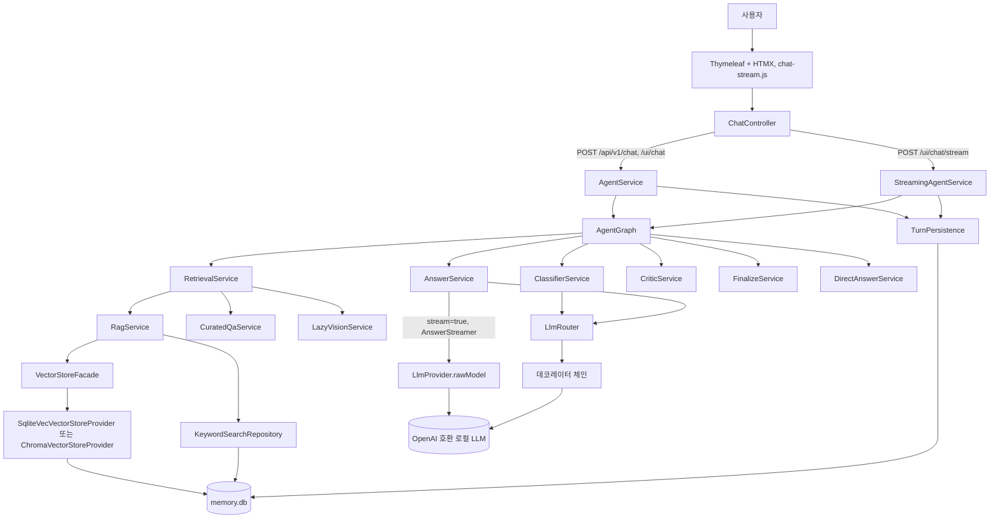
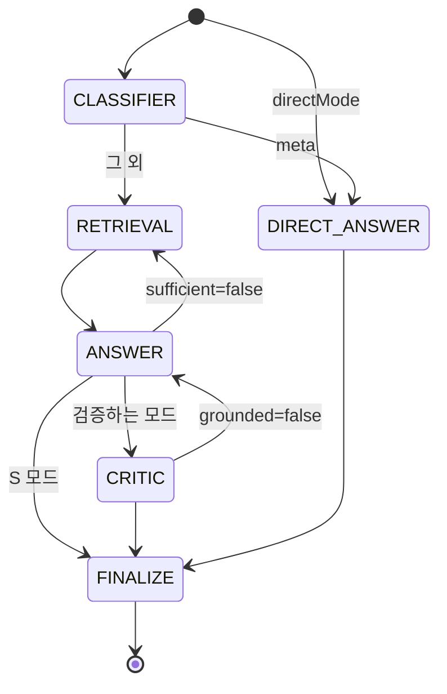
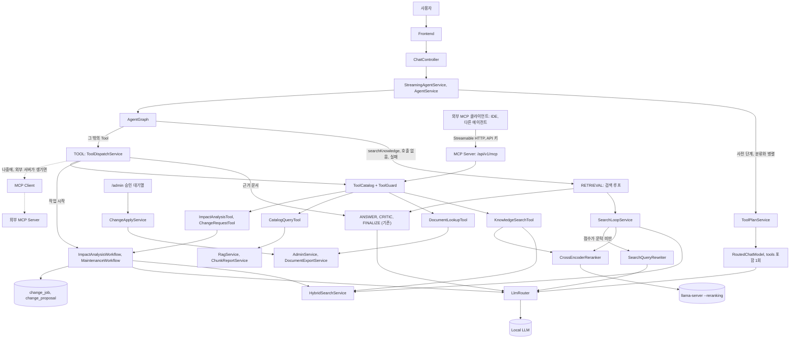
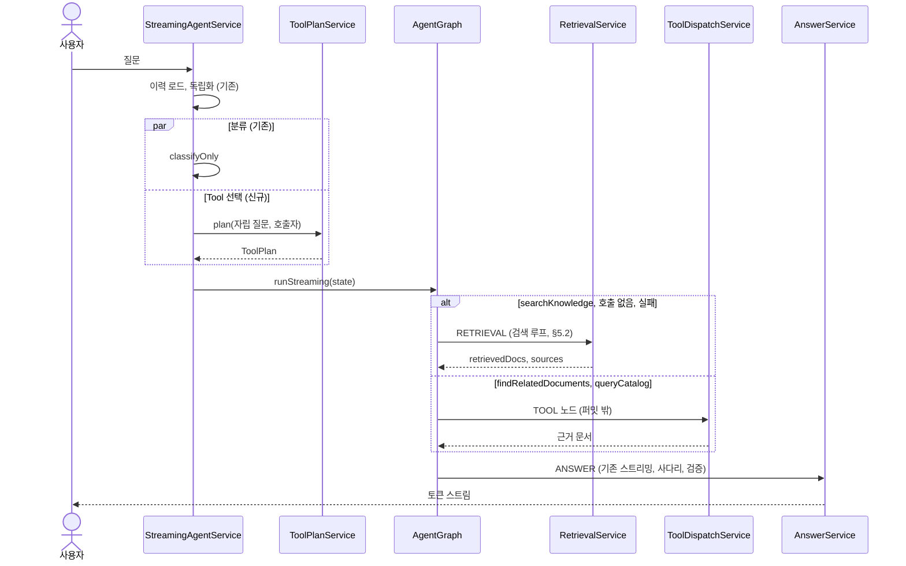
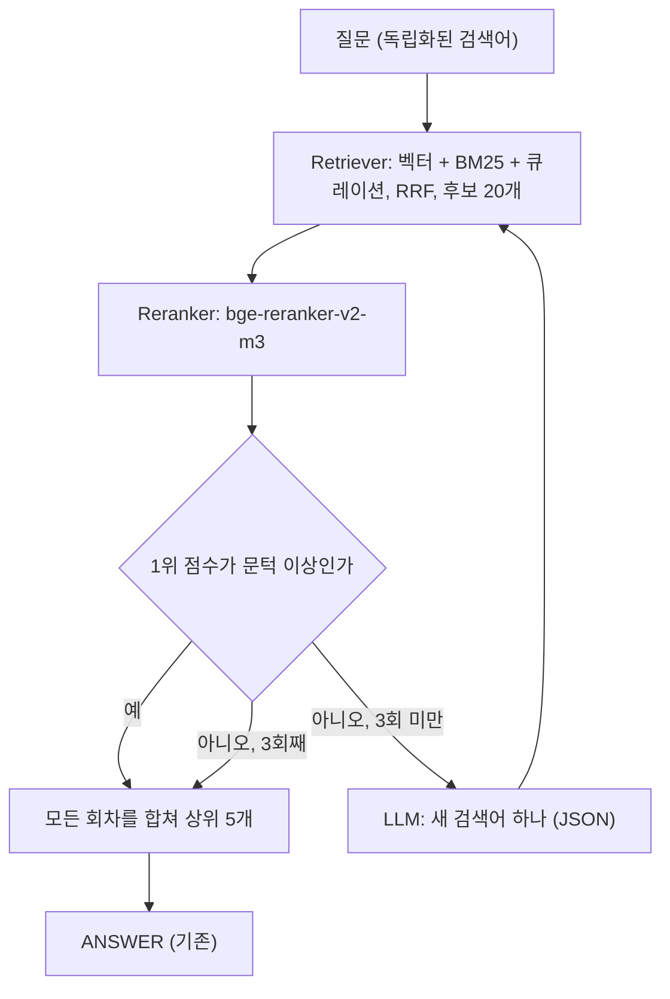
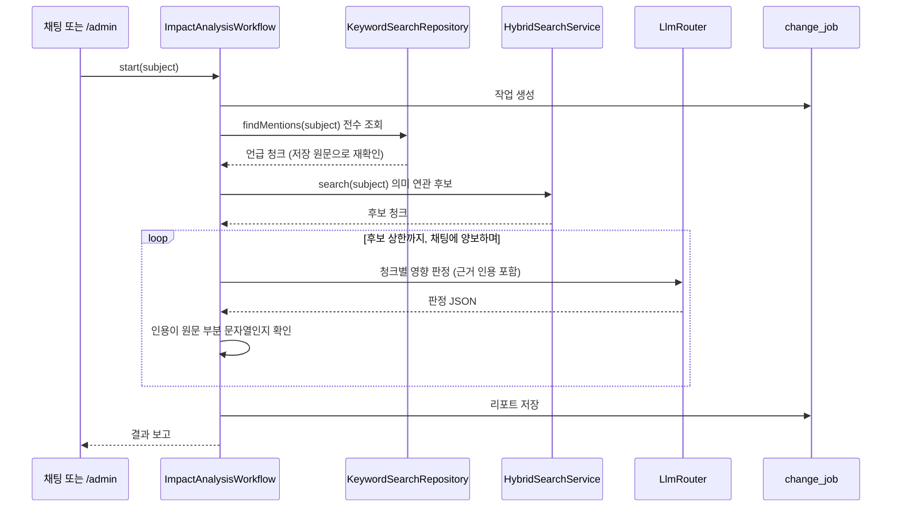
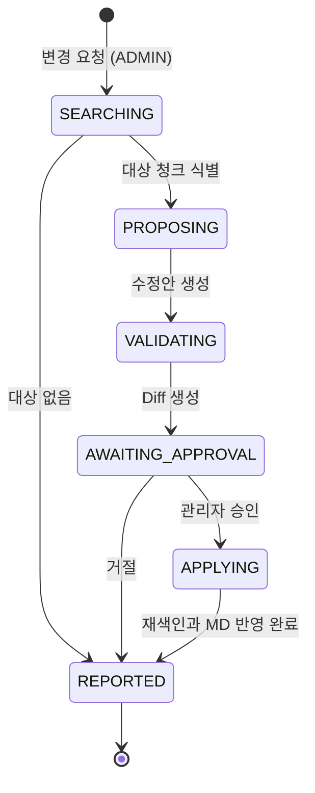
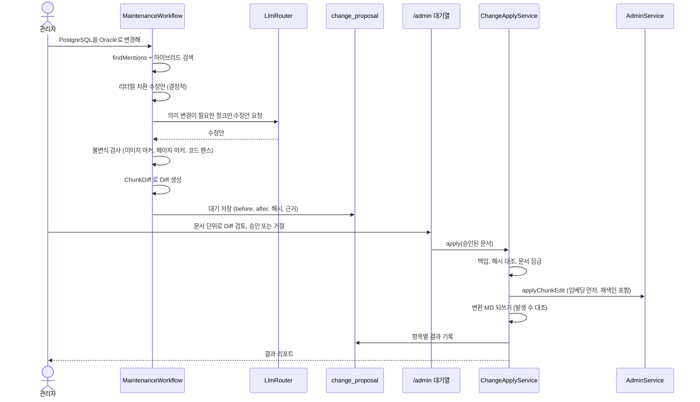
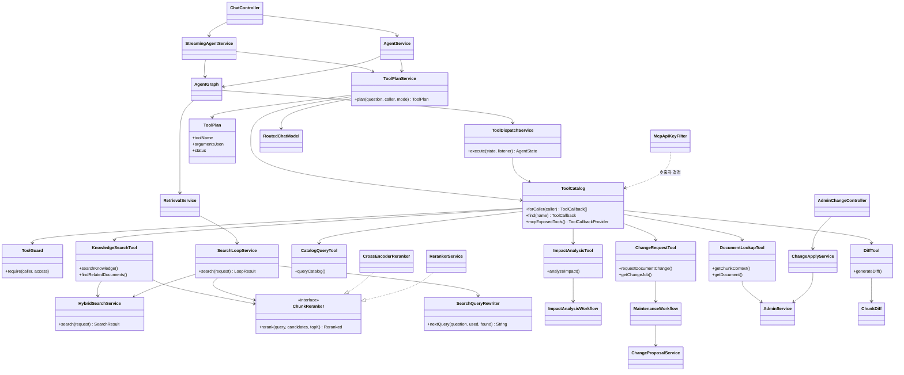

# MCP 기반 Agent 아키텍처 설계서 및 개발 로드맵

> 기준: `fix/opus` 브랜치 HEAD `0f19115`, Spring Boot 4.1.2, Spring AI 2.0.2, Java 21.
> `클래스:줄` 표기는 이 커밋의 `src/main/java/com/example/ragagent` 아래 파일을 가리킨다.
> 라이브러리 동작은 Spring AI 2.0.2 문서와 로컬 jar(`javap`, `jshell`)로 확인했다.
> 검색·리랭크·Tool 호출 수치는 2026-11-05에 로컬 모델과 DB 복사본으로 잰 일회성 실측이다(부록 A). 앱에 구현해 잰 값이 아니므로 구현 뒤 하네스로 다시 잰다.
> 결정과 진행 상태는 [PLAN.md §6.33](PLAN.md) 이 추적한다.

## Context

**왜 하는가.** 지금 앱은 `AgentGraph` 라는 이름을 쓰지만 LLM이 도구를 고르지는 않는다. 질문은 항상 같은 순서(분류, 검색, 답변, 검증)로 처리된다. 목표는 LLM이 문서 검색, DB 조회, 관련 문서 찾기가 필요한지 판단해 Tool을 호출하고, 그 위에서 영향도 분석과 문서 유지보수까지 지원하는 것이다.

**결론 여섯 가지.**

1. **검색을 Retriever + Reranker로 바꾼다.** 후보 20개를 찾아 교차 인코더로 재순위화하고 상위 5개만 LLM에 넣는다. 실측에서 LLM에 넣는 청크는 절반이 됐는데 recall은 올랐다(골든셋 0.96에서 1.00, 후속 질문 0.67에서 0.76).
2. **답을 못 찾으면 다른 검색어로 최대 3회까지 다시 찾는다.** 재검색 여부는 리랭커 점수로 코드가 정하고, 새 검색어는 LLM이 만든다. 후속 질문 recall이 0.90까지 오른다. 로컬 모델이 재검색을 스스로 결정하지 못해서(무관한 결과를 줘도 12건 중 0건) 역할을 이렇게 나눴다. (결정됨)
3. **LLM은 턴마다 Tool을 한 번 고르고, 답변은 기존 `ANSWER → CRITIC` 이 쓴다.** `searchKnowledge` 를 고르면 `RETRIEVAL` 의 검색 루프로 이어진다. 스트리밍, 프롬프트 축소 사다리, 검증은 바뀌지 않는다. 선택 정확도는 실측 49건 중 44건이었다.
4. **앱 내부 Tool은 같은 JVM에서 직접 호출하고, 같은 Tool을 MCP Server로 외부에 공개한다.** Retriever와 Reranker는 `searchKnowledge` Tool 안에 있어 양쪽이 같은 검색을 쓴다. MCP Client는 외부 MCP 서버가 생길 때만 붙인다. (테스트 결과 MCP Client의 우선 순위 낮아짐)
5. **영향도 분석과 유지보수는 자유 루프가 아니라 고정 워크플로다.** LLM은 단계 안의 판단만 한다. 쓰기는 관리자 승인 뒤 워크플로 코드만 수행한다. (미확정)
6. **Q&A 품질을 올리는 것은 Tool Calling이 아니라 리랭크와 재검색이다.** Tool 선택의 가치는 지금 못 하는 일(카탈로그 조회, 영향도 분석, 유지보수)로 가는 길을 여는 것이다. 그래서 순서도 검색 개선이 먼저다.

**이번에 정한 결정.**

| 항목 | 결정 |
|---|---|
| MCP 경로 | 내부 직접 호출 + MCP Server로 외부 공개 |
| DB 조회 | 앱 내부 DB만, 미리 정한 조회만. LLM이 쓴 SQL은 실행하지 않는다 |
| 코퍼스 반영 | 관리자 승인 후 반영 |
| 수정 범위 | 청크 + 변환 MD. 원본 DOCX/PDF는 고치지 않고 리포트에 명시 |
| 재검색 주도 | 코드가 리랭커 점수로 판단, LLM은 새 검색어만 생성. 최대 3회 |
| 적용 범위 | 새 응답 모드 없이 S/N/C 공통 검색 경로에 적용. `/settings` 로 끌 수 있고 C 모드는 그대로 둔다 |
| 리랭커 | 교차 인코더(`bge-reranker-v2-m3`)를 `llama-server --reranking` 으로 운영 |
| 리랭크 후보 수·최종 컷 | `search-top-k` 하나만 편집한다. 후보 수 = `search-top-k × 2`, 최종 컷 = `max(5, ⌈search-top-k ÷ 2⌉)` 로 파생하고 `/settings` 에서 조회 전용으로 보인다(§4.3, 2026-11-06) |

**선결 결함 (Phase 0에서 먼저 처리).** 블로킹 LLM 호출의 요청 본문에 `model` 이 설정값이 아니라 `gpt-5-mini` 로 나갔다. 2026-11-06 요청 본문으로 확인했고 `ModelPinningChatModel` 로 고쳤다. 자세한 내용은 §2.4.

**알려진 제약.** llama-server와 달리 LM Studio에서는 앱의 "생각 끔"이 듣지 않는다. 고치지 않기로 했다(운영 결정). 이 문서의 LLM 호출 지연은 생각을 끈 값이므로 LM Studio에서는 더 걸린다(§2.4).

---

## 1. 현재 구조 분석

### 1.1 전체 아키텍처

패키지 루트는 `com.example.ragagent`, Java 파일은 235개다. 큰 패키지는 `service`(68), `llm`(44), `ingestion`(18), `config`(16)이다. 프론트엔드는 Thymeleaf + HTMX이고 JS 프레임워크는 없다.



SQLite 파일은 하나(`memory.db`)이고 연결 풀은 1개다. 운영 테이블, `chunk_fts`, sqlite-vec 벡터가 전부 이 파일에 있다. 현재 `.env` 는 `VECTORSTORE_TYPE=sqlite-vec`, `LOCAL_LLM_MODEL=gemma-4-E2B` 다.

### 1.2 요청 처리 흐름

| 경로 | 핸들러 | 호출 대상 |
|---|---|---|
| `POST /ui/chat/stream` | `ChatController:183` | 가상 스레드에서 `StreamingAgentService.run()` |
| `POST /ui/chat` | `ChatController:243` | `AgentService.chat()` 후 HTMX 조각 반환 |
| `POST /api/v1/chat` | `ChatController:322` | `AgentService.chat()` 후 JSON 반환 |

`StreamingAgentService.run()` 의 순서는 다음과 같다.

1. 질문을 검증하고, 실패하면 SSE `error` 를 보낸다.
2. 15초 하트비트와 유휴 워치독을 시작한다.
3. 이력 로드, 후속 질문 독립화(`QuestionCondenser`), 분류(`classifyOnly`)를 병렬로 돌린다.
4. `agentGraph.runStreaming()` 을 호출한다. 이벤트는 `SseGraphListener` 가 SSE로 내보낸다.
5. `TurnPersistence.save()` 로 저장하고 `done` 을 보낸다.
6. 오류가 나면 부분 답변을 `[오류로 중단됨]` 과 함께 저장한다.

SSE 이벤트는 `stage`, `token`, `sources`, `images`, `verifying`, `retry`, `done`, `error` 다.

### 1.3 RAG 처리 흐름

`AgentGraph` 는 상태 기계이고 `AgentState`(불변 레코드, 컴포넌트 38개)를 노드 사이로 넘긴다.



- 재시도 상한은 `app.max-retry-count`(기본 2)다. `sufficient=false` 는 재검색, `grounded=false` 는 재검색 없이 답변만 다시 쓴다.
- 같은 게이트로 같은 문서 집합을 보고 다시 반려되면 상한이 남아도 멈춘다(`AgentState.repeatsLastRejection`).
- `CriticService` 는 LLM을 부르지 않는다. 검증 LLM 호출은 `AnswerService.evaluate()` 가 답변 직후 수행하고, CRITIC은 그 결과만 읽는다.
- 검색 결과가 0건이면 LLM을 부르지 않고 정형 문구로 답한다.

### 1.4 Vector Search 흐름

`RetrievalService.execute(AgentState[, GraphListener])` 가 유일한 공개 API이고 호출자는 `AgentGraph:121` 뿐이다.

1. 후보 수를 계산한다: `effectiveTopK = topK + 재시도 + 모드 부스트 + 이력 부스트`.
2. 세 축을 가상 스레드로 병렬 실행한다(`:203`).
   - 키워드 축: `RagService.keywordSearch()`, FTS5 BM25.
   - 큐레이션 축: `curatedAxis()`. 벡터는 유사도 0.5 미만 제거, 키워드는 내용어 2개 이상 일치 요구.
   - 벡터 축: `searchBatch()`. 길이 게이트를 넘으면 `MultiQueryExpander` 가 변형 2개를 만든다.
3. RRF로 합친다(`:257`). k=60, 키워드 가중치 0.5, 큐레이션 가중치 1.0.
4. 태그 필터, 제외 청크 제거, 리랭크(기본 꺼짐) 또는 컷을 적용한다.
5. `withStoredText()` 로 키워드 전용 히트를 저장 원문으로 되돌린다(`:285`).
6. `SourceRef` 와 이미지 참조를 만들고, `LazyVisionService` 가 캐시에 없는 이미지만 Vision으로 설명한다.

벡터 저장소는 `VectorStoreProvider` 인터페이스 뒤에 있고 `VectorStoreFacade` 가 위임한다. 구현체는 `SqliteVecVectorStoreProvider`, `ChromaVectorStoreProvider` 다.

### 1.5 Prompt 생성 흐름

프롬프트는 모두 `messages.properties`, `messages_ko.properties` 의 `prompt.*` 키에 있다. 시스템 프롬프트는 `ResponseMode`(S/N/C)가 고른다.

`AnswerService.buildAnswerPrompt()`(`:1383`)가 사용자 메시지를 다음 순서로 조립한다.

1. `[이전 대화]`
2. `[검색된 문서]`
3. `[경고]`
4. `[직전 시도 메모]`
5. `[질문]`: `PromptInjectionGuard.wrap(state.question())`, 언제나 원문

창을 넘으면 `fitToBudget()` 이 `PromptLadder` 의 순서대로 줄인다: 과거 질문 자르기, 직전 1턴만 남기기, 문서를 바닥(top-k의 50%)까지, 직전 답변을 요약으로, 이력 전부 빼기, 문서 1개까지. 서버가 컨텍스트 초과로 거절하면 `withShrinkRetry()` 가 다음 걸음으로 다시 보낸다.

### 1.6 Spring AI 사용 방식

| 구분 | 현재 사용 |
|---|---|
| 모델 구성 | 자동 구성 제외. `LlmConfig:162-190` 이 프로바이더마다 `OpenAiChatModel` 을 직접 만든다 |
| 데코레이터 체인 | `ThinkingControlChatModel`, `LoggingChatModel`, `CalibratingChatModel`, `MaxTokensCappingChatModel`, `OpenAiChatModel` 순서(`LlmConfig:201-212`) |
| 게이트·사용량 | 체인이 아니라 `LlmRouter.executeSingleTracked()` 에 있다 |
| 주 호출 패턴 | `router.executeGated*(..., model -> model.call(prompt))`. 앱 코드에 `ChatClient.prompt()...call()` 은 없다 |
| 채팅 스트리밍 | `AnswerStreamer` 가 체인을 우회해 `rawModel().stream()` 을 부른다 |
| 구조화 출력 | `BeanOutputConverter.getFormat()` 을 프롬프트에 붙이고 텍스트를 파싱한다. `responseFormat` 은 쓰지 않는다 |
| Advisor | 앱 코드에 없다 |
| Tool Calling, MCP | **0건.** API만 클래스패스에 있다. `pom.xml` 에 MCP 의존성이 없다 |
| RAG 모듈 | `spring-ai-rag` 의 `MultiQueryExpander` 만 쓴다 |

---

## 2. MCP 적용 포인트

### 2.1 Tool 후보 식별

| 컴포넌트 | 승격 | 이유 | 처리 |
|---|---|---|---|
| `RetrievalService` | 직접 불가 | 공개 API가 `AgentState` 뿐. 합성 state는 `threadId=null` 이면 Vision 미스 때 NPE, `version=null` 이면 BM25 0건 | 검색 본체를 `HybridSearchService` 로 분리 |
| `RagService` | 일부 가능 | `listDocuments`, `findDocument`, `listTags`, `listVersions` 는 바로 쓸 수 있다 | 조회만 승격. `indexDocument`, `deleteDocument` 제외 |
| `KeywordSearchRepository` | 간접 | `search()` 결과 본문이 저장 원문이 아니라 파생 텍스트이고 score도 없다 | 전수 조회 `findMentions` 신설 후 원문 치환 |
| `VectorStoreFacade` | 간접 | `findByIds` 는 유용하지만 version 정규화가 키워드 축과 다르다 | Tool이 직접 부르지 않고 서비스 경유 |
| `AdminService` | 일부 가능 | `getChunks`, `getChunk`, `countChunks` 는 조회. `updateChunk`, `reindexChunk` 는 쓰기 | 쓰기는 워크플로 내부에서만 |
| `DocumentExportService`, `ChunkReassembler` | 일부 수정 | 재조립 텍스트가 지역 변수라 밖으로 안 나온다 | `reassembledText()` 공개 메서드 추가 |
| `ChunkDiff` | 그대로 | Spring 의존이 없는 순수 클래스 | 그대로 호출. 축약 포매터만 신규 |
| `ChunkReportService` | 일부 가능 | 조회는 쓸 수 있으나 전 사용자 데이터 | ADMIN 전용 |
| `RetrievalMetricsService`, `QuestionReuseService` | ADMIN만 | 범위가 전 사용자라 다른 사용자의 질문·답변이 보인다 | 일반 Tool로 공개 금지 |
| `CuratedQaService`, `CuratedSubmissionService` | 금지 | 코퍼스로 들어가는 유일한 문이고, 진입 메서드가 호출 출처를 검사하지 않는다 | Tool로 노출하지 않는다 |

### 2.2 승격 전에 해결할 구조 문제

Tool은 컨트롤러를 거치지 않고 서비스를 직접 부르므로, 컨트롤러가 지키던 것이 사라진다.

| 문제 | 근거 | 대응 |
|---|---|---|
| 권한 검사가 URL 필터뿐이다 | `@PreAuthorize` 0건. `SecurityConfig:87, :138, :205-215` | Tool 계층에 `ToolGuard` 를 둔다 |
| SSE 워커에는 `SecurityContext` 가 없다 | `ChatController:209` 의 가상 스레드 | 호출자(`ToolCaller`)를 요청 스레드에서 만들어 명시로 넘긴다 |
| 사전 확인과 감사가 컨트롤러에만 있다 | 재인덱싱 409는 `AdminController:696-709`, 내보내기 감사는 `DocumentController:284` | 쓰기는 워크플로 서비스로 옮기고 Tool 호출을 `AuditLogger` 로 남긴다 |
| `version` 인자가 `curated` 예약 네임스페이스에 닿는다 | 업로드·`index()`·`VectorStoreFacade.add` 에 거부 코드가 없다 | LLM 입력에서 `version` 을 뺀다. 서버가 정한다 |
| DB 연결이 1개다 | `DataSourceConfig:20-22, :242` | 오래 걸리는 조회를 Tool로 내지 않는다. `tagsByDocIds` 는 호출 금지 |
| 청크 쓰기가 실패를 돌려주지 않는다 | `updateChunk` 반환이 `void`. Chroma는 실패를 삼키고, sqlite-vec는 0행 갱신도 성공이다. 재임베딩이 실패하면 본문만 새것으로 남는다(`AdminService:616-620, :637-664, :724-727, :895-905`) | 임베딩을 먼저 하고 결과를 돌려주는 `applyChunkEdit()` 신설(§5.5) |

### 2.3 재사용 가능한 컴포넌트

**그대로 재사용**

| 영역 | 클래스 |
|---|---|
| Embedding | `EmbeddingBeanConfig`, `LoadBalancingEmbeddingModel` |
| Vector 저장소 | `VectorStoreProvider`, `VectorStoreFacade`, 두 구현체 |
| Chunking·인덱싱 | `ChunkSplitter`, `DocumentIndexer`, `KeywordExtractor`, `SearchTextBuilder` |
| 답변 생성 | `AnswerService`, `AnswerStreamer`, `StreamFailover`, `PromptLadder`, `CriticService`, `FinalizeService` |
| Prompt | `ResponseMode`, `prompt.*` 번들, `PromptInjectionGuard.wrap()` |
| 예산 | `PromptBudget`, `ThinkingBudget`, `TokenEstimator`, `ProviderContextWindows` |
| Diff·승인 패턴 | `ChunkDiff`, `CuratedSubmissionRepository` 의 compare-and-set 상태 전이 |
| 백그라운드 양보 | `ClarifiedQuestionBackfill` 의 "대화형 게이트가 비어야 보낸다" 패턴 |
| 운영 | `AuditLogger`, `MdcPropagation`, `DatabaseBackupService` |

**일부 수정 후 재사용**

| 클래스 | 수정 |
|---|---|
| `RetrievalService` | 축 조립과 융합을 `HybridSearchService` 로 옮기고, 검색 루프를 부르는 어댑터로 축소 |
| `RerankerService` | LLM 리랭커로 남긴다. `ChunkReranker` 인터페이스를 구현하고, 교차 인코더가 없을 때만 쓴다 |
| `AgentGraph`, `AgentState` | `TOOL` 노드 추가, 상태 컴포넌트 추가(`AgentState.of()` 동시 수정) |
| `AgentService`, `StreamingAgentService` | 사전 단계에 Tool 계획 future 추가 |
| `RoutedChatModel` | 대화의 라우팅 모드를 받는 생성자 추가 |
| `LlmRouter` | 실패해도 차단하지 않는 호출 경로, Tool 미지원 기억 |
| `GraphListener`, `SseGraphListener`, `chat-stream.js` | `onToolCall` 이벤트와 SSE `tool` |
| `ThinkingSite` | `SEARCH_REWRITE`, `AGENT_PLAN` 등 사이트 추가 |
| `PromptLadder` | 문서 바닥(top-k의 50%)이 실제 컷을 기준으로 잡히게 입력 수정 |
| `SourceRef` | 리랭크 점수 추가(nullable) |
| `ResponseMode` | `allowsAgent()` 성질 추가 |
| `LlmCurlLogger`, `CalibratingChatModel`, `ThinkingObservations` | Tool 메시지 인식(§2.4) |
| `SecurityConfig`, `NoAuthAutoLoginFilter`, `RateLimitFilter` | MCP 전용 체인, 통과 경로, 전용 버킷 |
| `KeywordSearchRepository` | `findMentions()` 추가 |
| `AdminService` | `applyChunkEdit()` 추가 |
| `DocumentExportService` | `reassembledText()` 공개 |
| `AppProperties`, `SettingsKeys` | `app.agent.*`, `agentSafe()` |

**신규 개발**

| 영역 | 클래스 |
|---|---|
| Tool 계층 | `ToolCatalog`, `ToolCaller`, `ToolGuard`, 각 `*Tool` |
| Agent | `ToolPlanService`, `ToolDispatchService`, `ToolPlan` |
| 검색 | `HybridSearchService`, `SearchLoopService`, `ChunkReranker`, `CrossEncoderReranker`, `SearchQueryRewriter` |
| MCP Server | `McpServerConfig`, `McpApiKeyFilter` |
| 워크플로 | `ImpactAnalysisWorkflow`, `MaintenanceWorkflow`, `ChangeProposalService`, `ChangeApplyService`, `MarkdownWriteBack` |
| 저장 | Flyway `V12` 이후, `ChangeJobRepository`, `ChangeProposalRepository`, `AgentToolCallRepository` |
| 화면 | `/admin` 변경 승인 대기열, 리포트 화면 |
| 측정 | `ToolCallingEvaluationTest`, `agent-eval/tool-gold.json` |

### 2.4 Spring AI 2.0.2에서 실제로 확인한 제약

| 사실 | 근거 | 설계 영향 |
|---|---|---|
| `internalToolExecutionEnabled` 는 제거됐고 `OpenAiChatModel` 은 Tool을 실행하지 않는다. 실행 루프는 `ToolCallingAdvisor` 또는 수동 루프다 | 2.0.2 upgrade-notes, `javap` | 앱의 `model.call()` 은 `tool_calls` 를 돌려주기만 한다. Tool 계획 호출에 이 성질을 그대로 쓴다 |
| `LlmResult` 는 텍스트만 남긴다 | `LlmRouter:354, :1129` | `RoutedChatModel` 처럼 클로저로 `ChatResponse` 를 붙잡는다 |
| 퍼밋은 `call.apply()` 동안 유지되고, 장애 전환은 클로저를 다시 돌린다 | `LlmRouter:1099-1102, :758, :819` | 게이트 안에서 Tool을 실행하면 중첩 획득과 Tool 재실행이 생긴다. Tool은 퍼밋 밖에서만 돈다 |
| 체인의 옵션 복사는 `mutate()` 라 tool 필드를 보존한다 | `ThinkingControl:104`, `MaxTokensCappingChatModel:92` | 체인은 고칠 필요가 없다. `ThinkingControl.fromGeneric` 만 유실하므로 `OpenAiChatOptions` 를 직접 쓴다 |
| `RoutedChatModel` 은 `fixedRoutingMode()` 만 쓴다 | `RoutedChatModel:46`, `ThinkingSite:193-198` | 대화 라우팅 사이트면 예외가 나고, 고정 모드면 LOCAL_ONLY 대화가 원격으로 나갈 수 있다. 턴의 모드를 받게 고친다 |
| `RoutedChatModel.getOptions()` 는 일반 옵션이다 | `RoutedChatModel:60-63` | `ChatClient` 와 조합하면 tool 콜백이 조용히 빠진다. `ChatModel` 로 직접 쓴다 |
| `AnswerStreamer` 는 `tool_calls` 를 읽지 않는다 | `AnswerStreamer:190-212` | 이 경로에 tools를 실으면 빈 답변이 된다. 싣지 않는다 |
| 서버가 `tools` 를 거부하면 라우터가 프로바이더를 차단한다 | `LlmRouter:752-755, :801-814` | 강등한 답변까지 소진으로 실패한다. 비차단 경로가 필요하다 |
| 계측 3곳이 Tool 메시지를 모른다 | `CalibratingChatModel:160-166`, `LlmCurlLogger:56-60`, `ThinkingObservations:224-233` | 토큰 보정 왜곡, 재현 로그 불일치, 텍스트 없는 응답을 "생각함"으로 오판 |
| MCP 서버는 서블릿 환경에서 `immediateExecution(true)` 로 돈다 | `McpServerStatelessAutoConfiguration` 바이트코드 | Tool이 요청 스레드에서 돌아 `SecurityContext` 를 읽을 수 있다 |
| `ToolCallbackProvider` 빈은 전부 MCP로 나간다 | `ToolCallbackUtils`, `StatelessToolCallbackConverterAutoConfiguration` | 공개 범위는 빈 하나(`mcpExposedTools`)로 통제한다 |
| `spring.ai.mcp.server.enabled` 기본값은 켜짐이다 | 설정 메타데이터 | 스타터를 넣으면 명시적으로 꺼 둔다 |
| `mcpServerJsonMapper` 는 `defaultCandidate=false` 라 앱의 `JsonMapper` 를 밀어내지 않는다 | `McpServerJsonMapperAutoConfiguration`, `OnBeanCondition.isDefaultCandidate` | 코드상 안전. `spring.jackson.*` 가 살아 있는지 Phase 2 테스트로 고정한다 |
| Stateless 서버는 `McpSyncRequestContext` 메서드를 건너뛴다 | 2.0.2 문서 | 진행률 알림을 쓰지 않고 작업 조회 Tool로 대신한다 |
| LM Studio는 형식이 틀린 tool 호출을 `content` 로 돌려준다. `tool_choice=required` 는 llama.cpp 엔진에서만 된다 | LM Studio 문서 | `[TOOL_REQUEST]`, `<tool_call>` 이 본문에 보이면 실패로 처리한다. `required` 에 의존하지 않는다. 실측에서는 지연도 16.8초로 컸다 |
| LM Studio는 `chat_template_kwargs.enable_thinking` 을 무시하고 `reasoning_effort: none` 은 받는다 | 실측(부록 A.2) | 고치지 않고 알려진 제약으로 둔다. `application.properties` 주석에 남겼다 |
| LM Studio에는 `/v1/rerank` 가 없다 | 실측 | 리랭커는 별도 `llama-server --reranking` 으로 돌린다 |
| llama.cpp는 `--jinja` 가 있어야 Tool Calling이 되고, 병렬 호출은 기본 꺼짐이다 | llama.cpp 문서 | 운영 매뉴얼과 Phase 3 사전 평가의 사전 조건에 넣는다 |

**선결 결함: 블로킹 호출의 `model` 누락.**

- `OpenAiChatOptions.builder().temperature(..).maxTokens(..).build().getModel()` 은 `gpt-5-mini` 를 돌려준다(`jshell` 로 실행 확인).
- `OpenAiChatModel.buildRequestPrompt` 는 프롬프트 옵션이 null일 때만 기본 옵션을 쓰고 병합하지 않는다(바이트코드 확인).
- 앱에서 채팅 옵션에 `.model()` 을 싣는 자리는 `LlmConfig:175, :187`, `AnswerStreamer:102` 뿐이다. `ClassifierService:97` 같은 블로킹 호출부는 싣지 않는다.
- 따라서 분류, 검증, 독립화 등 블로킹 호출은 `gpt-5-mini` 로 나간다. **2026-11-06 요청 본문으로 확인했다**(`ThinkingControlWireTest.blockingCallsSendTheConfiguredModel`, 고치기 전 세 호출 모두 `gpt-5-mini`).
- llama-server처럼 모델 이름을 무시하는 서버에서는 증상이 안 보일 수 있다. 원격 프로바이더는 다른 모델 호출이나 404에 이어 차단으로 갈 수 있다.
- `ThinkingControlWireTest` 가 `model` 을 단언하지 않아 잡히지 않았다. Spring AI 2.0 업그레이드 커밋(`a8e1f78`) 이후의 회귀일 가능성이 있다(1.x 동작은 확인하지 않았다).
- **수정(2026-11-06).** 체인 가장 안쪽에 `ModelPinningChatModel` 을 두어 프로바이더의 모델을 모든 호출에 싣는다. 같은 와이어 테스트가 이제 설정값을 단언한다.

**알려진 제약: LM Studio의 생각 끄기.**

- `ThinkingDialect.AUTO` 는 LOCAL 프로바이더를 `TEMPLATE_KWARGS` 로 풀어 `chat_template_kwargs.enable_thinking=false` 를 보낸다(`ThinkingDialect:33`).
- LM Studio는 이 필드를 오류 없이 무시한다. 같은 요청의 지연과 출력 토큰이 필드를 넣어도 그대로였고(23.8초, 301토큰), `reasoning_effort: none` 만 2.6초, 31토큰, 생각 0으로 줄었다.
- 따라서 사이트 21곳을 전부 `off` 로 출하했어도 **LM Studio에 연결된 배포에서는 분류, 독립화, 검증 같은 호출이 지금도 생각을 하고 있다.** `THINKING_EVALUATION.md` 의 수치는 llama-server 직결 측정이라 이 문제가 드러나지 않았다.
- 고치지 않기로 했다(2026-11-05 운영 결정). `application.properties` 의 `thinking-dialect` 설명에 주석으로 남겼다.
- 이 문서의 새 검색어(1.5초)와 Tool 선택(2.6초) 지연은 생각을 끈 값이다. 앱 설정 그대로 LM Studio에 붙이면 이 호출들도 생각을 하며, Tool 선택은 그때 약 13초였다.
- 다시 필요해지면 LM Studio 프로바이더에 `thinking-dialect=openai-effort` 를 준다. 기본값을 바꾸면 llama-server 쪽이 깨질 수 있어 배포별로 건다.

---

## 3. Tool 설계

### 3.1 원칙

- **Q&A에서 LLM에게 보이는 Tool은 4개(관리자 5개)다.** Tool 스키마는 입력 토큰을 쓰고, 소형 모델은 선택지가 많을수록 틀릴 가능성이 커진다. 실제 수치는 Phase 3 직전의 사전 평가에서 잰다.
- **인자는 짧은 평문만 받는다.** `version`, `userId` 는 인자에 없다. 서버가 정한다.
- **결과는 짧게 돌려준다.** 행 수와 발췌 길이에 상한을 둔다(발췌 300자, 50행).
- **호출자에 따라 목록을 거른다.** `ToolCatalog.forCaller(caller)` 가 권한 없는 Tool은 스키마조차 주지 않는다. 모든 Tool 메서드는 첫 줄에서 `ToolGuard` 를 지난다.
- **쓰기는 Tool이 아니다.** 적용과 재색인은 승인 뒤 워크플로만 호출한다.

정의는 `@Tool` 메서드로 한 번만 쓴다. 내부 호출은 `ToolCallbacks.from()`, 외부 공개는 `ToolCallbackProvider` 빈 하나를 거친다. `@Tool` 에는 `readOnlyHint` 같은 MCP 힌트가 없지만, 공개 Tool이 읽기와 제안뿐이라 처음에는 넘어간다.

### 3.2 Tool 목록

| Tool | 요청서 대응 | Agent 노출 | MCP 노출 | 접근 |
|---|---|---|---|---|
| `searchKnowledge` | `searchKnowledge()` | O (`RETRIEVAL` 로 연결) | O | 읽기 |
| `findRelatedDocuments` | `findRelatedDocuments()` | O | O | 읽기 |
| `queryCatalog` | `searchDatabase()` | O | O | 조회마다 다름 |
| `analyzeImpact` | 영향도 분석 | O | O | 읽기 |
| `requestDocumentChange` | `updateDocument()` 대체 | ADMIN만 | ADMIN만 | 제안 |
| `getChunkContext` | 추가 | X | O | 읽기 |
| `getDocument` | `getDocument()` | X | ADMIN만 | ADMIN 읽기 |
| `getChangeJob` | 추가 | X | O | 읽기 |
| `generateDiff` | `generateDiff()` | X | O | 읽기 |

Tool이 아닌 내부 기능: `ChangeApplyService.apply()`(`updateDocument` 의 실제 쓰기)와 재색인(`reindexKnowledge` 에 해당). 둘 다 관리자 승인 뒤 워크플로만 호출한다.

### 3.3 Tool 상세

**searchKnowledge**

| 항목 | 내용 |
|---|---|
| 목적 | 문서와 큐레이션 Q&A를 찾는다. Retriever(하이브리드 검색)와 Reranker(교차 인코더)가 이 Tool 안에 있다 |
| 입력 | `query`(필수), `keywords`(선택), `tags`(선택), `topK`(선택, 리랭크 컷 이하) |
| 출력 | `hits[{chunkId, file, page, snippet, score}]`, `totalHits`, `lowConfidence` |
| 구현 | 신규 `KnowledgeSearchTool` 이 `HybridSearchService.search()` 와 `ChunkReranker.rerank()` 를 잇는다. 채팅은 `RETRIEVAL` 노드의 검색 루프(§5.2)로 같은 두 서비스를 쓰고, MCP 호출은 재검색 없이 1회 검색한다. 외부 LLM은 `score`, `lowConfidence` 를 보고 스스로 다시 부를 수 있다 |
| 재사용 | 높음. 리랭커가 켜지면 질의 확장은 끈다. 측정상 골든셋 26건 중 0~1건만 바뀌고 검색마다 LLM 1회와 약 1.1초를 쓴다 |

**findRelatedDocuments**

| 항목 | 내용 |
|---|---|
| 목적 | 주제나 식별자와 관련된 문서를 문서 단위로 찾는다 |
| 입력 | `subject`(필수), `limit`(기본 10) |
| 출력 | `documents[{docId, file, tags, hitCount, topSnippet}]` |
| 구현 | `HybridSearchService` 결과를 docId로 묶고 `RagService.findDisplayNames()` 로 표시 이름을 붙인다 |
| 재사용 | 중간 |

**queryCatalog** (`searchDatabase` 대체)

| 항목 | 내용 |
|---|---|
| 목적 | 앱 내부 메타데이터를 미리 정한 이름으로 조회한다 |
| 입력 | `name`(enum), `params`(선택) |
| 출력 | `rows[]`(50행 이하), `truncated` |
| 구현 | 신규 `CatalogQueryService`. `documents.list`, `documents.recent`, `tags.list` 는 `RagService`, `reports.open` 은 `ChunkReportService`(ADMIN), `usage.summary` 는 `LlmUsageRepository`(ADMIN) |
| 재사용 | 높음. 자유 SQL 없음. `users`, `app_secret`, `persistent_logins`, `settings_override`, `llm_provider_override` 는 대상이 아니다 |

**analyzeImpact**

| 항목 | 내용 |
|---|---|
| 목적 | 변경이나 삭제 대상의 영향 범위를 분석한다 |
| 입력 | `subject`(필수), `changeNote`(선택) |
| 출력 | `{jobId, status}` |
| 구현 | `ImpactAnalysisWorkflow.start()` (§5.4) |
| 재사용 | 중간. `findMentions` 와 판정 단계는 신규 |

**requestDocumentChange** (`updateDocument` 대체)

| 항목 | 내용 |
|---|---|
| 목적 | 문서 변경 요청을 받아 수정안을 만들기 시작한다. **코퍼스에는 아무것도 쓰지 않는다** |
| 입력 | `instruction`(필수), `from`, `to`(리터럴 치환일 때) |
| 출력 | `{jobId, status}` |
| 구현 | `MaintenanceWorkflow.start()` (§5.5) |
| 재사용 | `curated_submission` 의 대기열 패턴 |

**getChunkContext**

| 항목 | 내용 |
|---|---|
| 목적 | 검색된 청크의 앞뒤 문맥을 읽는다 |
| 입력 | `chunkId`(필수), `before`(2 이하), `after`(2 이하) |
| 출력 | `chunks[{chunkId, index, text}]` |
| 구현 | `AdminService.getChunk()` 로 위치를 읽고 `getChunks(collection, docId, offset, limit)` 로 이웃을 읽는다 |
| 재사용 | 높음 |

**getDocument**

| 항목 | 내용 |
|---|---|
| 목적 | 문서 전문을 구간 단위로 읽는다 |
| 입력 | `docId`(필수), `offset`, `maxChars`(기본 4,000) |
| 출력 | `{docId, file, totalChars, text, nextOffset}` |
| 구현 | `DocumentExportService.reassembledText()` 추가. `getAllChunks`, `ChunkReassembler.reassemble`, `postProcess` 를 잇고 overlap은 `DocRegistry.findByDocId(docId).chunkOverlap()` 에서 읽는다 |
| 재사용 | 높음. ADMIN 전용인 이유는 `/ui/documents/*/export` 가 ROLE_ADMIN이기 때문이다(`SecurityConfig:212`) |

**getChangeJob, generateDiff**

| Tool | 입력 | 출력 | 구현 |
|---|---|---|---|
| `getChangeJob` | `jobId` | 상태, 수정안 수, 요약 | `ChangeJobRepository`. 요청자와 ADMIN만 |
| `generateDiff` | `before`, `after` | 변경 구간 요약 | `ChunkDiff.compare()` + 신규 `UnifiedDiffFormatter`. `lines` 에 같은 줄이 전부 들어 있고 `tooLarge` 일 수 있어 축약이 필요하다 |

---

## 4. Target Architecture



요청서의 목표 구조와 다른 점은 셋이다. **내부 Tool은 MCP Client를 거치지 않고, 재검색 여부는 LLM이 아니라 코드가 정하며, 답변은 Tool 루프가 아니라 기존 노드가 쓴다.**

### 4.1 설계 결정

| # | 결정 | 이유 | 버린 대안 |
|---|---|---|---|
| D1 | Tool 선택은 턴당 1회, `searchKnowledge` 는 `RETRIEVAL` 로 연결 | `sources`, `imageRefs`, LazyVision, 재시도 입력이 그대로다. 답변 프롬프트의 조립 경로가 하나로 남는다 | 근거 수집 루프를 첫 노드로. 결과 병합, 재시도, 검증 상한을 전부 다시 맞춰야 한다 |
| D1a | 재검색 여부는 리랭커 점수로 코드가 정하고, 새 검색어만 LLM이 만든다 | 로컬 모델은 재검색을 스스로 결정하지 않았고(0/12), 충분 여부 판단도 치우쳤다(답이 있어도 10/12 부족). 새 검색어 생성은 1.5초에 안정적이었다 | LLM 자율 루프. 재개 신호는 §7 |
| D1b | 새 응답 모드 없이 공통 검색 경로에 적용 | 추가 비용이 작고 재검색은 필요한 턴에서만 돈다. C는 근거 엄격도 축의 모드라 바꾸면 응용 기능이 사라진다 | 심층 모드 추가, C 모드 변경 |
| D1c | 교차 인코더를 별도 서버로 | 점수를 주므로 재검색 판단이 가능하다. 후보 20개에 약 3초로 LLM 리랭커(15.7초)보다 빠르다. llama-server와 GGUF가 이미 있어 과거 제외 사유(ONNX 도입, `PLAN §10.5`)가 사라졌다 | 기존 LLM 리랭커. 순서만 돌려줘 점수가 없다 |
| D2 | Tool 선택을 분류와 병렬로 사전 단계에서 호출 | `condensedF.thenApplyAsync` 에 하나를 더하면 된다(`AgentService:133`). 임계 경로 지연이 거의 늘지 않는다 | 그래프 노드에서 순차 호출 |
| D3 | 호출이 없거나 실패하면 `RETRIEVAL` | Agent가 검색을 없앨 수 없게 한다. "Tool 없음"을 잡담으로 읽으면 소형 모델의 실수가 근거 없는 답변이 된다 | 호출 없음을 `DIRECT_ANSWER` 로 |
| D4 | 분류기와 독립화 유지 | meta 판단과 자립 질문을 그대로 쓴다. Tool 계획 입력에 이력이 필요 없어 예산 문제가 사라진다 | 첫 LLM 호출로 분류 대체. 측정 뒤 재검토 |
| D5 | `ChatClient` + `ToolCallingAdvisor` 를 쓰지 않는다 | 게이트 클로저에 넣으면 퍼밋을 쥔 채 Tool이 돌고, 장애 전환이 Tool을 재실행한다 | 라이브러리 기본 루프 |
| D6 | 내부 직접 호출 + 같은 프로세스의 MCP Server | HTTP 왕복과 신원 재전달이 없다. SQLite pool=1, 메모리 브레이커와 게이트를 공유한다 | 별도 프로세스는 같은 DB 파일을 쓸 수 없다 |
| D7 | MCP Server는 `STATELESS` | 세션 관리가 없다. 양방향 기능은 쓰지 않는다 | `STREAMABLE`. 진행률이 꼭 필요해지면 재검토 |
| D8 | 영향도·유지보수는 고정 워크플로 | 소형 모델에게 긴 계획을 맡기지 않는다. 재개, 감사, 재현이 쉽다 | LLM 주도 다단계 계획 |
| D9 | 기본 꺼짐(`app.agent.enabled=false`, MCP Server도 꺼짐) | 기존 경로가 언제나 폴백이다 | 일괄 전환 |

### 4.2 MCP Server 구성

```properties
spring.ai.mcp.server.enabled=${MCP_SERVER_ENABLED:false}
spring.ai.mcp.server.protocol=STATELESS
spring.ai.mcp.server.type=SYNC
spring.ai.mcp.server.name=rag-agent
spring.ai.mcp.server.streamable-http.mcp-endpoint=/api/v1/mcp
```

- 의존성은 `spring-ai-starter-mcp-server-webmvc` 하나다. BOM이 2.0.2로 고정하고 Jackson 3용 `mcp-json-jackson3` 을 쓴다.
- 앱에 토큰 인증이 없으므로 `McpApiKeyFilter` 를 새로 만든다. 읽기 키와 ADMIN 키를 분리한다. 폐쇄망에서 인가 서버를 전제할 수 없어 OAuth2는 쓰지 않는다.
- 이 경로에는 **기존 세 체인보다 앞선 전용 `SecurityFilterChain`** 을 둔다(`@Order`, STATELESS, CSRF 끔, API 키 필수). 전용 체인이 없으면 세션 체인의 CSRF나 평문 no-auth의 `permitAll` 을 그대로 받는다.
- `NoAuthAutoLoginFilter` 는 `@Component` 라 서블릿 필터로도 돌아 principal을 덮어쓸 수 있고, 관리자가 없으면 `/setup` 으로 리다이렉트한다. `isPassThrough` 에 이 경로를 더한다.
- `RateLimitFilter` 에 전용 `mcp` 버킷을 둔다. 그대로 두면 `default` 버킷이라 `chat` 한도를 우회한다.

### 4.3 Reranker 구성

임베딩 서버와 같은 방식으로 llama-server를 하나 더 띄운다. 측정에 쓴 명령은 다음과 같다.

```bash
llama-server -m bge-reranker-v2-m3-Q8_0.gguf -c 8192 -ngl 0 --host 127.0.0.1 --port 8092 --reranking -b 2048 -ub 2048 --no-webui
```

```properties
app.reranker.base-url=${RERANK_BASE_URL:}
app.reranker.model=${RERANK_MODEL:bge-reranker-v2-m3}
app.reranker.timeout-seconds=${RERANK_TIMEOUT_SECONDS:15}
app.search-rerank-min-score=${SEARCH_RERANK_MIN_SCORE:0.0}
app.search-max-attempts=${SEARCH_MAX_ATTEMPTS:3}
```

- `base-url` 이 비면 리랭커가 꺼지고 앱은 지금과 똑같이 동작한다.
- `search-top-k`(기본 10)의 뜻은 바꾸지 않는다. 리랭커가 없거나 죽었을 때의 최종 컷으로 남겨, 장애 시 동작이 정확히 현재와 같아진다. 리랭커가 동작할 때의 후보 수와 최종 컷은 이 값에서 파생한다(아래).
- `search-rerank-min-score`, `search-max-attempts` 는 핫 편집 대상이다(`SettingsKeys`, `SEARCH_HOT_SPECS`, `searchXxxSafe()` 셋 다).
- `relevance_score` 는 모델의 원점수라 문턱 0.0은 이 모델 값이다. 모델을 바꾸면 다시 잰다.
- 폐쇄망 배포에는 GGUF 파일(`Q8_0`)을 함께 옮긴다.

#### 후보 수와 최종 컷은 `search-top-k` 에서 파생한다 (결정 2026-11-06)

설정으로 고치는 값은 `search-top-k` 하나다. 리랭커가 동작할 때의 후보 수와 최종 컷은 별도 프로퍼티가 아니라 이 값에서 계산한다.

| 값 | 식 | 기본(`search-top-k`=10) |
|---|---|---|
| 리랭크 후보 수 (`effectiveRerankCandidates()`) | `search-top-k × 2` | 20 |
| 리랭크 최종 컷 (`effectiveRerankTopK()`) | `max(5, ⌈search-top-k ÷ 2⌉)`, 후보 수를 넘지 않는다 | 5 |
| 리랭커 없음·장애 | `search-top-k` 그대로 | 10 |

| `search-top-k` | 1 | 2 | 4 | 10 | 11 | 20 | 50 (설정 상한) |
|---|---|---|---|---|---|---|---|
| 후보 수 | 2 | 4 | 8 | 20 | 22 | 40 | 100 |
| 최종 컷 | 2 | 4 | 5 | 5 | 6 | 10 | 25 |

- 두 값은 `AppProperties` 의 파생 메서드다. 프로퍼티, 환경변수, `SettingsKeys`·`SEARCH_HOT_SPECS` 항목이 없다. `search-top-k` 를 핫 편집하면 다음 검색부터 함께 바뀐다(매 호출 다시 계산하고 필드에 캐시하지 않는다). 하나만 열어 두므로 후보 수가 최종 컷보다 작은 조합 같은 어긋난 설정이 만들어질 수 없다.
- `/settings` 검색 튜닝 카드의 `search-top-k` 바로 아래에 **조회 전용 항목 둘**(후보 수, 최종 컷)을 둔다. `SettingsService.searchHotItems()` 가 `readOnly(...)` 로 만들고, 값은 위 두 메서드가 돌려주는 것이라 다음 검색이 쓰는 값과 같다(`effectiveValue()` 와 같은 원칙). 키가 없는 `editable=false` 항목은 `settings-item.html` 이 입력칸 없이 값만 그리므로 템플릿 변경은 필요 없고, 편집 카드 안에 놓았을 때 모양은 구현 때 화면으로 확인한다.
- 라벨 `settings.item.rerank-candidates`, `settings.item.rerank-top-k` 와 풍선 설명 `settings.desc.*` 를 한/영 번들에 둔다. 설명에 식(`search-top-k × 2`, `max(5, search-top-k ÷ 2)`)을 보인다. 리랭커가 꺼져 있으면(`app.reranker.base-url` 이 비었거나 연결 실패) 항목 옆 배지로 "리랭커 꺼짐 — 적용되지 않음" 을 알린다. 값은 항상 보인다.
- 기본값 10에서 20 / 5는 부록 A의 실측 구성과 같다. 다른 `search-top-k` 에서의 recall은 측정하지 않았다.
- **위험.** 후보 수가 `search-top-k` 를 따라 커진다. 20개에 약 3초(CPU)를 선형으로 가정하면 상한(50)에서는 후보 100개에 약 15초다(미측정). 상한을 두지 않았다. 필요하면 측정한 뒤 후보 수 상한을 더한다.

---

## 5. Agent Workflow

### 5.1 Q&A Agent



Tool 계획 호출의 뼈대는 다음과 같다. Spring AI 2.0에서 `model.call()` 은 Tool을 실행하지 않으므로 `tool_calls` 만 읽고 끝난다.

```java
ChatModel model = new ThinkingSiteChatModel(
        new RoutedChatModel(router, ThinkingSite.AGENT_PLAN, state.routingMode()),
        ThinkingSite.AGENT_PLAN);
OpenAiChatOptions options = ThinkingControl.mark(OpenAiChatOptions.builder()
        .toolCallbacks(catalog.forCaller(caller))
        .parallelToolCalls(false)
        .maxTokens(baseReservation), ThinkingSite.AGENT_PLAN).build();

ChatResponse response = model.call(new Prompt(messages, options));
return ToolPlan.from(response, catalog);   // 첫 호출만 읽는다. 형식 실패와 잘린 응답은 NONE
```

**규칙.**

| 항목 | 내용 |
|---|---|
| 입력 | 시스템 프롬프트 `prompt.agent.plan` + `effectiveSearchQuestion()`. 이력을 넣지 않아 §6.31 이력 제외와 충돌하지 않는다 |
| 실행 | 첫 `tool_call` 하나만 쓴다. Tool은 그래프 노드에서 퍼밋 밖으로 실행한다 |
| 우선순위 | 분류가 `meta` 면 Tool 계획을 무시하고 `afterClassify()` 를 그대로 지난다 |
| 대상 턴 | `ResponseMode.allowsAgent()`, 시작은 N 모드만. `directMode` 는 제외 |
| 라우팅 | 대화의 라우팅 모드를 따른다. LOCAL_ONLY 대화가 원격으로 나가지 않는다 |
| 생각 수준 | `AGENT_PLAN` 출하값 off |
| 근거 문서 | `retrievedDocs` 에 넣고 `sources` 는 비운다. 재사용 출처가 만들어지지 않아 시간이 지나면 낡는 카탈로그 답변이 재사용되지 않는다 |
| 재시도 | `sufficient=false` 는 기존 `RETRIEVAL` 로 간다. 카탈로그로 못 답한 질문이 문서 검색으로 내려가는 효과가 있다 |

**실패 처리.** 어떤 실패도 턴을 실패시키지 않는다. 사용자 중단(인터럽트)만 그대로 전파한다.

| 상황 | 동작 |
|---|---|
| Tool 호출 없음 | `RETRIEVAL` |
| 잘린 응답(`finishReason=length`) | `RETRIEVAL` |
| 본문에 `[TOOL_REQUEST]`, `<tool_call>` 이 보임 | 형식 실패로 기록하고 `RETRIEVAL` |
| 모르는 Tool, 인자 오류 | `RETRIEVAL` |
| 서버가 `tools` 거부 | 프로바이더를 차단하지 않고 미지원으로 기억, 이후 턴은 계획 호출을 건너뛴다 |
| 게이트 대기 초과, 소진, 타임아웃 | Tool 계획을 건너뛰고 `RETRIEVAL`. 진짜 장애면 기존 경로가 기존 방식으로 보고한다 |
| Tool 실행 예외 | 기록하고 `RETRIEVAL` |

### 5.2 검색 루프 (Retriever + Reranker)

요청하신 흐름을 그대로 담되, 재검색을 결정하는 주체만 코드로 옮겼다.



**실측 결과.** 재현 스크립트이고 큐레이션 축은 빠졌다(부록 A).

| 방식 | LLM에 넣는 청크 | 골든셋 26건 recall | 후속 질문 21건 recall |
|---|---|---|---|
| 현재(RRF 상위 10개) | 10 | 0.96 | 0.67 |
| RRF 상위 5개, 리랭크 없음 | 5 | 0.96~1.00 | 0.62 |
| 후보 20개 리랭크, 상위 5개 | 5 | 1.00 | 0.76 |
| **리랭크 + 재검색 최대 3회** | **5** | **1.00** | **0.90** |

앱의 후속 질문 경로는 독립화까지 포함해 0.714~0.762다. 위 표의 후속 질문은 독립화 없이 원문으로 돌렸고, 재검색 때만 앞 질문을 LLM에게 줬다.

**규칙.**

| 항목 | 내용 |
|---|---|
| 후보 수 | `search-top-k × 2`(기본 20, §4.3). 15개는 후속 질문이 0.67에 머물렀다. 요청 범위(12~20)의 위쪽이다 |
| 최종 컷 | `max(5, ⌈search-top-k ÷ 2⌉)`(기본 5, §4.3), 후보 수를 넘지 않는다. 기본값에서는 후보의 1/4이다 |
| 최대 횟수 | `app.search-max-attempts=3`. 첫 검색을 포함한다 |
| 재검색 조건 | 리랭커 1위 점수가 `app.search-rerank-min-score`(0.0) 미만. 실측에서 답을 못 찾은 5건을 모두 잡았고 불필요한 재검색은 6건이었다 |
| 새 검색어 | 입력은 질문, 앞 질문, 지금까지 쓴 검색어, 상위 3개 발췌(160자). 출력은 `{"nextQuery": "..."}`. 사이트는 `SEARCH_REWRITE`, 호출은 `QuestionCondenser.distill()` 과 같은 블로킹 경로, 대화의 라우팅 모드를 따른다 |
| 종료 | 문턱 이상, 횟수 소진, 새 검색어가 비거나 이미 쓴 것일 때 |
| 합치기 | 회차별 점수의 최댓값으로 같은 청크를 합치고 점수순으로 자른다 |
| 원문 치환 | 리랭크 전에 `withStoredText` 를 지난다. 키워드 축 히트는 파생 텍스트라 지금은 컷 뒤에서 되돌린다(`RetrievalService:285`) |
| 질의 확장 | 리랭커가 동작하면 `MultiQueryExpander` 를 건너뛴다. 턴의 전처리 LLM 호출을 늘리지 않는다 |
| 사후 재시도 | 루프는 턴의 첫 `RETRIEVAL` 에서만 돈다. `sufficient=false` 재시도는 지금처럼 1회 검색이라 최악의 호출 수가 곱해지지 않는다 |
| 낮은 관련도 | 3회 뒤에도 문턱 미만이면 `retrievalWarnings` 로 `[경고]` 에 남긴다 |
| 진행 표시 | `stage` 이벤트로 "다른 표현으로 다시 찾는 중 (2/3)" 을 보낸다 |
| 기록 | 검색 횟수, 쓴 검색어, 1위 점수. 점수는 `SourceRef` 로 `/admin` 검색 진단에 보인다 |
| 대상 | S/N/C 공통. Direct는 검색이 없어 해당 없다 |

**실패 처리.**

| 상황 | 동작 |
|---|---|
| 리랭커 연결 실패, 시간 초과 | RRF 순서로 `search-top-k` 만큼 자른다. 재검색은 하지 않는다. 현재 동작과 같다 |
| 새 검색어 생성 실패 | 그때까지 찾은 결과로 진행 |
| 재검색 결과가 나쁨 | 점수 최댓값으로 합치므로 첫 결과를 잃지 않는다 |

**구현 지점.** `RetrievalService:269-271` 의 분기와 `:185-187` 의 후보 계산이 바뀐다. `ChunkReranker.rerank(query, candidates, topK)` 는 문서와 점수를 함께 돌려준다. 지금 `RerankerService.rerank()` 는 `List<Document>` 만 돌려줘 점수를 전달하지 못한다. Spring AI에 리랭크 추상이 없으므로 `CrossEncoderReranker` 는 `/v1/rerank` 를 직접 호출한다. 동시 호출은 임베딩처럼 자체 세마포어로 제한한다.

**청크 수를 줄일 때의 파급.** 리랭크 최종 컷(`effectiveRerankTopK()`)이 곧 답변·검증의 문서 수이므로 `/settings` 미리보기가 이 값을 봐야 한다. `PromptLadder.floor()` 는 `search-top-k` 기준 그대로 둔다(2026-11-06 결정) — 문서가 5개면 바닥이 문서 수와 같아 '문서를 바닥까지' 칸이 순서에서 빠지고 이력을 먼저 줄인 뒤 문서를 줄인다. 칸 순서는 측정으로 정한 값이라 바꾸지 않았다. `search-eval` 골든셋은 `topK: 10` 으로 재므로 recall@5 판정을 하네스에 더한다.

**결정(2026-11-06).** 재시도 증가분(+1)과 이력 제외·모드 부스트는 리랭크 최종 컷 위에 그대로 더한다(기존 동작 유지). 리랭커가 실패하면 컷을 `search-top-k` 기준으로 되돌려 후보 풀 앞쪽을 쓴다. **구현·측정 결과**는 `SEARCH_EVALUATION.md` §7.5.

**(이전 열린 항목)** 지금 `effectiveTopK` 는 `search-top-k` 에 재시도 증가분(회당 +1), 모드 부스트, 이력 제외 부스트를 더한 값이다(`RetrievalService:166-168`). 리랭커가 동작할 때 이 증가분을 `effectiveRerankTopK()` 에 더할지는 Phase 1a 구현에서 정한다. 더하지 않으면 재시도가 문서를 늘리지 못하고, 더하면 최종 컷이 5보다 커질 수 있다.

### 5.3 Tool을 고르는 대표 사례

| 질문 | Tool | 이후 |
|---|---|---|
| "고객 가입 정책 알려줘" | `searchKnowledge` | RETRIEVAL, ANSWER |
| "결제 관련 문서 뭐 있어?" | `findRelatedDocuments` | TOOL, ANSWER |
| "문서 몇 개 등록돼 있어?" | `queryCatalog` | TOOL, ANSWER |
| "ABC API가 삭제되었어" | `analyzeImpact` | TOOL, 영향도 워크플로 |
| "PostgreSQL을 Oracle로 변경해" | `requestDocumentChange` | TOOL, 유지보수 워크플로 |
| "안녕" | 분류기가 meta | DIRECT_ANSWER |

워크플로 Tool을 고른 턴은 정형 문구와 작업 링크를 답변으로 남기고 `FINALIZE` 로 간다(검색 0건 경로와 같은 모양). 권한이 없으면 애초에 스키마가 없어서 고를 수 없다.

### 5.4 영향도 분석 워크플로

Top-k 검색은 "관련 있는 몇 개"를 찾는 도구이고, 영향도는 "언급된 곳 전부"가 필요하다. 그래서 전수 조회를 먼저 쓴다.



- 판정은 `BeanOutputConverter` + `LenientJson`, 기존 패턴이다.
- 인용 검증은 코드가 한다. 인용이 원문에 없으면 그 판정을 "근거 미확인"으로 표시한다.
- 후보가 상한(제안 40개)을 넘으면 나머지는 언급 목록으로만 보여 주고 숫자를 함께 밝힌다.
- LLM 호출은 `ClarifiedQuestionBackfill` 처럼 대화형 게이트가 비어 있을 때 보낸다.
- `chunk_fts` 는 trigram이라 2글자 식별자는 찾지 못한다. 이 경우 리포트에 명시한다.
- 진행은 `IndexingProgressService` 와 같은 방식의 SSE로 보여 주고, 리포트는 요청자와 ADMIN만 본다.
- 재기동 시 진행 중이던 작업은 `interrupted` 로 표시한다.

### 5.5 Maintenance Agent 워크플로





**단계별 규칙.**

| 단계 | 규칙 |
|---|---|
| 대상 식별 | 큐레이션 청크(`doc_type=curated_qa`)는 수정안을 만들지 않고 "수동 처리"로 분류한다. 단일 출처가 `curated_qa` 라 청크를 고쳐도 재임베딩 때 되돌아간다 |
| 수정안 | 치환만으로 되는 곳은 코드가 만든다. 의미 변경(드라이버 클래스, 포트, SQL 문법)만 LLM이 만들고 "검토 필요"로 표시한다. 단위가 청크이므로 소형 모델의 창에 들어간다 |
| 맥락과 키워드 | `chunk_context`, `excerpt_keywords` 에도 같은 치환을 건다. 검색 텍스트는 `chunk_context + 본문` 이라(`SearchTextBuilder:45-49`) 본문만 고치면 옛 용어로 계속 검색된다 |
| 불변식 검사 | `ChunkImageEditor.markers()` 로 이미지 마커 보존, 페이지 마커 보존, `MarkdownCorrectionService.findFenceProblems()` 로 펜스 짝. 위반하면 수정안을 버린다 |
| 승인 단위 | **문서.** 일부 청크만 고치면 이웃 청크와 겹침 구간이 달라져 `ChunkReassembler` 의 재조립에 중복이 생긴다. 상태 전이는 compare-and-set이고 코퍼스 전체 일괄 승인은 만들지 않는다 |
| 적용 전 | `DatabaseBackupService` 로 백업한다. sqlite-vec에서는 벡터까지 한 파일이라 복구 지점이 된다. docId 단위로 잠가 재인덱싱과 겹치지 않게 한다 |
| 적용 | 현재 본문 해시가 `before_hash` 와 다르거나 청크가 없으면 `stale`. 신규 `AdminService.applyChunkEdit(collection, chunkId, newText, metaChanges, expectedHash)` 를 쓴다. 임베딩을 먼저 하고 `vectorStore.add` 로 저장하므로 임베딩 실패 시 아무것도 바뀌지 않고, 결과를 돌려준다. 청크 id가 유지되고 재사용 표시는 `modified` 가 된다 |
| MD 되쓰기 | `converted/{docId}_corrected.md`, 없으면 `{docId}.md`. 청크에는 부모 제목, `(2)` 제목, 이어짐 마커, 표 머리글이 더해져 MD와 본문이 다르므로 구간 일치에 기대지 않는다. 리터럴은 발생 수를 대조해 맞을 때만 치환하고, 어긋나면 `MD_CONFLICT` 로 남긴다. 임시 파일에 쓰고 원자적으로 옮긴다. 스캔 PDF처럼 MD가 없으면 `MD_MISSING` 이다 |
| 리포트 | 적용, stale, `MD_CONFLICT`, `MD_MISSING`, 수동 처리 수와 함께 "원본 파일을 다시 올리면 이 수정은 사라진다"를 명시한다 |

알려진 한계가 둘 있다. MD 반영에 성공해도 `edited_at` 이 찍혀 재인덱싱 경고가 뜬다(`AdminService:407-419`). 문서 재인덱싱은 청크 id를 바꾸므로 대기 중인 수정안은 `stale` 이 된다.

### 5.6 저장 구조 (Flyway `V12` 이후)

```text
agent_tool_call   id, thread_id, turn_id, user_id, tool_name, args_json, plan_status,
                  result_size, duration_ms, created_at
change_job        id, kind(impact|maintenance), request_text, requested_by, status,
                  summary_json, created_at, updated_at
change_proposal   id, job_id, doc_id, chunk_id, kind(literal|semantic),
                  before_text, after_text, before_hash, rationale, status,
                  md_status, reviewed_by, reviewed_at, applied_at
```

`change_proposal.status` 는 `pending`, `approved`, `rejected`, `applied`, `stale`, `failed` 다.

---

## 6. 패키지 설계

### 6.1 패키지 구조

기존 패키지를 옮기지 않고 새 패키지만 더한다. 235개 파일과 `CLAUDE.md`, `PITFALLS.md` 의 참조를 흔들 이유가 없다. 요청서 예시의 `rag`, `document`, `vector` 는 이미 `service`, `ingestion` 에 있으므로 만들지 않는다.

```text
com.example.ragagent
├─ agent/                기존: AgentGraph, AgentState
│  └─ tool/              ToolPlanService, ToolDispatchService, ToolPlan
├─ tool/                 ToolCatalog, ToolCaller, ToolAccess, ToolGuard, ToolResultFormatter
│  ├─ knowledge/         KnowledgeSearchTool, DocumentLookupTool
│  ├─ catalog/           CatalogQueryTool
│  └─ change/            ImpactAnalysisTool, ChangeRequestTool, DiffTool
├─ mcp/
│  └─ server/            McpServerConfig, McpApiKeyFilter
├─ workflow/             WorkflowJobService, ImpactAnalysisWorkflow, MaintenanceWorkflow,
│                        ChangeProposalService, ChangeApplyService, MarkdownWriteBack,
│                        UnifiedDiffFormatter
├─ service/              기존 + HybridSearchService, SearchLoopService, ChunkReranker,
│                        CrossEncoderReranker, SearchQueryRewriter, CatalogQueryService
├─ repository/           기존 + ChangeJobRepository, ChangeProposalRepository, AgentToolCallRepository
└─ controller/           기존 + AdminChangeController
```

| 패키지 | 역할 | 의존 방향 |
|---|---|---|
| `agent.tool` | Tool 선택과 실행 연결 | `tool`, `llm` |
| `tool` | 전송 중립 Tool 정의, 권한, 결과 축약 | `service`, `workflow` |
| `mcp.server` | MCP 노출과 인증. 비즈니스 로직 없음 | `tool` |
| `workflow` | 고정 단계 작업, 승인, 적용 | `service`, `repository`, `llm` |

`mcp.client` 는 외부 MCP 서버가 실제로 생길 때 만든다. 그때 `SyncMcpToolCallbackProvider` 를 `ToolCatalog` 에 더하면 된다.

### 6.2 클래스 구조



요청서의 클래스 예시와 대응은 다음과 같다. `AgentService` 는 기존 클래스를 그대로 쓴다. `ToolProvider` 는 `ToolCatalog`, `WorkflowService` 는 두 워크플로와 `WorkflowJobService`, `KnowledgeSearchTool`, `DiffTool` 은 같은 이름, `DocumentUpdateTool` 은 제안만 하는 `ChangeRequestTool`, `ReindexTool` 은 Tool이 아니라 `ChangeApplyService` 안의 단계다.

---

## 7. 개발 로드맵

요청서의 Phase 1~5 앞에 **Phase 0** 을 더했다. `model` 누락이 측정을 흔들 수 있고, 1a가 검색 코드를 옮기기 전에 기준선이 있어야 하기 때문이다. 측정 하네스 확장, 여러 청크 질문 골든셋, Tool 평가는 처음에는 Phase 0에 있었으나 필요한 단계로 옮겼다(2026-11-06). Phase 1은 Retriever와 Reranker가 들어가면서 커져 둘로 나눴다. 1a는 MCP와 무관하게 채팅 품질을 올리는 단계라 가장 먼저 효과가 난다. 완료 기준의 숫자는 일회성 실측을 근거로 한 제안값이다.

| Phase | 내용 | 난이도 | 선행 |
|---|---|---|---|
| 0 | 선결 결함 수정, 검색 기준선 (둘 다 완료) | 하 | 없음 |
| 1a | Retriever + Reranker + 재검색 루프 | 중 | 0 |
| 1b | Tool 계층 | 중 | 1a |
| 2 | MCP Server | 중 | 1b |
| 3 | Agent 도입(Tool 선택 1회). 시작 전에 Tool 사전 평가 | 중 | 1b |
| 4 | 영향도 분석, 문서 유지보수 | 상 | 1b |
| 5 | 운영 적용 | 중 | 2, 3, 4 |

Phase 2, 3, 4는 서로 의존하지 않아 병행할 수 있다. 다만 Phase 3의 워크플로 Tool은 Phase 4가 끝나야 켠다.

### Phase 0. 선결 결함과 검색 기준선

2026-11-06에 범위를 줄였다. 이후 단계가 실제로 의존하는 것만 남기고 나머지는 필요한 단계로 옮겼다.

- **작업**
  - `model` 누락을 와이어 테스트로 확정하고 고친다. `ThinkingControlWireTest` 에 `model` 단언을 더한다. **완료(2026-11-06).**
  - 현재 검색 기준선을 잰다. 코드를 바꾸지 않은 기존 `SearchQualityEvaluationTest`(골든셋 26건 + 후속 질문 21건)를 스크래치 DB 복사본에 돌려 recall@10, nDCG@10, 검색 중앙값 지연을 `SEARCH_EVALUATION.md` 에 남긴다. Phase 1a가 `HybridSearchService` 를 추출하기 **직전**에 한 번 한다. 기존 기록(2026-10-13)은 Spring AI 2.0 업그레이드(2026-11-05) 전의 값이라 새로 잰다. **완료(2026-11-06, `SEARCH_EVALUATION.md` §7).**
- **옮긴 항목** (결정 2026-11-06). 해당 단계가 오기 전에는 이 항목들이 막는 것이 없다.

| 항목 | 옮긴 곳 | 이유 |
|---|---|---|
| `SearchQualityEvaluationTest` 확장: recall@3·5·10 동시 출력, 리랭크 켬·끔, 재검색 켬·끔, 재검색 횟수와 지연 | Phase 1a 도중 | 리랭크 코드가 있어야 켬·끔을 잴 수 있고, 1a 완료 판정에 쓴다 |
| 여러 청크가 필요한 질문 골든셋 | Phase 1a 끝, 리랭크를 켜기 전 | 지금 골든셋은 첫 정답 청크 하나만 봐서 5개로 줄일 때의 위험(§8.5)을 재지 못한다. 리랭커가 꺼져 있는 동안은 영향이 없다 |
| `agent-eval/tool-gold.json`, `ToolCallingEvaluationTest` | Phase 3 직전 | Phase 3의 Tool 선택 방식을 정하는 데만 쓴다 |
| 모델 비교(`gemma-4-E2B`, `gemma-4-e4b`, 원격 `gemma-4-31b-it`) | Phase 3 직전 | 같다 |

- **위험**: 기준선을 건너뛰면 1a에서 분리한 뒤 "결과가 분리 전과 같다"를 판정할 근거가 없다.
- **완료 기준**
  - 블로킹 요청 본문의 `model` 이 설정값임을 테스트가 고정한다. **완료(2026-11-06).**
  - 검색 기준선이 `SEARCH_EVALUATION.md` 에 기록돼 있다. **완료(2026-11-06, §7).**

### Phase 1a. Retriever + Reranker + 재검색 루프

- **작업**
  - **시작 전**: Phase 0의 검색 기준선(`SEARCH_EVALUATION.md` §7)을 비교 기준으로 쓴다. 그 사이 문서·설정·DB가 바뀌었으면 분리 전 코드로 다시 잰다.
  - `HybridSearchService` 추출, `RetrievalService` 를 어댑터로 축소한다. 범위는 `:173` 의 try 안 축 실행부터 `withStoredText` 까지다. `state` 의존(`:207, :222, :241, :267`)은 `SearchRequest` 필드로 옮기고, 예외 폴백(`:272-282`)은 새 서비스 안에 두며, 정적 메서드는 테스트가 참조하므로 위임으로 남긴다. **완료(2026-11-06)** — 축 실행부터 제외까지, `withStoredText`, 질의 확장기를 `HybridSearchService` 로 옮겼다(`search()` · `fallbackSearch()`). 최종 컷 · LLM 리랭크 · 출처 · 이미지는 `RetrievalService` 에 남았고, 기존 이름을 부르는 테스트 때문에 정적 위임과 `RrfResult` · `RrfMetrics` 레코드도 거기 있다. 기존 `Retrieval*Test` 는 수정 없이 통과했고 결정적 기준선과 같다(`SEARCH_EVALUATION.md` §7.4).
  - `ChunkReranker` 인터페이스, `CrossEncoderReranker`, `SearchLoopService`, `SearchQueryRewriter` 를 만든다. `RerankerService` 는 `ChunkReranker` 구현으로 옮긴다.
  - §4.3의 설정(리랭커 접속, `min-score`, `max-attempts`)과 `/settings` 핫 키, 파생값 두 개(`effectiveRerankCandidates()`, `effectiveRerankTopK()`)와 그 조회 전용 항목 둘, 리랭커 상태 표시를 더한다.
  - `ThinkingSite.SEARCH_REWRITE`, `prompt.retrieval.rewrite` 한/영 번들을 더한다.
  - `GraphListener` 재검색 이벤트, `SourceRef` 점수, `/admin` 검색 진단 표시를 더한다.
  - 운영 매뉴얼에 리랭크 서버 기동 방법을 넣는다.
  - `SearchQualityEvaluationTest` 를 넓힌다(Phase 0에서 옮김). recall@3·5·10 동시 출력, 리랭크 켬·끔, 재검색 켬·끔, 재검색 횟수와 지연을 낸다.
  - 여러 청크가 필요한 질문을 골든셋에 더한다(Phase 0에서 옮김). 지금 골든셋은 첫 정답 청크 하나만 보므로 5개로 줄일 때의 위험(§8.5)을 재지 못한다. 리랭크를 기본값으로 켜기 전에 끝낸다.
- **난이도**: 중. 코드량보다 검색 회귀가 어렵다.
- **위험**: 분리가 검색 동작을 흔든다. `AnswerPromptGoldenTest` 는 문서를 미리 넣어 돌기 때문에 이 회귀를 잡지 못한다. 청크 5개가 비교형 질문에 모자랄 수 있다.
- **완료 기준**
  - 리랭커가 꺼져 있으면 `execute` 를 타는 `Retrieval*Test` 가 수정 없이 통과하고 `SearchQualityEvaluationTest` 결과가 분리 전 기준선(Phase 0)과 같다.
  - 켰을 때 앱 하네스에서 골든셋 recall@5가 끔 상태의 recall@10 이상이고, 후속 질문 recall@5가 0.85 이상이다(독립화와 큐레이션 축 포함).
  - 리랭크를 기본값으로 켜기 전에, 여러 청크 질문의 답변 품질이 청크 10개일 때보다 낮아지지 않는다.
  - 리랭크 서버 중단 주입에서 답변이 나오고 동작이 현재와 같다.
  - 턴당 검색 호출이 설정 상한을 넘지 않음을 테스트가 고정한다.
  - `search-top-k` 별 후보 수·최종 컷(§4.3 표)과 "후보 수 ≥ 최종 컷"을 단위 테스트가 고정하고, `/settings` 의 조회 전용 두 항목이 검색이 쓰는 값과 같음을 고정한다.

### Phase 1b. Tool 계층

- **작업**
  - `tool` 패키지(`ToolCatalog`, `ToolCaller`, `ToolGuard`, 읽기 Tool)를 만든다.
  - `KeywordSearchRepository.findMentions()`, `DocumentExportService.reassembledText()`, `CatalogQueryService`, `UnifiedDiffFormatter` 를 추가한다.
- **난이도**: 중.
- **위험**: Tool이 URL 권한을 우회한다.
- **완료 기준**
  - Tool별 단위 테스트와 권한 거부 테스트가 있다.
  - `curated` 네임스페이스, 민감 테이블에 닿는 입력이 없음을 테스트가 고정한다.

### Phase 2. MCP Server 구축

- **작업**
  - `spring-ai-starter-mcp-server-webmvc` 추가, §4.2 설정.
  - 전용 `SecurityFilterChain`, `McpApiKeyFilter`, `NoAuthAutoLoginFilter` 통과 경로, `mcp` 레이트리밋 버킷, 감사 로그.
  - 외부 클라이언트로 연결 확인. 공개 Tool은 읽기 위주로 시작한다.
- **난이도**: 중.
- **위험**: no-auth 모드에서 무인증 노출. 스타터 추가로 자동 구성이 늘어 기존 빈과 충돌.
- **완료 기준**
  - `MCP_SERVER_ENABLED=false` 면 경로가 없고 기존 테스트가 그대로 통과한다.
  - 켜도 `spring.jackson.*` 설정이 앱 `JsonMapper` 에 살아 있음을 테스트가 고정한다.
  - 세 보안 모드에서 키 없음 401, 읽기 키로 ADMIN Tool 거부, 관리자 없는 상태의 no-auth도 같은 결과임을 테스트가 고정한다.
  - MCP Inspector 또는 Claude Code에서 `tools/list`, `tools/call` 이 동작한다.

### Phase 3. Agent 도입

- **작업**
  - **사전 평가(구현 전, Phase 0에서 옮김).** `agent-eval/tool-gold.json` 과 `ToolCallingEvaluationTest` 를 만든다. 기존 골든셋에 기대 Tool을 더하고 카탈로그, 영향도, 유지보수 요청과 잡담을 추가한다. `ThinkingLevelEvaluationTest` 의 시스템 프로퍼티 게이팅과 JSONL 출력을 따른다. `gemma-4-E2B`, `gemma-4-e4b`, 원격 `gemma-4-31b-it` 를 비교해 선택 정확도, 잘못된 우회율, 인자 유효율, 형식 실패율, 지연을 `documents/AGENT_EVALUATION.md` 에 기록하고 아래 판단표로 방식을 정한다. 일회성 실측의 E2B는 선택 정확도 0.90, 형식 실패 0건이었다(부록 A.3). 그 실측이 어떤 서버에서 이뤄졌는지 기록이 LM Studio로 되어 있으므로 재측정 때 확인한다. 지연은 생각이 꺼지지 않는 서버에서는 부풀기 때문에 생각을 끌 수 있는 서버(llama-server)에서 잰다.
  - `ToolPlanService`, `ToolPlan`, `ToolDispatchService`, `TOOL` 노드, `AgentState` 컴포넌트(`toolPlan`, `caller`).
  - 두 진입점의 사전 단계에 Tool 계획 future 추가. 호출자는 요청 스레드에서 만든다.
  - `ThinkingSite.AGENT_PLAN`, `RoutedChatModel` 모드 생성자, `LlmRouter` 비차단 호출 경로와 미지원 기억.
  - `prompt.agent.plan` 한/영 번들.
  - `GraphListener.onToolCall`, SSE `tool`, 유휴 워치독 활동 처리, `chat-stream.js` 표시.
  - 계측 3곳 수정, `agent_tool_call` 저장, `app.agent.*` 설정과 `/settings` 토글.
- **난이도**: 중. Tool 계획이 기존 경로를 건드리지 않아서 낮아졌다.
- **위험**: 문서 질문을 다른 Tool로 잘못 보냄. 영향도·유지보수 요청을 놓침(실측 10건 중 3건, `RETRIEVAL` 로 내려가 답변은 나온다). 로컬 서버 부하 증가(턴당 LLM 호출 1회 추가).
- **완료 기준**
  - 에이전트 꺼짐에서 기존 동작이 같고 `AnswerPromptGoldenTest` 가 바이트 단위로 같다.
  - `searchKnowledge` 또는 호출 없음이면 답변 프롬프트가 꺼짐과 같다.
  - `ToolCallingEvaluationTest` 가 사전 평가 판단표의 기준을 넘는다.
  - 고의 실패 주입(형식 오류, 400, 500, 타임아웃, 소진)에서 모두 답변이 나오고 프로바이더가 차단되지 않는다.
  - 턴 지연 중앙값 증가가 합의한 범위 안이다(제안: 1초 이내).

**사전 평가 판단표** (구현 전에 Tool 선택 방식을 정한다)

| 측정 결과 (제안 기준) | Phase 3 방식 |
|---|---|
| 선택 정확도 90% 이상, 잘못된 우회 5% 이하, 형식 실패 5% 이하 | 네이티브 Tool Calling |
| 그 미만이지만 JSON 판정은 안정적 | `ClassifierService` 와 같은 프롬프트 JSON으로 Tool 선택. 나머지 설계는 같다 |
| 둘 다 불안정 | 로컬은 규칙 라우팅, Tool 선택만 상위 모델에 맡기는 안 검토 |

### 범위에서 뺀 것: LLM 자율 Tool 루프

LLM이 `ToolCallingManager` 수동 루프로 재검색을 스스로 결정하는 방식은 만들지 않는다. E2B와 e4b가 재검색을 결정하지 못했고(부록 A.3), 코드 주도 방식이 같은 효과를 냈기 때문이다.

**재개 신호.** Tool을 스스로 이어 부르는 모델이 배포에 들어오고, 그 모델의 자율 루프가 코드 주도보다 후속 질문 recall이나 다단계 질문에서 앞서는 것이 측정될 때. 그때 필요한 일은 다음과 같다.

- 위치는 첫 노드가 아니라 `sufficient=false` 분기(`AgentGraph:142-147`)로, `evalReason` 을 계획 입력으로 쓴다.
- 옵션을 다음 `Prompt` 에 함께 넘긴다. `new Prompt(history)` 만 쓰면 tool 정의가 사라진다.
- `RetrievalService:283-390` 을 `assemble(...)` 로 뽑아 `sources`, `imageRefs`, LazyVision을 공유한다.
- 결과는 이어 붙이지 말고 재순위화해 자른다. 그대로 이으면 발췌 상한 32,000자를 넘어 부정 판정이 버려진다(`AnswerService:1103-1110`).
- Tool 본문 예외는 문자열로 LLM에 돌아가므로 강등 조건을 형식 오류와 컨텍스트 초과로 좁힌다.

### Phase 4. 영향도 분석과 문서 유지보수

- **작업 (4a, 영향도)**: `ImpactAnalysisWorkflow`, `change_job`, 판정 프롬프트, 리포트 화면, 진행 이벤트.
- **작업 (4b, 유지보수)**: `MaintenanceWorkflow`, `change_proposal`, 불변식 검사, `/admin` 대기열(Diff 화면은 `fragments/admin-chunk-reports.html` 재사용), `AdminService.applyChunkEdit()`, `ChangeApplyService`, `MarkdownWriteBack`, 결과 리포트.
- **난이도**: 상.
- **위험**: LLM 수정안이 마커나 표를 깨뜨림. 적용 중간 실패로 벡터·FTS·MD가 어긋남. 청크와 MD의 본문 차이로 되쓰기 실패.
- **완료 기준**
  - 영향도: 심어 둔 언급을 전수 조회가 100% 찾고, 인용 검증이 가짜 인용을 걸러낸다.
  - 유지보수: 승인 없이 벡터·FTS·MD가 바뀌지 않음을 테스트가 고정한다.
  - 승인 뒤 새 용어로 검색되고 옛 용어로 검색되지 않으며 청크 id가 유지된다.
  - 임베딩 실패 주입에서 본문이 바뀌지 않는다.
  - 문서 재인덱싱 뒤에도 MD에 반영된 수정이 남고, 내보내기에 중복이 없다.
  - 경합(승인 사이에 청크가 바뀜)이 `stale` 로 처리된다.
  - 큐레이션 청크는 수정안이 만들어지지 않는다.

### Phase 5. 운영 적용

- **작업**
  - `/admin` Tool 호출 추적 패널. Tool별 선택 분포, 성공률, 지연, 폴백 비율.
  - `OPERATOR_MANUAL.md`, `USER_MANUAL.md`, `DATABASE.md`, `PITFALLS.md`, `CLAUDE.md` 갱신.
  - 단계적 전환: 관리자 계정 먼저, 그다음 기본값 판단.
  - 복구 절차 리허설(백업에서 되돌리기).
- **난이도**: 중.
- **위험**: 폴백이 조용히 늘어도 아무도 모른다. 로그에 문서 본문이 남는다.
- **완료 기준**
  - 2주 관측에서 폴백 비율과 턴 지연이 합의한 범위 안이다.
  - 설정 하나로 기존 경로로 돌아가는 것을 운영에서 확인했다.
  - 기본값 변경은 측정 문서를 갱신한 뒤에만 한다.

### 규약 테스트가 막는 코드

구현할 때 빌드가 먼저 알려 줄 항목이다.

| 테스트 | 걸리는 코드 |
|---|---|
| `ThinkingSiteConventionTest` | 변수에 담은 빌더의 `mark(b, site)`, `.tokens()` 없는 `new PromptBudget(`, `TaskType` 리터럴 |
| `ThinkingSiteTest`, `ThinkingPreviewMessagesTest`, `ThinkingPreviewService.shapeOf` | 새 사이트의 properties 줄, 번들 키, shape 누락 |
| `ResponseModeBranchConventionTest` | `allowsAgent()` 대신 쓴 `== ResponseMode.X` |
| `SpringBeanConstructorConventionTest` | 생성자를 더한 빈의 `@Autowired` 누락 |
| `AppPropertiesSafeAccessorTest` | `agentSafe()` 없이 raw `props.agent()` 접근 |
| `ParallelIsolationConventionTest` | MCP 보안 `@WebMvcTest` 의 `@ResourceLock` 누락 |
| `MessageBundleConventionTest` | `prompt.agent.*` 의 한/영 불일치, 줄 끝 `\n\` 누락. `@Tool` 설명은 검사 밖이다 |

---

## 8. 리스크 분석

### 8.1 MCP 도입 시 영향

| 리스크 | 심각도 | 대응 |
|---|---|---|
| no-auth 모드에서 MCP 경로가 무인증 노출 | 높음 | 기본 꺼짐, 전용 체인, API 키 필수 |
| 세션 체인의 CSRF, `/setup` 리다이렉트에 막힘 | 중간 | 전용 체인, `isPassThrough` |
| Tool이 URL 권한을 우회 | 높음 | `ToolGuard`, 호출자별 목록, 권한 거부 테스트 |
| 공개하지 않으려던 Tool이 MCP로 나감 | 중간 | `ToolCallbackProvider` 빈을 하나만 둔다 |
| 외부 클라이언트가 문서 전문을 대량 수집 | 중간 | `getDocument` ADMIN 전용, 전용 레이트리밋, 감사 |

### 8.2 Local LLM 한계

| 리스크 | 심각도 | 대응 |
|---|---|---|
| 로컬 모델이 재검색을 스스로 결정하지 못함 | 확인됨 | 코드 주도 재검색(D1a). LLM은 새 검색어만 만든다 |
| 로컬 모델의 충분 여부 판단이 치우침 | 확인됨 | 판단을 맡기지 않고 리랭커 점수를 쓴다 |
| Tool 선택 품질 | 중간 | 실측 0.90. 49건 표본이라 Phase 3 직전 사전 평가, 세 갈래 판단표 |
| LM Studio에서 생각이 꺼지지 않아 호출마다 약 13초 | 중간 | 고치지 않기로 한 알려진 제약(§2.4). llama-server에서는 꺼진다 |
| 형식이 틀린 호출이 `content` 로 샘 | 낮음 | 실측 0건. 본문 패턴 검사, `RETRIEVAL` |
| 서버가 `tools` 를 거부하면 프로바이더 차단 | 높음 | 비차단 경로, 미지원 기억 |
| Tool 스키마가 입력 토큰을 잠식 | 낮음 | 4~5개, 짧은 설명. 입력이 자립 질문뿐이라 창에 여유가 있다 |
| 수정안 품질 | 높음 | 청크 단위, 리터럴 우선, 불변식 검사, 사람 승인 |

### 8.3 Tool Calling 품질

| 리스크 | 심각도 | 대응 |
|---|---|---|
| 검색이 필요한데 Tool을 안 부름 | 낮음 | D3: 호출 없음은 `RETRIEVAL` 이라 손해가 없다 |
| 문서 질문을 다른 Tool로 잘못 보냄 | 중간 | Phase 3 사전 평가의 잘못된 우회율 기준. `sufficient=false` 면 문서 검색으로 내려간다 |
| 영향도·유지보수를 잘못 시작 | 중간 | 유지보수는 ADMIN만, 시작해도 코퍼스는 안 바뀐다. 영향도는 사용자별 동시 1건 |
| 인자 환각 | 낮음 | `searchKnowledge` 인자는 쓰지 않고, 나머지는 서버가 검증한다 |
| 문서 본문의 프롬프트 인젝션 | 중간 | Tool 계획 입력에 문서 본문이 없다. 워크플로 판정은 결과가 구조화되고 쓰기는 사람 승인 뒤다 |

### 8.4 Agent Loop 문제

재검색 루프의 판단과 상한을 코드가 쥐고 있어 LLM 자율 루프의 위험 대부분이 사라진다.

| 리스크 | 시점 | 대응 |
|---|---|---|
| 재검색 반복 | 1a | 횟수 상한, 같은 검색어면 종료 |
| 재시도와 재검색의 곱셈 | 1a | 재검색은 턴의 첫 `RETRIEVAL` 에서만 돈다 |
| 재검색이 첫 결과를 망침 | 1a | 회차별 점수 최댓값으로 합친다 |
| 유휴 워치독이 작업 중 끊음 | 1a, 3 | 재검색과 Tool 이벤트를 활동으로 센다. 기본 300초 |
| Tool 재실행 | 3 | Tool을 게이트 클로저 밖에서 실행해 장애 전환과 분리 |

### 8.5 성능과 검색 품질

측정은 부록 A의 일회성 실측이다. 코퍼스는 23종 2,388청크, LLM은 gemma-4-E2B, 리랭커는 CPU다.

| 항목 | 현재 | 적용 후 |
|---|---|---|
| 검색 단계 | 0.2초(확장 끔), 1.3초(확장 켬) | 중앙값 2.4~3.1초. 재검색이 돈 턴은 6~10초 |
| 턴당 평균 검색 횟수 | 1 | 1.15(골든셋), 1.48(후속 질문) |
| 새 검색어 생성 | 없음 | 약 1.5초 |
| 답변 입력 토큰 | 4,300~4,750 | 2,020~2,660 |
| 답변 첫 토큰 | 약 5초 | 0.3~2.1초(3건 표본, 프롬프트 캐시 영향 가능) |
| 답변 생성 | 12~50초 | 답변 길이에 좌우된다 |
| Tool 계획 호출 | 없음 | 2.6초(생각 끔). 분류와 병렬 |

청크가 줄어 얻는 시간이 리랭크 비용 대부분을 메운다. 재검색 턴만 눈에 띄게 늦어진다. 새 검색어, Tool 계획, 답변의 지연은 생각을 끈 값이다. LM Studio에서는 앱이 생각을 끄지 못해 이 호출들이 더 걸리고, 재검색 턴의 추가 시간도 그만큼 늘어난다.

| 리스크 | 심각도 | 대응 |
|---|---|---|
| 청크 5개가 비교형, 종합형 질문에 모자람 | 높음 | 골든셋은 첫 정답 청크만 본다. 여러 청크 질문을 측정에 더하고, 모자라면 컷을 6~7로 올린다. 값은 핫 편집이다 |
| 리랭커가 큐레이션 가중치를 무시함 | 중간 | 지금은 RRF 가중치로 큐레이션을 올린다. 리랭크 뒤에는 그 가중이 사라진다. 측정 DB에 큐레이션이 1건뿐이라 재지 못했다. 큐레이션 전용 질문 세트(`curated-related.json`)로 확인한다 |
| 문턱 0.0이 표본에 맞춰진 값 | 중간 | 같은 47건으로 정했다. 새 질문으로 다시 잰다 |
| 리랭크 서버 CPU 부하 | 중간 | 자체 세마포어. 동시 부하에서 p50 5.8초까지 늘었다. 필요하면 GPU로 옮긴다 |
| 로컬 서버 처리량 | 중간 | Tool 계획과 재검색이 LLM 호출을 늘린다. 게이트 기본 동시성은 3이다 |
| SQLite 연결 1개 | 중간 | 영향도 전수 조회와 일괄 적용은 후보 상한과 건별 처리로 연결을 오래 쥐지 않는다 |

### 8.6 운영 이슈

| 리스크 | 심각도 | 대응 |
|---|---|---|
| 폴백이 늘어도 드러나지 않음 | 중간 | 폴백 비율을 `/admin` 에 표시 |
| 적용 중 실패로 데이터 어긋남 | 높음 | 임베딩 먼저, 항목별 상태, 사전 백업 |
| Chroma 백엔드 동작 차이 | 중간 | 유지보수는 sqlite-vec 먼저. `AdminService.collectionFor()` 의 `manual_` 과 `VectorStoreRegistry` 의 컬렉션 이름이 달라 보이는 점은 미확인이므로 Chroma 지원 전 확인 |
| 원본 재업로드로 수정 소실 | 중간 | 리포트 경고 |
| 감사 로그의 민감 정보 | 중간 | 인자 마스킹, 본문 미기록 |

---

## 9. 최종 권고안

### 지금 당장 해야 할 일

1. `model` 누락을 확정하고 고친다. Agent와 무관하게 지금도 영향이 있다. **완료(2026-11-06).**
2. 현재 검색 기준선은 측정했다(2026-11-06, `SEARCH_EVALUATION.md` §7). 1a 시작 전에 문서·설정·DB가 바뀌었으면 다시 잰다.
3. 리랭크 서버를 띄우고 Phase 1a를 구현한다. 채팅 품질이 가장 크게 오르고 MCP 없이도 효과가 난다.
4. 1a 도중에 측정 하네스를 넓혀 일회성 실측을 앱 코드로 다시 잰다. 리랭크를 켜기 전에 여러 청크가 필요한 질문과 큐레이션을 본다.
5. 읽기 Tool과 `ToolGuard` 를 만든다.

### 나중에 해야 할 일

1. Agent 켜기: Phase 3 직전의 Tool 사전 평가(Tool 골든셋, 모델 비교)로 네이티브 또는 JSON 방식을 정한 뒤.
2. MCP Server 공개: 외부 클라이언트 수요가 확인된 뒤.
3. 영향도 분석을 먼저, 유지보수를 그다음에. 영향도는 읽기뿐이라 위험이 낮고 전수 조회를 공유한다.
4. 분류기를 Tool 선택으로 합치는 최적화: 측정 뒤.
5. MCP Client: 외부 MCP 서버가 실제로 생기면.
6. 원본 DOCX 쓰기: 수요가 확인되면 별도 과제로.
7. LLM 자율 Tool 루프: 재개 신호(§7)가 관측되면.

### 하지 말아야 할 일

1. `AgentGraph` 를 자유 ReAct 루프로 교체하지 않는다.
2. LLM에게 쓰기 Tool을 주지 않는다. `updateChunk`, `reindexChunk`, `createFromSubmission` 이 대상이다.
3. 자유 SQL을 실행하는 Tool을 만들지 않는다.
4. 같은 JVM 안에서 MCP Client로 자기 서버를 호출하지 않는다.
5. MCP Server를 별도 프로세스로 빼서 같은 SQLite 파일을 공유하지 않는다.
6. `ChatClient` + `ToolCallingAdvisor` 를 게이트 안에서 돌리지 않는다.
7. 채팅 스트리밍 경로(`AnswerStreamer`, `rawModel()`)에 tools를 싣지 않는다.
8. 측정 없이 Agent를 기본값으로 켜지 않는다.
9. 소형 로컬 모델에게 재검색 여부나 근거 충분 여부의 판단을 맡기지 않는다.
10. C 모드를 심층 검색으로 바꾸지 않는다. 문서를 재료로 새 코드를 만드는 지금 기능이 사라진다.

---

## 부록 A. 실측 기록 (2026-11-05)

앱 코드가 아니라 일회성 스크립트로 쟀다. 구현 뒤에는 검색은 Phase 1a에서 넓힌 하네스로, Tool 선택은 Phase 3 직전의 사전 평가로 다시 잰다.

**환경.** `gemma-4-E2B`(LM Studio, 컨텍스트 65,536), 임베딩 `bge-m3-Q4_K_M`(llama-server, CPU), 리랭커 `bge-reranker-v2-m3-Q8_0`(llama.cpp b11433, CPU), 벡터 sqlite-vec, `memory.db` 복사본 2,388청크, 골든셋 26건, 후속 질문 21건.

**재현 정확도.** 벡터, BM25, RRF(k=60, 키워드 가중치 0.5, 유사도 문턱 0.3)를 Python으로 다시 구현했다. 큐레이션 축과 질의 확장, 조사 처리 일부는 빠졌다. 재현값(골든셋 recall@10 0.96~1.00, 후속 질문 원문 0.67)이 `SEARCH_EVALUATION.md` 의 기록(0.962~1.000, 0.667)과 맞았다.

### A.1 후보 수와 리랭크

recall@K는 상위 K개 안에 정답 청크가 있는 비율이다.

| 세트 | 방식 | 후보 | r@3 | r@5 | r@10 | nDCG@10 |
|---|---|---|---|---|---|---|
| 골든셋 | RRF | 10 | 0.92 | 0.96 | 0.96 | 0.857 |
| 골든셋 | RRF | 20 | 0.88 | 1.00 | 1.00 | 0.871 |
| 골든셋 | 리랭크 | 12 | 0.96 | 0.96 | 0.96 | 0.919 |
| 골든셋 | 리랭크 | 15 | 1.00 | 1.00 | 1.00 | 0.943 |
| 골든셋 | 리랭크 | 20 | 1.00 | 1.00 | 1.00 | 0.943 |
| 골든셋 | 리랭크 | 30 | 1.00 | 1.00 | 1.00 | 0.929 |
| 후속 질문 | RRF | 10 | 0.52 | 0.62 | 0.67 | 0.494 |
| 후속 질문 | RRF | 20 | 0.52 | 0.62 | 0.67 | 0.476 |
| 후속 질문 | 리랭크 | 12 | 0.67 | 0.67 | 0.67 | 0.531 |
| 후속 질문 | 리랭크 | 15 | 0.67 | 0.67 | 0.67 | 0.549 |
| 후속 질문 | 리랭크 | 20 | 0.76 | 0.76 | 0.76 | 0.644 |
| 후속 질문 | 리랭크 | 30 | 0.76 | 0.76 | 0.81 | 0.659 |

리랭크 지연은 p50 2.8~5.8초(후보 20개, Tool 측정과 동시 실행), 8.4~8.8초(후보 30개)였다. 기존 LLM 리랭커는 `THINKING_EVALUATION.md` 기록으로 p50 15.7초다.

### A.2 생각 끄기 (LM Studio, 질문 3건)

| 요청 필드 | 지연 p50 | 출력 토큰 | 생각 글자 |
|---|---|---|---|
| 없음 | 28.4초 | 311 | 1,255 |
| `chat_template_kwargs.enable_thinking=false` | 23.8초 | 301 | 1,241 |
| `reasoning.effort=none` | 23.8초 | 306 | 1,235 |
| 시스템 프롬프트 `/no_think` | 28.1초 | 360 | 1,439 |
| **`reasoning_effort=none`** | **2.6초** | **31** | **0** |

리랭크 측정과 겹쳐 절대값은 부풀었다. 단독 측정의 Tool 선택은 p50 13.4초였다.

### A.3 Tool 호출

Tool 선택(Tool 5개, 생각 끄기 미적용)은 다음과 같다.

| 종류 | 정답 | 틀린 내용 |
|---|---|---|
| 문서 질문 | 25/26 | 호출 없음 1 |
| 카탈로그 | 5/5 | |
| 관련 문서 | 4/5 | `searchKnowledge` 1 |
| 영향도 | 3/5 | 호출 없음 2 |
| 유지보수 | 4/5 | 호출 없음 1 ("PostgreSQL을 Oracle로 변경해") |
| 잡담 | 3/3 | |
| **전체** | **44/49** | 형식 실패 0 |

재검색은 첫 결과를 준 뒤의 다음 행동을 봤다. 시나리오별 12건이다.

| 방식 | 답 있음: 멈춤 | 무관한 결과: 재검색 | 빈 결과: 재검색 | 지연 p50 |
|---|---|---|---|---|
| E2B 네이티브 | 판단 안 함 | 0 | 1 | 3.6초 |
| E2B 네이티브, 생각 끔 | 판단 안 함 | 0 | 0 | 2.6초 |
| e4b 네이티브, 생각 끔 | 판단 안 함 | 0 | 2 | 2.7초 |
| E2B `required` + `finishSearch` | 8 | 5 (호출 없음 6) | 11 | 16.8초 |
| E2B JSON 판정 | 2 | 12 | 12 | 1.5초 |

모델은 "다른 검색어를 시도해 보겠습니다"라고 글로 쓰고도 Tool을 호출하지 않았다. JSON 방식은 재검색 쪽으로 치우쳐 판단으로 쓸 수 없지만, 검색어는 34건 중 32건에서 새로 만들었다.

### A.4 리랭커 점수를 재검색 신호로

후보 20개, 전체 47건 중 상위 5개에 답이 있는 42건 기준이다.

| 문턱 | 재검색 발동 | 답 없음을 맞힘 | 불필요한 발동 | 놓침 |
|---|---|---|---|---|
| -1 | 8 | 4 | 4 | 1 |
| **0** | **11** | **5** | **6** | **0** |
| 1 | 13 | 5 | 8 | 0 |
| 2 | 21 | 5 | 16 | 0 |

### A.5 종단 측정

후보 20개, 컷 5, 문턱 0, 최대 3회로 끝까지 돌렸다.

| 세트 | recall@5 | 재검색한 턴 | 평균 검색 | 검색 단계 p50 | 최대 |
|---|---|---|---|---|---|
| 골든셋 26건 | 26/26 = 1.00 | 2 | 1.15 | 2.4초 | 10.3초 |
| 후속 질문 21건 | 19/21 = 0.90 | 9 | 1.48 | 3.1초 | 9.8초 |

재검색이 살린 예는 다음과 같다. 못 찾은 2건은 fu-06, fu-18이다.

| 원문 | LLM이 만든 검색어 |
|---|---|
| 처리일자는 어떻게 꺼내? | IBatchContext에서 처리일자(PROC_DATE)를 어… |
| 메타 로더는? | 메타 로더 NEXCORE |
| 업무 예외 클래스는? | KISBException 클래스 |

### A.6 한계

- 표본이 작다. 문턱은 평가에 쓴 47건으로 정했으므로 낙관적일 수 있다.
- 골든셋은 첫 정답 청크 하나만 본다. 여러 청크가 필요한 질문의 영향은 재지 않았다.
- 답변 품질이 아니라 검색 recall을 쟀다. 청크가 줄어든 답변의 품질은 재지 않았다.
- 후속 질문은 독립화 없이 원문으로 돌렸고 재검색 때 앞 질문을 줬다. 앱에서는 독립화가 먼저 돈다.
- 큐레이션 축이 빠졌다(DB에 1건).
- 첫 토큰 시간은 3건이고 프롬프트 캐시의 영향을 받았을 수 있다.
- 재검색, 종단, 답변 시간 측정은 `reasoning_effort: none` 으로 생각을 끄고 쟀다. 앱 설정 그대로 LM Studio에 붙이면 그 호출들은 생각을 해서 더 오래 걸린다.
- Tool 측정의 프롬프트는 한 벌이다. 다듬으면 달라질 수 있다.
